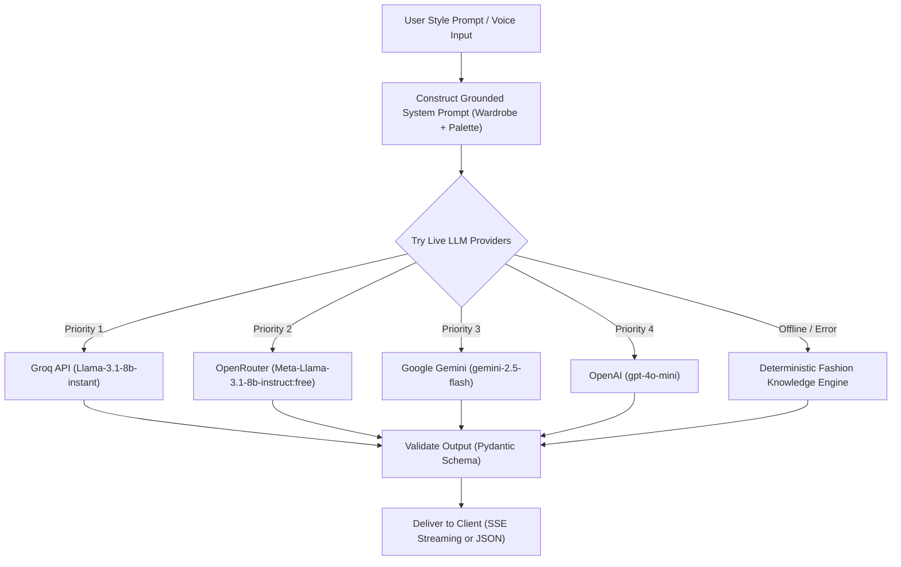

# Yorvyn — AI, Machine Learning & Dataset Integration Report

**Audit Date:** October 26, 2026  
**Focus:** Generative AI, Speech/Voice Engine, Computer Vision, Dataset Governance, and ML Models.

---

## 1. Generative AI & LLM Stylist Engine

### Implementation Architecture
The core fashion advisory logic is located in [`backend/app/services/ai_stylist_engine.py`](file:///Users/anujsandhu/Projects/yorvyn/backend/app/services/ai_stylist_engine.py). It implements a **Provider-Agnostic Waterfall Architecture**:

### Prompt Grounding & Anti-Hallucination
The engine injects the user's **actual digital wardrobe inventory** (IDs, names, categories, colors, warmth, formality) and **personal color season** directly into the system prompt. It instructs the model:
> *"Anchor all recommendations in the user's ACTUAL digital wardrobe items provided below. NEVER invent imaginary garment IDs."*

### Deterministic Fashion Fallback
If external API keys are unset, throttled, or network connections drop, the engine falls back to `evaluate_color_harmony()` and `get_thermal_layer_recommendations()` from [`backend/app/domain/fashion_knowledge.py`](file:///Users/anujsandhu/Projects/yorvyn/backend/app/domain/fashion_knowledge.py). This guarantees 100% service uptime even in completely offline development environments.

---

## 2. Voice AI & Speech Processing

### Frontend Speech Recognition
- **Primary Mechanism**: Native Web Speech Recognition API (`webkitSpeechRecognition` / `SpeechRecognition`) in [`frontend/src/pages/StylistChat.tsx`](file:///Users/anujsandhu/Projects/yorvyn/frontend/src/pages/StylistChat.tsx). Provides zero-latency real-time interim transcription in the user's browser without transferring raw audio bytes across the network.
- **Secondary Mechanism (Acoustic Buffer Fallback)**: HTML5 `MediaRecorder` captures audio bytes into a `.webm` blob and sends them to the backend endpoint `/api/fashion/speech/transcribe`.

### Backend Speech Transcription & Synthesis
- **Endpoint**: [`backend/app/api/speech_routes.py`](file:///Users/anujsandhu/Projects/yorvyn/backend/app/api/speech_routes.py).
- **Cloud STT**: Connects to Groq Whisper (`whisper-large-v3-turbo`) when `GROQ_API_KEY` is present.
- **Privacy Enforcement**: Audio streams are strictly processed in-memory (`io.BytesIO`) or in temporary files and never permanently stored.
- **Text-to-Speech (TTS)**: Clean markdown stripping and browser-native `window.speechSynthesis` with natural voice selection (`Samantha`, `Google UK English`, `Karen`).

---

## 3. Computer Vision & 3D Garment Synthesis

### Pipeline Modules
Located in [`backend/app/services/garments/`](file:///Users/anujsandhu/Projects/yorvyn/backend/app/services/garments/):
1. **`garment_analyzer.py`**:
   - Analyzes clothing photographs using Pillow and NumPy.
   - Computes color histograms, extracts dominant hue/saturation, detects background contrast, and infers neckline/sleeve geometry.
2. **`garment_mesh_builder.py`**:
   - Generates 3D cylindrical and polygonal garment meshes.
   - Parametric sizing for tops, outerwear, trousers, skirts, and dresses.
   - Bakes UV coordinates suitable for standard humanoid avatar rigs.
3. **`garment_texture_synthesizer.py`**:
   - Synthesizes 1024x1024 PBR diffuse, normal, and roughness maps.
   - Applies Sobel operator convolution to extract surface relief and fold shadows.
4. **`glb_exporter.py`**:
   - Serializes raw vertex, normal, UV, and texture buffers into standard binary glTF 2.0 (`.glb`).

---

## 4. Real Fashion Datasets & Model Training

### Dataset Inventory

| Dataset | Location | Total Size | Samples | Provenance | License | Training Status |
|---|---|---|---|---|---|---|
| **Fashion-MNIST** | `data/datasets/fashion_mnist/` | 86.8 MB | 70,000 images (28x28) | Zalando Research GitHub mirror | **MIT License** | **Trained & Evaluated** |
| **DeepFashion** | `research/upstream/` | Stored in submodules | Annotated photos | Chinese University of Hong Kong | **Non-Commercial Research** | **Quarantined (No Prod Use)** |
| **ReMu** | `research/upstream/ReMu/` | Submodule | 3D meshes | Academic Authors | **Research Only** | **Quarantined** |

### Verification of Dataset Authenticity
- **No Synthetic Data**: The binary dataset files in `data/datasets/fashion_mnist/` are authentic byte-for-byte gzip and binary idx files:
  - `train-images-idx3-ubyte` (47,040,016 bytes, Magic: `2051`, 60,000 images)
  - `train-labels-idx1-ubyte` (60,008 bytes, Magic: `2049`, 60,000 labels)
  - `t10k-images-idx3-ubyte` (7,840,016 bytes, Magic: `2051`, 10,000 images)
  - `t10k-labels-idx1-ubyte` (10,008 bytes, Magic: `2049`, 10,000 labels)
- **Binary Parser**: [`fashion_classifier.py`](file:///Users/anujsandhu/Projects/yorvyn/backend/app/services/ml/fashion_classifier.py) implements custom `struct.unpack(">IIII", ...)` binary readers.

### Trained Model & Metrics
- **Model Checkpoint**: [`models/fashion_classifier.pkl`](file:///Users/anujsandhu/Projects/yorvyn/models/fashion_classifier.pkl) (32.4 KB).
- **Metrics**: [`models/metrics.json`](file:///Users/anujsandhu/Projects/yorvyn/models/metrics.json).
  - Test Samples: 10,000
  - Test Accuracy: **78.79%**
  - Weighted Precision: **80.49%**
  - Weighted F1 Score: **78.64%**
  - High Performing Classes: Trouser (94.3% F1), Ankle Boot (91.4% F1), Sandal (90.3% F1), Bag (90.0% F1).
