# Yorvyn — Complete Project Architecture & Development Audit Report

**Audit Date:** October 26, 2026  
**Auditor:** Principal Software Architect, Full-Stack & AI Systems Lead  
**Repository Root:** `/Users/anujsandhu/Projects/yorvyn`  
**Git HEAD:** `7139fc7` (Branch: `main`)  
**Status:** Audit-Only Non-Destructive Inspection  

---

## 1. Executive Summary

Yorvyn is a personalized AI fashion intelligence and 3D digital wardrobe platform. Originally conceived as a fragrance recommendation platform, the codebase has undergone a major multi-phase evolution into an AI fashion stylist with real-time 3D avatar synthesis (Ara 3D Gen / Three.js), a 2D-to-3D photo garment reconstruction pipeline, a multi-provider LLM stylist engine, real Fashion-MNIST machine learning classification, Supabase Auth + PostgreSQL migration, and Cloudinary media storage.

This audit provides an evidence-based assessment of what is fully functional, what is partially integrated, what legacy code remains, and what is required for production readiness.

### High-Level Metrics
- **Total Frontend Modules (Vite/TypeScript):** 1,926 transformed modules (Build: **PASS**, exit code 0).
- **Technology Library Packages:** 12 modular packages under `packages/` (Test suite: **12/12 PASS**).
- **Backend Test Suite:** 126 unit/integration tests executed (117 **PASS**, 9 **FAIL** in legacy perfume tests).
- **Photo-to-3D Garment Pipeline:** Fully verified test suite (**PASS**).
- **Database Migrations:** 2 versioned SQL migrations (`001_initial_supabase_schema.sql`, `002_user_profile_onboarding.sql`).

---

## 2. System Architecture & Component Diagram

```mermaid
graph TD
    subgraph Client ["Frontend (React 18 + Vite + Three.js)"]
        UI_Auth["Login / Signup (Reference Sky Glass UI)"]
        UI_Onboarding["5-Step Onboarding Wizard (3D Preview)"]
        UI_Wardrobe["Digital Wardrobe View"]
        UI_Avatar["Avatar Studio (Ara 3D Engine)"]
        UI_Stylist["AI Stylist Chat (Text & Voice AI)"]
        UI_GarmentModal["Photo-to-3D Garment Upload Modal"]
    end

    subgraph ServiceLayer ["Frontend Services & Context"]
        AuthCtx["AuthContext (@supabase/supabase-js)"]
        ProfSvc["profileService (Supabase Profiles)"]
        FashionApi["fashionApi (REST Client)"]
        AraService["AraService (Humanoid Synthesizer)"]
    end

    subgraph Backend ["FastAPI AI Backend (Python 3.9)"]
        AuthMid["Supabase JWT Verification & UserContext"]
        FashionRoutes["/api/fashion (Wardrobe, Outfits, Profiles)"]
        GarmentRoutes["/api/fashion/garment-gen (Photo-to-3D Jobs)"]
        SpeechRoutes["/api/fashion/speech (Whisper & TTS)"]
        StylistEngine["Multi-Provider LLM Engine (Groq/OpenRouter/Gemini/OpenAI)"]
        JobManager["GarmentJobManager (ThreadPool Executor)"]
        MLClassifier["FashionClassifier (SGD on Fashion-MNIST)"]
    end

    subgraph Persistence ["Databases & External Storage"]
        SupabaseDB["Supabase PostgreSQL (8 Core Tables + RLS)"]
        CloudinaryCDN["Cloudinary Image Storage & CDN"]
        LocalGLB["Local File Store (Binary GLBs / Assets)"]
        LegacyFirestore["Firebase Firestore (Legacy / Partial Deprecation)"]
    end

    UI_Auth --> AuthCtx
    UI_Onboarding --> ProfSvc
    UI_Onboarding --> AraService
    UI_Stylist --> FashionApi
    UI_GarmentModal --> FashionApi

    AuthCtx --> SupabaseDB
    ProfSvc --> SupabaseDB
    FashionApi --> Backend

    Backend --> AuthMid
    AuthMid --> SupabaseDB
    FashionRoutes --> SupabaseDB
    JobManager --> CloudinaryCDN
    JobManager --> LocalGLB
    JobManager --> SupabaseDB
    StylistEngine --> Backend
    MLClassifier --> Backend
```

---

## 3. Technology Stack Inventory

| Tier | Component | Technology / Library | Version | Operational Status |
|---|---|---|---|---|
| **Frontend Framework** | UI Library | React | 18.2.0 | Verified Working |
| **Frontend Language** | Type System | TypeScript | 5.3.3 | Verified Working (Strict build passes) |
| **Build Tooling** | Bundler / Dev Server | Vite | 5.4.21 | Verified Working |
| **3D Rendering Engine** | WebGL / Scene Graph | Three.js | 0.160.0 | Verified Working |
| **Avatar Synthesis** | Anatomical Engine | Ara 3D Gen (MakeHuman CC0) | Ported internally | Verified Working |
| **Atmospheric Shaders** | Dynamic Cloud / Fog | Vanta.js (Fog) + Three.js | 0.5.24 | Verified Working |
| **Backend Framework** | ASGI REST API | FastAPI | 0.128.8 | Verified Working |
| **ASGI Server** | HTTP Server | Uvicorn | 0.39.0 | Verified Working |
| **Data Validation** | Schema Models | Pydantic v2 + pydantic-settings | 2.13.5 / 2.11.0 | Verified Working |
| **Authentication** | Auth Provider | Supabase Auth (GoTrue) | 2.x JS / python-jose | Verified Working |
| **Application Database** | Relational DB | Supabase PostgreSQL 15 | SQL Migrations 001/002 | Verified Working (Schema ready) |
| **Image Storage & CDN** | Media Cloud | Cloudinary SDK | 1.46.3 | Verified Working (with mock fallback) |
| **Machine Learning** | Classifier & Metrics | Scikit-Learn | 1.6.1 | Verified Working (78.8% test acc) |
| **Voice AI** | Speech-to-Text | Groq Whisper v3 / Web Speech API | Cloud / Browser Native | Verified Working |
| **Voice Playback** | Text-to-Speech | Web Speech Synthesis API | Native Browser | Verified Working |

---

## 4. Architectural Data Flow

1. **Authentication Flow**:
   - User signs in or registers via [`frontend/src/pages/Login.tsx`](file:///Users/anujsandhu/Projects/yorvyn/frontend/src/pages/Login.tsx).
   - Supabase client establishes a JWT session stored in `localStorage`.
   - Onboarding status (`onboarding_completed`) is checked; if incomplete, routed to `/onboarding`.
   - Backend FastAPI endpoints verify incoming `Bearer <token>` against configured `SUPABASE_JWT_SECRET`.

2. **Photo-to-3D Garment Pipeline**:
   - User uploads a real clothing photo in [`PhotoTo3DGarmentModal.tsx`](file:///Users/anujsandhu/Projects/yorvyn/frontend/src/components/PhotoTo3DGarmentModal.tsx).
   - FastAPI `/api/fashion/garment-gen/upload` validates file type (JPEG/PNG/WebP, max 15MB) and queues an async job.
   - Worker extracts dominant color palettes, silhouette masks, generates 3D wearable mesh topology, synthesizes PBR diffuse/normal/roughness maps, and exports binary GLB.
   - 3D preview thumbnail is uploaded to Cloudinary CDN under `yorvyn/users/{uid}/garments/{asset_id}`.
   - Supabase `yorvyn_garment_jobs` and `yorvyn_wardrobe_items` records are created.
   - **Privacy Policy**: Ephemeral input photographs in `/tmp/yorvyn_garment_pipeline/{job_id}` are strictly purged from disk.

3. **Conversational Fashion AI & Recommendations**:
   - In [`StylistChat.tsx`](file:///Users/anujsandhu/Projects/yorvyn/frontend/src/pages/StylistChat.tsx), user inputs text or speaks via microphone.
   - Spoken audio is transcribed using Web Speech API (or backend Groq Whisper fallback).
   - Query, user personal style profile, weather/occasion context, and digital wardrobe items are passed to `AIStylistEngine`.
   - Engine queries live LLMs (Groq `llama-3.1-8b-instant`, OpenRouter, Gemini, OpenAI) in waterfall order, falling back to deterministic color harmony algorithms when offline.

---

## 5. Technical Assessment Summary

- **Strengths:**
  - Modern architecture with zero monolith lock-in.
  - Complete 12-package modular technology library in `packages/`.
  - True 3D garment synthesis producing binary GLBs rather than 2D flat image overlays.
  - Strict privacy protections purging temporary user clothing photographs.
  - Resilient offline fallback mechanisms across database, storage, and speech.
- **Weaknesses / Debt:**
  - Legacy perfume recommendation code and 9 outdated tests still present in `backend/tests/`.
  - Firebase packages still present in `package.json` while Supabase migration is partially dual-running.
  - Production deployment requires live credentials in `.env` to switch from development mock stores to live cloud instances.
