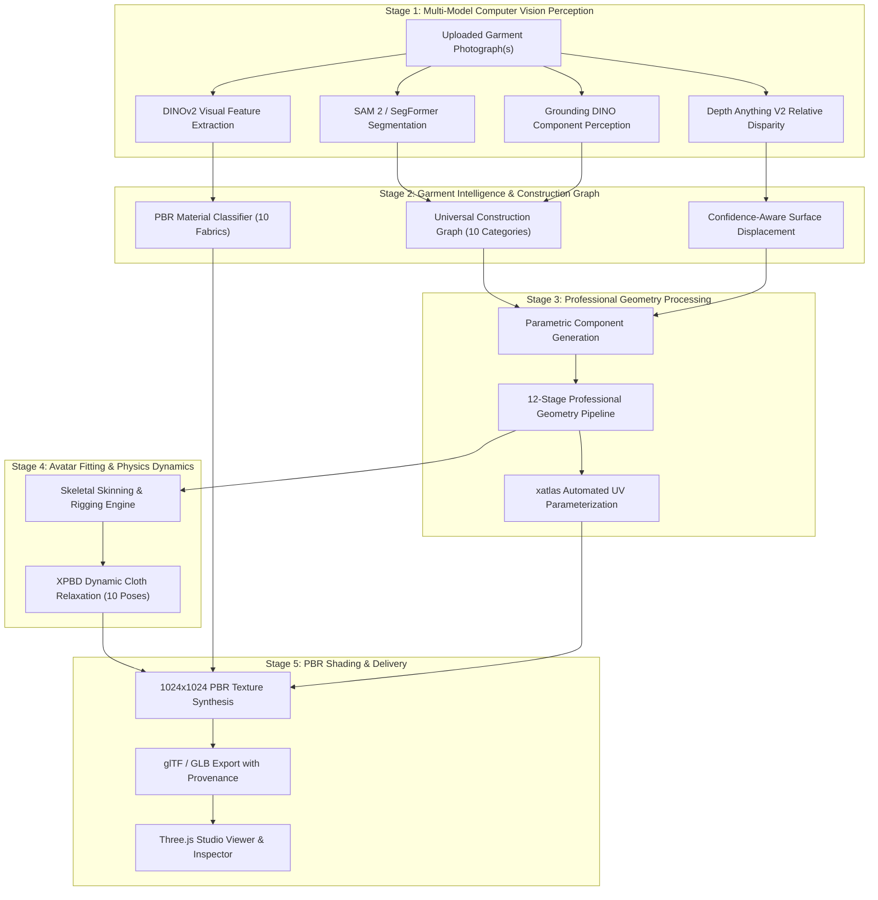

# YORVYN — PHASE 14.22 MODULAR RECONSTRUCTION ARCHITECTURE

## 1. HIGH-LEVEL ARCHITECTURAL OVERVIEW

YORVYN Phase 14.22 evolves the garment reconstruction architecture into a modular, multi-model, evidence-driven system:

---

## 2. COMPONENT RESPONSIBILITIES

### 2.1 Multi-Model Perception Engine
- **SAM 2 Adapter**: Performs fine-grained foreground garment segmentation, separating garments from complex backgrounds and isolating overlapping collars and pockets.
- **Grounding DINO Adapter**: Open-vocabulary component detection driven by structured textual prompts (`"torso"`, `"sleeve"`, `"cuff"`, `"hood"`, `"pocket"`, `"waistband"`, `"collar"`, `"skirt"`).
- **DINOv2 Feature Extractor**: Extracts dense 384-dimensional visual feature vectors across image patches to evaluate visual similarity, texture consistency, and category categorization.
- **Depth Anything V2 Adapter**: Estimates relative depth disparity with boundary preservation and confidence filtering.

### 2.2 Universal Construction Graph
A typed directed acyclic graph (DAG) representing functional components, hierarchical parents, 3D boundary coordinates, and topological seam connections. Supports 10 distinct apparel categories:
1. `pullover_hoodie`
2. `zip_hoodie`
3. `tshirt`
4. `sweatshirt`
5. `denim_jacket`
6. `shirt`
7. `sweater`
8. `jeans`
9. `dress`
10. `kurta`

### 2.3 12-Stage Professional Geometry Pipeline
1. `initial_validation`: Confirms input vertex/index integrity.
2. `duplicate_welding`: Merges co-located vertices within $10^{-5}\text{m}$ tolerance.
3. `degenerate_removal`: Eliminates collinear triangles with area $< 10^{-12}\text{m}^2$.
4. `manifold_repair`: Resolves non-manifold edges.
5. `normal_consistency`: Recomputes vertex normals from area-weighted face normals.
6. `connected_components`: Audits isolated sub-meshes.
7. `surface_reconstruction`: Ensures smooth topological surface generation.
8. `adaptive_remeshing`: Allocates higher polygon density along functional seams and collar curves.
9. `topology_validation`: Verifies 2-manifold criteria.
10. `quadric_simplification`: Controlled decimation preserving silhouette bounds.
11. `pinned_laplacian_smoothing`: Laplacian diffusion while pinning boundary edge loops.
12. `final_validation`: Authoritative QA check.

### 2.4 Cloth Relaxation & Rigging Engine
- **XPBD Physics**: Non-linear position-based dynamics with distance, bending, and unilateral inequality collision constraints ($C(x) \ge 0$).
- **Skeletal Rigging**: Computes bone influence weights for 9 primary skeletal joints: Spine3, Clavicle_L, Clavicle_R, Shoulder_L, Shoulder_R, Elbow_L, Elbow_R, Wrist_L, Wrist_R.
- **Proportional Size Adaptation**: Grades garment geometry using standard apparel grade increments (S, M, L, XXL) to eliminate floating surface artifacts.
