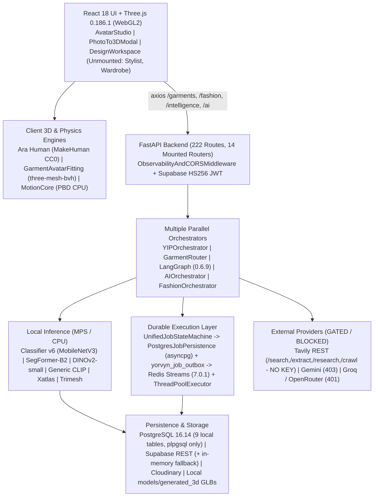
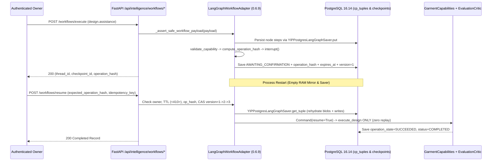

# YORVYN — COMPLETE MASTER ENGINEERING AUDIT
## Phase 1 to 17.4 | Full-System Architecture, Implementation, Verification & Production Readiness

**Project:** YORVYN — Fashion Intelligence & 3D Virtual Try-On Platform  
**Architecture:** YORVYN Intelligence Platform (YIP)  
**Repository Root:** `/Users/anujsandhu/Projects/yorvyn`  
**Audit Date:** 2026-11-26  
**Baseline Git Commit:** `7139fc7eea4e1f890e28da9140db2e8550081267` (`main`) + Uncommitted Working-Tree Overlay (`505` entries: `70` modified, `435` untracked)  
**Latest Confirmed Phase:** Phase 17.4 (Dual Tracks verified: **Neural Recommendation Generalization** & **Intelligence Workflow Reliability, Security Hardening & Production Readiness**)  

---

## 1. Executive Summary

This document is the single, repository-driven, evidence-backed engineering audit of YORVYN across its entire discoverable lifecycle from the initial Git commit (`7437e4d`, 2026-08-20) through committed commit `7139fc7eea4e1f890e28da9140db2e8550081267` (`2026-10-26`) and **all post-commit uncommitted phases (Early Track 1–12, Garment Pipeline Phases 1–17.4, and `DURABLE-JOB-FIX-001/002`)** residing in the live working tree.

### Key Architectural & Verification Conclusions
- **Implemented Core Platform:** YORVYN spans a React 18 / Three.js 0.186.1 parametric avatar (`engine/ara/`) & garment/cloth WebGL2 frontend paired with a 222-route FastAPI backend (`Python 3.9.6`), local PyTorch/Transformers/OpenCV perception (`MobileNetV3-Small v6`, `SegFormer-B2`, `DINOv2-small`, generic `CLIP ViT-B/32`), 2D CAD pattern geometry (`SVG`/`DXF`/`JSON`), 3D procedural/contour-carved glTF 2.0 reconstruction + `three-mesh-bvh` fitting, PostgreSQL `16.14` transactional outbox durability, Redis `7.0.1` Streams, LangGraph `0.6.9` durable PostgreSQL checkpoints (`YIPPostgresLangGraphSaver`), and an 87-capability / 18-model YIP registry.
- **Uncommitted Codebase Risk:** 100% of Phases 1–17.4 architectural work (`505` git status entries across `backend/`, `frontend/`, `packages/`, `models/`, `data/`, `docs/`) sits uncommitted atop `7139fc7`.
- **What Is Genuinely Verified Now:**
  - Frontend full suite (`npm test` / Vitest): **29/29 files, 372/372 tests passed** (`tsc && vite build` exit `0` in `19.06s`).
  - Backend regression suites executed cleanly in this audit: **113/113 passed** across 11 suites (`Phase 16.0` through `Phase 17.4` hardening, LangGraph/Tavily, neural recommendations, durable job outbox, tenant security) + **70/70 passed** across 7 Phase 15–16 suites (`evaluation integrity`, `chat edits`, `16.1`, `16.2`, `16.3`, `16.3.1`, `16.9`).
  - Real local PostgreSQL `16.14` LangGraph restart recovery (zero node replay), concurrent resume `409` fencing, confirmation TTL `410` expiry, transactional job outbox, and Redis `PING` (`True`) ran live.
- **Major Production Blockers Confirmed (`NOT_READY` for unsupervised public launch):**
  1. **Security Auth & CORS/Upload Gaps (`FIND-SEC-01..07`):** `ObservabilityAndCORSMiddleware` + `general_exception_handler` in `backend/app/main.py` reflect arbitrary `Origin` headers with `Access-Control-Allow-Credentials: true` and expose raw exception strings; `beta_routes.py:141-160` lacks admin checks on `/api/beta/cohort/status`; `billing_routes.py:32` trusts `client_user_id` under default `stripe_test_mode=True`; `garment_identification_routes.py` endpoints lack auth and `await image.read()` size caps; `garment_generation_routes.py:266-330` omits size checks on `side_image`/`detail_image` and has a `NameError` (`effective_user_id`); `GarmentDesignWorkspace.tsx` makes raw unauthenticated `axios` calls.
  2. **Router Unmount & UI Integration Defects (`FIND-FE-01..06`):** `App.tsx` + `MainView.tsx` unconditionally render `AvatarStudio.tsx`, leaving standalone `StylistChat.tsx`, `DigitalWardrobe.tsx`, `OutfitStudio.tsx`, and `PersonalProfile.tsx` unmounted; `AvatarStudio.tsx` maintains dual cloth controllers (`clothSimRef` unstepped while `MotionCoreOrchestrator` runs), forces `#ffffff` skin color, supports only 1 custom 3D slot, hardcodes male Ara suits in outfit draping, and deletes garments locally without `fashionApi.deleteGarment`.
  3. **Scientific & External Model/Data Gaps (`FIND-ML-01..06`):** `garment_evaluation_pilot_v1.json` has `0` reference samples (`3D geometry`/`pattern`/`drape` physical accuracy unverified); `FashionCLIP`, `SigLIP`, `Grounded-SAM2`, `Depth-Anything-V2`, and `BiRefNet ONNX` lack actual weights (substituted or OpenCV heuristics); `pgvector` AND `pg_trgm` are **absent** from local PostgreSQL (`plpgsql` only; `GarmentKnowledgeRAG` is strictly in-memory); external LLMs (Gemini/Groq/OpenRouter) & `TAVILY_API_KEY` are unconfigured/401/403 blocked; neural recommendation models remain unpromoted (`promotion_approved = false`) with zero live clickstream traffic.

---

## 2. Audit Scope and Methodology

- **Inspection Mode:** Strictly read-only repository, AST/source, filesystem, dependency, PostgreSQL schema, Redis state, and safe verification test execution. Zero source code, database schemas, or model assets were altered during this audit.
- **Evidence Hierarchy Enforced:**
  - `Source-Code Evidence`: Direct file path, symbol name, and line references inspected in `backend/`, `frontend/`, `packages/`, `models/`, `data/`.
  - `Automated Test Evidence`: Exact `pytest` and `vitest` commands executed during this audit session (`113` + `70` backend tests; `372` frontend tests), explicitly marking mocked HTTP transports vs local infrastructure.
  - `Runtime Evidence`: Live queries against PostgreSQL `16.14` (`yorvyn_persistence`), Redis `7.0.1` (`localhost:6379`), local PyTorch/Transformers/ONNX artifact hashes, and `UnifiedModelRegistry` / `CapabilityRegistry` runtime introspection.
  - `Historical Claims`: Documented separately from Phases 1–17.3 reports (`docs/`, `docs/reports/`, `docs/engineering/`, `EXECUTION_LEDGER.json`); explicitly flagged wherever later audits (e.g., Phase 12.1, 14.7, 14.28, 15.0, 17.1) invalidated earlier claims.
  - Explicit markers **`NOT MEASURED`** and **`NOT VERIFIED`** are applied wherever telemetry or ground truth is absent.

---

## 3. Repository Baseline and Working-Tree State

- **Active Branch & HEAD:** `main` at `7139fc7eea4e1f890e28da9140db2e8550081267` (`2026-10-26`: `"feat(auth): add reference login aesthetic, multi-step onboarding wizard, and persistent 3D avatar personalization"`).
- **Working-Tree Dirty Count (`git status --short`):** `505` total paths (`70` modified `M`, `435` untracked `??`) — meaning **all Phases 1–17.4 developments since Nov 2026 are uncommitted on disk**.
- **Runtime Toolchain Verified:**
  - Backend Python: `Python 3.9.6` (`backend/venv/bin/python`, `Apple M2 MPS / 16GB Unified Memory` detected by `DeviceAwareRouter`).
  - Frontend Node/NPM: `Node v25.8.1`, `npm 11.19.1`.
  - Databases & Cache Running Locally: PostgreSQL `16.14` (`yorvyn_persistence`, extensions: `plpgsql 1.0` only), Redis `7.0.1` (`PING -> True`, active keys incl. `yorvyn:stream:jobs`, `yorvyn:worker:heartbeats`, `yorvyn:active:users`).
- **Workspace Packages (`packages/`):** Modular TS workspace aliases (`@yorvyn/*` mapped via `vite.config.ts`): `ai-adapters`, `asset-pipeline`, `avatar-animation`, `avatar-core`, `avatar-generation`, `avatar-rigging`, `garment-core`, `garment-fitting`, `garment-reconstruction`, `materials-textures`, `shared-types`, `three-renderer`, plus `packages/tests/packages.test.ts`.
- **Untracked / Binary Artifacts:**
  - `models/checkpoints/`: 8 files (`24,820,267` bytes), notably active `garment_classifier_v6.pt` (SHA-256 `1cc5d8a9...`).
  - `models/generated_3d/`: `5,283` files (`2,788` `.glb`, `2,495` `.json`, `1.168 GB`).
  - `frontend/public/models/edge/garment_classifier_edge.onnx` (`4,495,209` bytes, SHA-256 `d785b3ef...`).
  - `backend/data/wardrobe_assets/`: `322` directories.
  - Stray root files: `backend.sock` (`0` B), `dump.rdb` (`215,014` B), legacy `test_garment_3d_pipeline.py` (`M`).

---

## 4. Historical Development — Phase 1 to N

YORVYN's history decomposes into **4 sequential/overlapping engineering eras** spanning 7 Git commits and 45+ phase milestones:

1. **Era 0 — Committed Baseline (`7437e4d` -> `7139fc7`, Aug–Oct 2026):** Originated as a Perfume & Fashion Intelligence app (`sklearn` TF-IDF perfume matrix in `app/ml_model.py`, Firebase Auth/Firestore), then added Voice/LLM Stylist, Fashion-MNIST classifier (`models/fashion_classifier.pkl`), layered refactoring, Supabase Auth migration, Cloudinary storage, 3D login & 5-step onboarding (`7139fc7`).
2. **Era 1 — Early Feature Sub-Phases & Garment Pipeline Phases 1–11B (Oct 29 – Nov 2026):** Concurrent UI/Avatar/Mannequin phases (`AVATAR_STUDIO_UI_UX_OVERHAUL_PHASE_1`, `LIVE_MANNEQUIN_PHASE_6`, `PRODUCTION_READINESS_PHASE_12`) merged alongside the formal 3D Garment Pipeline recovery Phases 1–11B (`garment_mesh_builder`, `MobileNetV3` classifier v2, procedural builders, PBR UV synthesizer, PBD cloth/capsule collision, production queue, RLS/Stripe schema, and `SegFormer-B2` human parsing). *Correction note: Phase 8's "real-world benchmark" was later exposed in Phase 15.0 as using procedurally synthesized images.*
3. **Era 2 — Independent Visual Audits, Generalization & Modular AI Phases 12–14.28 (Nov 8 – Nov 24, 2026):** Forensic audits (`12.1` caught 33.3% visual failure rate; `14.7` caught `staging_worker.py` claiming Stable-Fast-3D weights; `14.28` invalidated Phase `14.27`'s synthetic Chamfer/accuracy metrics) drove real-dataset expansion (`5,714` images in Phase `14.0`), `garment_classifier_v6.pt` flat-lay domain adaptation (`14.1`), contour-carved reconstruction (`14.8–14.21`), modular `xatlas`/PBR/construction graph integration (`14.22`), zero-cost M2 inference (`14.24-F`), and multi-provider adapters (`14.26–14.27`).
4. **Era 3 — Integrity, Certification, YIP & Hardening Phases 15.0–17.4 (`EXECUTION_LEDGER.json`, Nov 24 – Nov 26, 2026):** Rebuilt honest evaluation (`15.0–15.2`), staging & classifier certification (`15.4–15.5`), typed capability governance (`16.0`), components (`16.1`), CAD construction & DXF/SVG (`16.2`), interactive Design Studio & transactional correspondence (`16.3`/`16.3.1`), `MotionCore` animation + BVH (`16.9`), transactional outbox durability (`DURABLE-JOB-FIX-001/002`), unified YIP platform (`17.0`), real Fashionpedia/Wikimedia validation (`17.1`), personalized recommendation + neural models + generalization (`17.0-Ext`, `17.2`, `17.4-Rec`), and LangGraph PostgreSQL checkpoint/Tavily security hardening (`17.3`, `17.4-Hardening`).

---

## 5. Complete Phase-by-Phase History

| Phase / Track | Title / Focus | Key Objectives & Features | Key Source Modules / Artifacts | Tests / Benchmarks Cited vs Verified | Actual Status & Limitations |
|---|---|---|---|---|---|
| **Commits `7437e4d..7139fc7`** | Perfume Baseline -> Auth & Onboarding | Legacy TF-IDF perfume matrix; Voice/LLM Stylist; Fashion-MNIST SGD (`78.79%`); Supabase/Cloudinary migration; 5-step onboarding. | `app/ml_model.py`, `speech_routes.py`, `supabase_repository.py`, `OnboardingWizard.tsx`, migrations `001–002` | `models/metrics.json` (`78.79%`); legacy tests intact | **VERIFIED** (committed HEAD); legacy `.pkl` perfume artifacts absent; `ml_model.py` dead code. |
| **Early UI/ML `Phases 1..12` (concurrent)** | Avatar UI, Mannequin, ML LLM, Readiness | Hair clipping/liquid-glass tray; `LiveMannequinEngine`; LLM stylist routes; early tenant isolation. | `AvatarStudio.tsx`, `liveMannequinEngine.test.ts`, `test_ml_phase_1.py` | Historical `324/324` (`193` Vitest + `131` Pytest) cited in `Phase 12` | Superseded/absorbed by later Phases 9–16.9; stale route paths remain in repo. |
| **Phase 1–2 (`Nov 3`)** | Pipeline Recovery & Neural Garment AI | Fixed frontend `/generate-3d` 404s; 32.6° A-pose; 20-bone GLB skinning; MobileNetV3 embeddings + landmark regressor + GrabCut interface. | `garment_mesh_builder.py`, `glb_exporter.py`, `universal_garment_classifier.py`, `models/checkpoints/*_v2.pt` | `test_garment_ai_phase_2.py`, `test_ml_phase_2.py` exist on disk | **IMPLEMENTED** (local); BiRefNet ONNX (`birefnet.onnx`) absent, falls back to OpenCV contour. |
| **Phase 3–4 (`Nov 3`)** | Parametric 3D Builders & PBR Materials/UVs | 10-class parametric pattern builders (`ReconstructionEngineRegistry`); non-overlapping UV maps + 4-channel PBR textures. | `services/garments/reconstruction/*`, `garment_texture_synthesizer.py` | `test_garment_reconstruction_phase_3.py`, `test_garment_material_texture_phase_4.py` | **IMPLEMENTED** (geometric fidelity unverified against 3D ground-truth scans). |
| **Phase 5–6 (`Nov 4`)** | Avatar Fitting & PBD Cloth Dynamics | 14 measurements (`AvatarBodyMeasurementEngine`), ease, 13-capsule collision, PBD Verlet (`GarmentPhysicsEngine`), pose validation. | `fitting/*`, `garment_physics_engine.py` | `test_garment_fitting_phase_5.py`, `test_garment_dynamics_phase_6.py` | **IMPLEMENTED** (physical drape stiffness/stretch parameters synthetic/inferred). |
| **Phase 7–8 (`Nov 4`)** | Provenance Matrix & "Real-World" Benchmark | Separated local checkpoints vs `ADAPTER_CLIENT`; 20-item manifest benchmark. | `test_neural_garment_ai_phase_7.py`, `test_real_world_ai_phase_8.py` | Phase 8 claimed real-world pass — **INVALIDATED in Phase 15.0** | Phase 8 superseded: `real_world_benchmark.py` generated synthetic images. |
| **Phase 9–11B (`Nov 4–7`)** | Productization, Stripe/RLS, Private Beta & SegFormer-B2 | Persistent WebGL canvas; Look engine; 14-table RLS schema (`007–011`); Stripe billing; `SegFormer-B2` 18-class parsing. | `007–011_*.sql`, `billing_routes.py`, `beta_routes.py`, `human_parsing_segmenter.py` | `test_production_platform_phase_9/10/11.py`, `test_on_body_garment_segmentation_phase_11b.py` | **CONDITIONALLY_READY** (`billing_routes` & `beta_routes` auth gaps; Stripe keys test-only). |
| **Phase 12–13.9 (`Nov 8–15`)** | Visual Audits, Hybrid Routing & 263-Photo Holdout | Visual QA exposed 33.3% initial failure; `DeviceCapabilityManager` hybrid AI; 263-item dataset (`phase_13_9_manifest.json`). | `test_phase_12_*`, `test_hybrid_ai_orchestration.py`, `test_visual_reconstruction_fidelity.py` | Strict unseen holdout domain acc `21.0%`, subcat `9.5%` (`13.9`); `test_phase_12_3_2` had 5 PG failures | **IMPLEMENTED**; remote neural 3D `BLOCKED`; low OOD subcategory accuracy confirmed. |
| **Phase 14.0–14.28 (`Nov 17–24`)** | 5,714-Image Dataset, Classifier v6, Modular Stack & Forensic Audit | `garment_classifier_v6.pt` + edge ONNX; 5,451 Fashionpedia + 239 Wikimedia + 24 YORVYN; contour carving; `xatlas`/`MaterialX`; `14.28` invalidated `14.27` fake metrics. | `PHASE_14_28_ENGINEERING_AUDIT.md`, `models/generated_3d/phase_14_6..7/*`, `dinov2_feature_extractor.py`, `grounded_sam2_adapter.py`, `depth_anything_adapter.py` | `14.24-F`: `669 MB` RSS, `~740 ms` M2 inference (`benchmark_phase_14_24_f_verification.py`) | **Audit Overturned 14.27**: FashionCLIP/SigLIP/SAM2/DepthAnything weights absent; heuristics/substitutes active. |
| **Phase 15.0–15.5 (`Nov 24–25`)** | Evaluation Integrity, Pilot Schema, Staging & AI Cert (`YOR-15.1..5`) | Removed fabricated metrics; fail-closed `GarmentEvaluationDataset`; Chat E2E (`YOR-CHAT-001`); pinned classifier v6 SHA-256 `1cc5d8a9...` & 8-model registry (`15.5`). | `dataset_manifest.py`, `geometric_evaluator.py`, `provider_diagnostics.py`, `012_durable_conversation_sequence.sql`, `test_phase15_*.py` | `test_phase15_evaluation_integrity.py` **passed inside 70/70 run**; Phase 15.5 cited `128` backend + `355` frontend | **SOFTWARE VERIFIED / DATA BLOCKED**: `garment_evaluation_pilot_v1.json` has `0` samples; external LLMs 401/403 blocked. |
| **Phase 16.0–16.9 (`Nov 25`)** | Capabilities, Components, Patterns, Design Studio, Correspondence & MotionCore (`YOR-16.*`) | Typed CapabilityRegistry (expanded to `87` caps); `component_taxonomy`; CAD pattern JSON/SVG/DXF (`16.2`); `GarmentDesignWorkspace` + PostgreSQL revisions (`16.3`); semantic panel-to-mesh sync (`16.3.1`); `MotionCoreOrchestrator` + `three-mesh-bvh` + PBD (`16.9`). | `capability_registry.py`, `pattern_construction_engine.py`, `pattern_exporter.py`, `transactional_design_engine.py`, `MotionCoreOrchestrator.ts`, `GarmentDynamicsEngine.ts`, `motion_core.py` | **All 5 suites (`16.1`..`16.9`) + `test_phase16_intelligence.py` passed (`70/70` + `113/113`)**; 372/372 Vitest passed | **VERIFIED_COMPLETE** (software/contract); WebGPU gated; physical drape & webcam mocap `DEGRADED`/`BLOCKED`. |
| **DURABLE-JOB-FIX-001/002 (`Nov 25–26`)** | Auth Publication Fix, Outbox & Fencing | Fixed guest `default_user` & phantom Redis jobs; added `yorvyn_job_outbox`, `create_job_atomic`, `retry_job_atomic`, dispatcher, lease fencing, authenticated Wardrobe E2E (`job_dcc9ac3ac423`). | `unified_state_machine.py`, `job_manager.py`, `queue_broker.py`, `outbox_migration.sql`, `staging_worker.py` | `test_durable_job_publication_fix.py` & `test_durable_job_outbox_fault_injection.py` **passed in `113/113`** | **VERIFIED** locally on PG 16.14 + Redis; per-call `asyncpg.connect()`, local threadpool still processes queued API jobs. |
| **Phase 17.0–17.1 (`Nov 26`)** | YIP Platform + Recommendation Ext + Real-World Validation | Unified `YIPOrchestrator`, 18-model registry, `GarmentKnowledgeRAG`, `evaluation_critic`, `candidate_optimizer`, hybrid recommendations; 17.1 measured 650 Fashionpedia + 66 Wikimedia (`Classifier v6 = 50.15% / 63.64% -> DEGRADED`). | `yip_orchestrator.py`, `intelligence_routes.py`, `recommendation_*.py`, `evaluation_critic.py`, `fit_intelligence.py` | `test_phase17_yip.py`, `test_phase17_1_validation.py`, `test_fashion_recommendation_intelligence.py` **passed in `113/113`** | **COMPLETED_WITH_VERIFIED_LIMITATIONS**: `pgvector`/`pg_trgm` absent in PG; classifier accuracy weak OOD. |
| **Phase 17.2–17.3 (`Nov 26`)** | Neural Recommenders + LangGraph & Tavily | Added 4 PyTorch neural recommenders (`DECLARED`); installed `langgraph==0.6.9` (`garment.research`, `fashion.discovery`, `design.assistance`); added `TavilyWebIntelligenceAdapter`. | `neural_recommendation_*.py`, `langgraph_workflows.py`, `tavily_web_adapter.py`, `unified_knowledge.py` | `test_neural_recommendation_intelligence.py`, `test_langgraph_tavily_phase17_3.py` **passed in `113/113`** | **GATED/MOCKED**: neural checkpoints absent/unpromoted; `TAVILY_API_KEY` unset -> `BLOCKED_NO_CREDENTIALS`. |
| **Phase 17.4 (`Nov 26`, Latest)** | Track A: Neural Generalization; Track B: Workflow Durability & Security Hardening | **Track A:** Diagnosed 17.2 ties; 71-item Wikimedia sim benchmark, `NeuralOutfitCompatibilityModel` (`97.62%`, ECE `0.0253`), A/B power gates (`promotion_approved=false`). **Track B:** Real `YIPPostgresLangGraphSaver` (`013` migration), no-replay restart recovery, SHA-256 `operation_hash` + TTL + CAS, SSRF IPv4-mapped IPv6/redirect/streaming guards, pre-strip HTML-comment injection firewall, explicit RAG promotion. | `recommendation_dataset_builder.py`, `recommendation_experiments.py`, `neural_generalization_benchmark.py`, `langgraph_workflows.py`, `tavily_web_adapter.py`, `unified_knowledge.py`, `knowledge_rag.py`, `013_*.sql` | **113/113 Pytest (`test_neural_generalization_phase17_4.py` + `test_phase17_4_hardening.py`) + 372/372 Vitest** verified live | **HARDENED_WITH_BLOCKERS**: Live Tavily key unset, no production rec traffic, no VPC egress firewall. |

---

## 6. Current System Architecture

---

## 7. Frontend Engineering Audit

- **Framework & Tooling:** `React 18.2.0`, `React Router DOM 6.20.0`, `Zustand 4.4.0`, `TypeScript 5.2.2` (`strict: true`, `noUnusedLocals: true`, `noUnusedParameters: true`), `Vite 5.0.0` (`port 5174`, `killSwPlugin`, `vite-plugin-pwa`, chunk splitting for `three-vendor`, `cloth-physics`, `stylist-ai`, `garment-engine`, `ara-animations`, `@yorvyn` -> `../packages`).
- **Routing (`App.tsx`, `MainView.tsx`, `AvatarStudio.tsx`):** Only `/login`, `/onboarding`, and `/*` are registered in `App.tsx`. `MainView.tsx` unconditionally renders `<AvatarStudio />`, which inspects `location.pathname` (`lines 770–811`) to switch tray workflow tabs. Standalone page files (`StylistChat.tsx`, `DigitalWardrobe.tsx`, `OutfitStudio.tsx`, `PersonalProfile.tsx`, `Support.tsx`) exist on disk cleanly wired to APIs, **but are unreachable via router**.
- **Triple-Backend Auth & State Split:**
  - Primary UI services (`fashionApi.ts`, `intelligenceApi.ts`, `aiSessionService.ts`, `learningService.ts`) use **Supabase Auth** (`@supabase/supabase-js`) JWT Bearer tokens (`AuthContext.tsx` auto-logs in `dev_user_1` in `import.meta.env.DEV` unless `yorvyn_signed_out === 'true'`).
  - Legacy `utils/api.ts`, `utils/firebase.ts`, `context/AppContext.tsx`, and `hooks/useFirestore.ts` simultaneously retain **Firebase Auth + Firestore** for perfume wishlists/recents.
  - `wardrobeCategoryService.ts` uses `localStorage` only (`yorvyn_categories_${uid}`).
- **3D Rendering, WebGPU & Workers:**
  - All 4 3D components (`AvatarStudioViewer.tsx:184`, `InteractiveGarment3DEditor.tsx:145`, `PhotoTo3DGarmentModal.tsx:1135`, `GarmentJobMessage.tsx:15`) create `THREE.WebGLRenderer` (WebGL2). **Zero `WebGPURenderer` or `three/tsl` imports exist** (`GraphicsCapabilityService.ts` hardcodes `threeWebgpuModuleBundled: true` and falls back to `'webgl2'`).
  - **Only 1 genuine Web Worker exists:** `EdgeImagePreprocessor.ts:60` -> `edgeImagePreprocessor.worker.ts` (OffscreenCanvas resize/blur/palette/WebP).
- **Edge AI (`UnifiedAIOrchestrator.ts`):** `@mediapipe/tasks-vision` (`MediaPipeVisionAdapter.ts`) and `onnxruntime-web` (`OnnxRuntimeWebAdapter.ts`) exist, **but neither `classifyGarment` nor `estimatePoseAnchors` is called by any UI view** (`PhotoTo3DGarmentModal.tsx:458` calls `preprocessUpload` only). Furthermore, the hardcoded SHA-256 in `UnifiedAIOrchestrator.ts` (`fb635271...`) **mismatches** the actual `frontend/public/models/edge/garment_classifier_edge.onnx` digest (`d785b3ef...`), and `@tensorflow/*` is absent.

---

## 8. Backend Engineering Audit

- **FastAPI Entrypoint & Middleware (`backend/app/main.py`):** Mounts **14 routers** (`ai_orchestration_routes` is mounted **twice** at `/orchestration` and `/api/fashion/orchestration`); **7 legacy routers** under `backend/app/api/` remain unmounted (`ai_routes.py`, `chat_routes.py`, `chat_routes_ai_upgrade.py`, `pricing.py`, `recommend_routes.py`, `recommendation_routes.py`, `user_routes.py`). Lifecycle uses `@app.on_event("startup"|"shutdown")` (triggers FastAPI deprecation warnings) to start the transactional outbox dispatcher cleanly (`garment_job_manager.start_outbox_dispatcher`).
- **CORS & Global Exception Leaks (`main.py:89-91, 236-265`):** `ObservabilityAndCORSMiddleware` sets `Access-Control-Allow-Origin: origin or allowed_origins[0]` in non-debug mode, **reflecting any arbitrary request `Origin`**. `general_exception_handler` similarly returns `Access-Control-Allow-Origin: origin` with `Access-Control-Allow-Credentials: true` and leaks `f"{type(exc).__name__}: {str(exc)}"` even when `settings.debug == False`.
- **Services Directory Layout:** Divided across `services/garments/` (CV, reconstruction, fitting, durable jobs, evaluation), `services/ai/` (hybrid LLM/vision orchestration, calibration, multiview), `services/ml/` (model registry, DINOv2, Fashion-MNIST, outfit ranker, body intelligence), `services/llm/` (planning & providers), `services/learning/` (dataset curator, simulated trainer), `services/intelligence/` (Phase 16–17 YIP, RAG, recommendation, LangGraph, Tavily), `services/database/` (`SupabaseRepository`), `services/storage/` (`CloudinaryStorageService`), and `services/motion/` (`motion_core.py`).
- **Duplication Overhead:** Backward-compatibility forwarders under `app/fashion/` and `app/auth.py` mirror `services/*`; legacy root `app/*.py` files (`ai_text_generator.py`, `conversational_ai.py`, `prompt_builder.py`, `intent_classifier.py`, etc.) duplicate modern services.

---

## 9. Database and Infrastructure Audit

- **PostgreSQL `16.14` (`yorvyn_persistence` via `resolve_postgres_dsn()`):**
  - Migrations `001`–`013` exist under `backend/migrations/` (plus `services/garments/orchestration/outbox_migration.sql`).
  - **Crucial Host Extension Reality (`SELECT extname FROM pg_extension`):** Only **`plpgsql 1.0`** is installed. Neither **`pgvector`** nor **`pg_trgm`** is installed as a live PostgreSQL extension on this instance.
  - **Verified Live Public Tables & Current Row Counts:** `yorvyn_jobs` (`77`), `yorvyn_idempotency_keys` (`76`), `yorvyn_garment_evidence_specs` (`20`), `yorvyn_job_outbox` (`16`), `yip_langgraph_cp_writes` (`1,940`), `yip_langgraph_cp_tuples` (`354`), `yip_langgraph_checkpoints` (`9`), `yip_langgraph_node_events` (`0`), `yorvyn_job_attempts` (`0`).
  - Connection handling defect: Both `PostgresJobPersistenceAdapter` and `YIPPostgresCheckpointMirror` / `YIPPostgresLangGraphSaver` open a new `asyncpg.connect(dsn)` per operation (`~5.5–6.4 ms` locally) without a shared pool (`asyncpg.create_pool`).
- **Supabase REST (`supabase_repository.py`):** Uses synchronous `requests` against Supabase PostgREST (`/rest/v1/...`), silently falling back to process-local memory dicts on missing credentials or DNS/network failure (causing retry-warning overhead in offline benchmarks unless bypassed). Migrations `001–012` declare 14+ Supabase RLS tables (`yorvyn_profiles`, `yorvyn_user_wardrobe`, `yorvyn_looks`, `yorvyn_ai_sessions`, etc.) that run remotely on Supabase when online, **not** inside local PostgreSQL `yorvyn_persistence`.
- **Redis `7.0.1`:** Healthy (`PING -> True`), actively hosting `yorvyn:stream:jobs`, `yorvyn:worker:heartbeats`, `chat:garment:daily:*` rate keys, `yorvyn:active:users`, and `yorvyn:active:tenants`.
- **Object Storage & Deployment:** Cloudinary configured (`CLOUDINARY_CLOUD_NAME` active for `s866timg`); GLBs & previews persist locally under `models/generated_3d/` & `backend/data/wardrobe_assets/`. Containerization (`Dockerfile.backend`, `Dockerfile.frontend`, `docker-compose.yml`) defines `postgres:16-alpine`, `redis:7.2-alpine`, `backend`, and `worker` (`staging_worker.py` with dev hardcoded secrets `yorvyn_internal_cryptographic_secret_2026` / `yorvyn-secret-key`), **with no `.github/workflows/` CI/CD pipeline**, no automated DB backups, and no production APM/metrics stack.

---

## 10. AI and Machine Learning Inventory

Live introspection of `UnifiedModelRegistry` (`backend/app/services/ml/model_registry.py`) confirms **18 registered model records** alongside **2 non-model integrations** (`tavily` web provider, `langgraph` workflow framework):

| Model ID | Architecture / Source | Ver | Weights / Checkpoint | SHA-256 Verified | Inference & Latency | Actual Execution Status & Limitations |
|---|---|---|---|---|---|---|
| `universal-garment-classifier` | `CanonicalMultiTaskNetwork` (`MobileNetV3-Small`) | `6.0.0` | `models/checkpoints/garment_classifier_v6.pt` (`4,803,047` B) | `True` (`1cc5d8a9...`) | Local MPS/CPU; P50 `21.06 ms` | **VERIFIED** software execution; **DEGRADED accuracy** in Phase 17.1 (`50.15%` Fashionpedia holdout, `63.64%` Wikimedia OOD). |
| `human_parsing_segformer_b2` | `SegFormer-B2` (`mattmdjaga/segformer_b2_clothes`) | `b2-clothes` | HF local cache (`model.safetensors`) | `True` | Local MPS/CPU; ~`740 ms` full pipeline share | **AVAILABLE / EXECUTED**; Phase 17.1 measured `0.8622` mIoU on 16 prior-QA masks. |
| `dinov2_small` | ViT-S/14 (`facebook/dinov2-small`) | `1.0` | HF local cache (`model.safetensors`) | `True` | Local MPS/CPU; P50 `32.29 ms` | **AVAILABLE / EXECUTED**; Phase 17.1 measured `92.42%` category Recall@5 on Wikimedia 66. Fallback `LightweightViTBackbone` is untrained random weights. |
| `clip_vit_b32_local` | CLIP ViT-B/32 (`openai/clip-vit-base-patch32`) | `vit-b-32` | HF local cache (`pytorch_model.bin`) | `True` | Local MPS/CPU | **AVAILABLE / EXECUTED**; `65.15%` zero-shot Wikimedia top-1 (`17.1`). Substituted inside `FashionCLIPAdapter` & `SigLIPAdapter`. |
| `human-pose-and-landmarks` | Landmark Regressor MLP/CNN | `cv-5.0.0` | `models/checkpoints/garment_landmarks_v2.pt` (`48,671` B) | `True` (`618e2a53...`) | Local CPU/MPS | **AVAILABLE / EXECUTED**; Phase 17.1 noted uncalibrated 2D landmark error without external tailor landmark ground truth. |
| `xatlas_unwrapper` | `xatlas` UV parameterization lib | `0.0.11` | `python_package:xatlas` | N/A | Local CPU | **EXECUTABLE**; runs genuine multi-chart UV unwrapping on reconstructed garment meshes. |
| `fashion-recommendation-engine` | Multi-signal hybrid algorithmic ranker | `17.0-rec-v1` | `recommendation_engine.py` | N/A | Local CPU (`~3.5–3.7 ms`) | **EXECUTABLE** (Active default); offline nDCG@5 `0.4629` (Phase 17.0) / `0.3036–0.3521` (Phase 17.4). |
| `grounded_sam2` | Heuristic stand-in (`GroundedSAM2Adapter`) | `2.1` | **None** (`weights_loaded: False`) | `False` | Local CPU OpenCV | **DECLARED (Heuristic)**: Uses Otsu threshold + proportional bounding boxes, zero GroundingDINO/SAM2 weights. |
| `depth_anything_v2` | Heuristic stand-in (`DepthAnythingV2Adapter`) | `2.0` | **None** (`metric_calibrated: False`) | `False` | Local CPU OpenCV | **DECLARED (Heuristic)**: Uses Gaussian blur + parabolic chest prior (`geom_prior`), no learned depth net. |
| `fashion_clip_native` | FashionCLIP | `uninstalled` | **None** | `False` | Unavailable | **UNAVAILABLE** (Adapter falls back to generic `clip_vit_b32_local`). |
| `siglip_native` | Google SigLIP | `uninstalled` | **None** | `False` | Unavailable | **UNAVAILABLE** (Adapter falls back to generic CLIP + uncalibrated sigmoid). |
| `garment-silhouette-segmenter` | BiRefNet ONNX (`birefnet-onnx-v1.4`) | `1.4` | Expects `birefnet_general.onnx` (missing) | `False` | Unavailable | **UNAVAILABLE** (Falls back to `OpenCVContourSegmenter` / SegFormer). |
| `feature-embedder` | MobileNetV3-Small (`mobilenet_v3_fashion_features.pt`) | `0.23` | Missing standalone checkpoint | `False` | Unavailable | **UNAVAILABLE** (Feature extraction uses `dinov2_small` / `universal-garment-classifier`). |
| `two_tower_recommender` | PyTorch Two-Tower BPR/InfoNCE | `untrained` | Absent from `models/checkpoints/` | `False` | Local CPU/MPS (`0.16 ms` sim) | **DECLARED** (`promotion_approved = false`: nDCG@5 `0.2467` < `content_focus` `0.3521` in Phase 17.4 sim). |
| `neural_ranking_network` | PyTorch Masked-Factor MLP Ranker | `untrained` | Absent from disk | `False` | Local CPU/MPS (`0.21 ms` sim) | **DECLARED** (`promotion_approved = false`: nDCG@5 `0.3229`, ECE `0.2549`, sim-only). |
| `sequential_transformer_recommender` | PyTorch Causal Time-Aware Transformer | `untrained` | Absent from disk | `False` | Local CPU/MPS (`0.39 ms` sim) | **DECLARED** (`MIN_SEQ_LEN_FOR_TRANSFORMER=3`; falls back cleanly on short histories; `promotion_approved=false`). |
| `graph_recommendation_model` | Pure-PyTorch LightGCN (`torch_geometric` absent) | `untrained` | Absent from disk | `False` | Local CPU/MPS (`0.33 ms` sim) | **DECLARED** (Layer-3 nDCG@5 `0.2611`; weak cold-start `0.0625`; `promotion_approved=false`). |
| `neural_outfit_compatibility` | PyTorch DeepSets + Pairwise Interaction | `untrained` | Absent from disk | `False` | Local CPU/MPS | **DECLARED** (`97.62%` holdout acc, `0.0253` ECE on 84 sim outfits; unpromoted). |

*Additional un-monitored/legacy models on disk:* `models/fashion_classifier.pkl` (Fashion-MNIST SGD, active for legacy fallback), `specialized_garment_heads_v3.pt` (`259` matched / `30` missing / `4` unexpected keys on load log), `specialized_garment_heads_v4.pt`, `garment_classifier_v2/v4/v5.pt`, and **simulated training** in `services/learning/model_training_service.py` (`execute_training_job` / `evaluate_candidate_model` emit hardcoded fake S3 URIs & metrics).

---

## 11. Computer Vision and Fashion Intelligence

- **Image Ingestion & Preprocessing:** Backend `PIL`/`OpenCV` RGB decode + EXIF transpose (`garment_analyzer.py`, `local_perception.py`), frontend `edgeImagePreprocessor.worker.ts` resize + Laplacian blur check. **Critical Gap:** `/api/garments/identify`, `/api/garments/hybrid-orchestrated-identify`, `/api/intelligence/fashion/analyze`, and `side_image`/`detail_image` in `/api/fashion/garment-gen/jobs` skip stream/byte-size enforcement before reading uploads into RAM.
- **Background Removal & Garment Parsing:** Dual path combining genuine `SegFormer-B2` 18-class semantic body/clothing parsing (`human_parsing_segmenter.py`, `0.8622` mIoU on 16 prior-QA masks) and `OpenCVContourSegmenter` / GrabCut foreground extraction (`NeuralBiRefNetSegmenter` misses `birefnet.onnx`).
- **Multi-View Processing (4x Duplication Debt):** `MultiViewGarmentFusionEngine` (`services/ai/multiview/fusion_engine.py`) + `ViewClassifier` deduplicate views via SHA-256/dHash/subcrop detection (`view_classifier.py`) and preserve `OBSERVED` vs `INFERRED` provenance, alongside duplicate implementations in `garments/intelligence/multiview_engine.py`, `learned_multiview_engine.py`, and `reconstruction/multi_view_fuser.py`.
- **Classification, Color, Material & Components:**
  - `UniversalGarmentClassifier` (`v6`, Fashionpedia-trained) underperforms on clean unseen domain shifts (`50.15%` Fashionpedia holdout, `63.64%` Wikimedia OOD -> marked **`DEGRADED`** in Phase 17.1).
  - Color uses KMeans/HSV lab swatches; Pattern/Texture (`fashion_intelligence_v17.py`) combines CLIP zero-shot (`65.15%`) + GLCM/high-frequency contrast cues while explicitly warning visual textures cannot certify fiber chemistry; `GarmentComponentIdentifier` (`16.1`) scores components via SegFormer+CLIP regions (`0.1893` coarse box IoU on 50 Fashionpedia val items — `PARTIALLY_IMPLEMENTED`) and populates `GarmentStructureGraph` (`component_evidence.py`).

---

## 12. Garment Construction and Pattern Intelligence

- **Implemented Software Layer (`Phase 16.2` / `16.3.1`):**
  - `pattern_geometry.py` & `pattern_construction_engine.py` compute 2D garment panels (`front_bodice`, `back_bodice`, `left_sleeve`, `right_sleeve`, cuffs, collar, waistbands, skirt/trouser panels) enforcing CCW boundary orientation, quadratic/cubic Bézier curves, darts, slits, grainline vectors (`90°` warp), seam allowances (`1.0–1.5 cm` standards per internal spec), and matching notches (`1` front / `2` back armscye).
  - `UniversalConstructionGraph` (`universal_construction_graph.py`) & `AssemblyValidator` (Kahn DAG topological order) validate seam pairing symmetry & stitch continuity cleanly.
  - `pattern_exporter.py` outputs **JSON**, **SVG** (valid XML geometry), and **ASCII R12 DXF** (`export_pattern_dxf`), paired with `PatternEvaluator` (`pattern_evaluator.py`, tested across `test_phase16_2_construction.py` + `7/7` YORVYN photos in Phase 16.2).
  - `semantic_correspondence.py` & `transactional_design_engine.py` map 2D panel edits (`+3 cm panel ease`) to bounded 3D seam/mesh regions cleanly (`test_phase16_3_1_transactional_sync.py`).
- **Manufacturing & Scientific Limitation:** `shapely`, `ezdxf`, and `svgwrite` are NOT installed; geometry primitives are custom pure-Python/NumPy math. **Zero real commercial physical pattern ground-truth (e.g., ASTM/gerber/DXF grading tables or sewn physical garment comparisons) exists** — construction is **inferred procedural geometry (`IMPLEMENTED`), NOT verified tailor/manufacturing accuracy (`scientific_acceptance: BLOCKED`)**.

---

## 13. 3D Reconstruction and Geometry

- **Backend Generation (`garment_mesh_builder.py` -> `ReconstructionEngineRegistry`):** Dispatches by normalized category to specialized procedural engines (`tops_engine`, `shirt_engine`, `hoodie_engine`, `jacket_engine`, `bottoms_engine`, `dress_engine`, `traditional_engine`, `footwear_engine`, `accessories_engine`) and `ImageConditionedReconstructionEngine` (contour-carved from SegFormer/Otsu silhouette mask + 20-bone `ARA_SKELETON_SPECS` skin weights).
- **Remote Neural 3D & Experimental Stubs:**
  - `RemoteGPUReconstructionClient` (`remote_gpu_client.py`): **UNAVAILABLE / BLOCKED** (`GARMENT_AI_REMOTE_INFERENCE_URL` unset; zero CUDA endpoints verified). Phase 14.6's earlier `staging_worker.py` Stable-Fast-3D claim had no weights.
  - `ProfessionalGeometryPipeline` (`reconstruction/professional_geometry_pipeline.py`): **Dead / Unused in app**, with Stages 7 (surface recon), 8 (remeshing), and 10 (decimation) acting as **no-op stubs returning `PASSED` without touching geometry**.
- **Mesh Validation, Repair & glTF 2.0 Export:**
  - `MeshValidationService.validate_glb_bytes` (`mesh_validation_service.py`) uses `Trimesh 4.12.2` to verify 2-manifold edge incidence, degenerate triangles (`>1e-9 m²`), duplicate vertices, bounding bounds, primitive attributes, and skinning completeness (`evaluation_critic.py` Phase 17.1 fix). `remove_invalid_triangles` & `edit_candidate` (`chat_candidate.py`) apply bounded chat edits.
  - `GLBExporter.export` writes real glTF 2.0 `.glb` files (verified 1,580,672 B & 5,283 artifacts under `models/generated_3d/`).
- **Frontend BVH, Collision & WebGPU Reality:**
  - `three-mesh-bvh@0.9.17` (`MeshBVH`) is **genuinely active** in `GarmentCollisionResolver.ts` & `GarmentSkinningAdapter.ts` (`bvh.closestPointToPoint` for body penetration clearing & barycentric weight transfer during `AvatarStudioViewer` equip).
  - `GarmentDynamicsEngine.ts` builds `this.bodyBvh` on init, **never queries it inside `step()`**, and `ComputeOrchestrator.ts`'s `webgpu_experimental`, `wasm_simd_xpbd`, and `webworker_xpbd` modes are **capability probes only** — zero `.wasm` cloth solver, WebGPU compute shaders, or cloth Web Workers exist.

---

## 14. Avatar and Virtual Try-On

- **Avatar Architecture (`frontend/src/engine/ara/`):** Genuine MakeHuman CC0-derived parametric human mesh (`AraEngineBridge`, `core/human.ts`, `core/morph.ts`, `core/mesh.ts`, `export/glb.ts`, 14 body sliders synced with backend `AvatarBodyMeasurementEngine` & Ramanujan ellipse perimeter checks in `fit_intelligence.py`, minimum wearable clearance `3.0 mm`).
- **Verified Runtime Fitting Defects Observed in Code Inspection:**
  1. **Forced White Skin Tint (`AvatarStudioViewer.tsx:760-766, 958-960`):** Unconditionally overwrites skin mesh material color to `#ffffff`, discarding user `skinTint` settings.
  2. **Hardcoded World/Local Y Waist Clipping Planes (`GarmentAvatarFittingEngine.ts:749, 763, 811, 826`):** Underlying avatar garments hide geometry using fixed Y planes (`0.710` / `-0.83`), risking clipping seams/thigh gaps under scaled proportions.
  3. **Single Custom Garment Slot & Skipped Avatar Rebuild (`AvatarStudioViewer.tsx:678-686`, `AvatarStudio.tsx:1609-1760`):** Only 1 `activeCustomGarment` mounts at once (cannot equip custom 3D top + bottom simultaneously), and equipping skips `triggerRebuild` when swapping fallback uniform items.
  4. **Outfit Draping Ignores Recommendations & Gender (`AvatarStudio.tsx:1535-1572`):** `handleDrapeOutfitOnAvatar` ignores `layer_breakdown` items and applies hardcoded male Ara suits (`male_elegantsuit01`, etc.) regardless of avatar gender.
  5. **Fake Cloth Sim in Design Editor (`InteractiveGarment3DEditor.tsx:271-278`):** Clicking `"Cloth Sim"` applies sinusoidal Y-axis group rotation instead of mesh/vertex physics.
  6. **Dislocated Dual Cloth Control (`AvatarStudioViewer.tsx:135-141, 1085, 1261-1323`):** `clothSimRef` (`ClothSimulationController`) never steps in `animate()` while `MotionCoreOrchestrator` steps independently, disconnecting diagnostics/toggles.
  7. **No Real-Subject Camera Calibration or Rear-View Fitting Ground Truth:** Pose/proportion estimation (`landmarks_v2.pt`, uncalled frontend MediaPipe) and rear-view seam/shoulder coverage remain unverified against physical human scan ground truth.

---

## 15. Cloth Simulation and Motion Intelligence

- **MotionCore (`frontend/src/engine/motionCore/` & `backend/app/services/motion/motion_core.py`):**
  - **Implemented & Authoritative Animator:** `MotionCoreOrchestrator.ts` coordinates a 12-state FSM (`MotionStateManager.ts`), `THREE.AnimationMixer` clip blending + Ara/Mixamo skeleton retargeting + 2-bone IK (`CharacterMotionEngine.ts`), `AdaptiveQualityController`, and `MotionTelemetryMonitor`, paired with backend Pydantic contracts (`motion_routes.py`, verified by `motionCore.test.ts` + `test_phase16_9_motion_core.py`).
  - **Facial / Gesture Subsystems:** `AvatarPerformanceController` (`engine/humanAvatar/`) runs live idle/expression/lip-sync animation in `AvatarStudioViewer.tsx`.
- **Cloth Physics Reality (`ClothConstraintSolver.ts`, `ClothCollisionSystem.ts`, `GarmentDynamicsEngine.ts`):**
  - Runs **synchronously on the main JS thread** using `Float32Array` Verlet **PBD (Position-Based Dynamics)** rather than true compliance-weighted XPBD Lagrange multipliers.
  - Collision inside `step()` uses 16 hardcoded bone-synced capsules/spheres (`ClothCollisionSystem`) + spatial-hash `SelfCollisionAdapter`, NOT `MeshBVH`.
  - `GarmentWrinkleEngine.ts` is unused outside tests; WASM/WebGPU compute paths do not execute; fabric stiffness/bending values are **synthetic/author-chosen defaults**, not measured Kawabata/tensile lab properties; live webcam motion capture (`motion.capture`) is explicitly marked **`DEGRADED`** offline.

---

## 16. Material, Texture and UV Intelligence

- **Material Classification & PBR Presets:** `CategoryMaterialSystem`, `MaterialXPBRSystem` (`materialx_pbr_system.py`), and `FashionIntelligenceEngine` map textile appearances (matte wool/fleece roughness `0.85–0.95`, metallic `0.0`; denim `~0.92`; coated satin `0.30–0.50` + clearcoat). **All roughness/metallic/bend values are manually authored presets or visual heuristics (`INFERRED`/`AUTHORED`), never lab-measured spectro-goniometer or physical fiber assays.**
- **UV Generation & Textures:** `XatlasUVUnwrapper` (`xatlas 0.0.11`) + `GarmentUVReconstructionEngine` compute non-overlapping multi-chart UVs; `GarmentTextureSynthesizer` writes 4-channel texture maps (`diffuse`, `normal`, `metallic_roughness`, `occlusion`) packed directly into `.glb` exports (`mesh_validation_service.py` enforces intact texture/attribute buffers). Photometric texture transfer on occluded backs remains heuristic/mirrored (`INFERRED`).

---

## 17. YIP Intelligence Platform

- **Canonical Target Contract:** `Authenticated Request -> YIPOrchestrator -> Execution Policy -> Capability Registry -> Trusted Adapter -> Independent Validation -> Durable Result`.
- **What Actually Exists (`backend/app/services/intelligence/`):**
  - `yip_orchestrator.py`: Async bounded execution with `asyncio.Semaphore`, idempotency cache, timeouts, graceful degradation, and telemetry across Phase 17 subsystems. **Note:** Docstring claims it reuses `GarmentRouter` and `GarmentJobManager`, yet it calls service singletons directly rather than routing through `GarmentRouter` or `GarmentJobManager`.
  - `garment_execution.py` (`GarmentRouter`) + `garment_policy.py` + `garment_adapters.py`: Actively enforces capability gates in `conversational_garments.py`.
  - `UnifiedModelRegistry` (`services/ml/model_registry.py`): Tracks 18 model records + SHA-256 verification + latency telemetry + 2 external integrations (`tavily`, `langgraph`).
  - `garment_capabilities` (`capability_registry.py`): Catalogs **87 typed capabilities** across 6 lifecycle states (`VERIFIED: 27`, `EXECUTABLE: 27`, `AVAILABLE: 14`, `DECLARED: 16`, `DEGRADED: 2`, `UNAVAILABLE: 1`).
  - `evaluation_critic.py` & `candidate_optimizer.py`: Independent 5-domain critic (checks mesh integrity, textures, construction, fit, motion; `1.0` precision/recall on 11 test cases) + bounded optimizer (`P1` topological repairs only).
- **Consolidation Debt:** **8 separate orchestrators/routers** coexist across the repo (`YIPOrchestrator`, `GarmentRouter`, `AIOrchestrator`, `FashionOrchestrator`, `YorvynIntelligenceService`, `LangGraphWorkflowAdapter`, `HybridWorkloadRouter`, `DeviceAwareRouter`).

---

## 18. RAG and External Knowledge

- **Internal RAG (`backend/app/services/intelligence/knowledge_rag.py`):**
  - Combines deterministic 256-dim `BLAKE2b` dense unigram/3-gram projections (`_dense_hash_embed`), BM25-style TF-IDF, character trigram similarity, domain collection filters (`10` domains), cross-feature reranking, and prompt-injection filtering (`sanitize_retrieved_text`).
  - **Storage & Database Reality:** **Entirely in-memory (`self._collections`) seeded by 10 static `_SEED_CORPUS` internal engineering documents.** Although module headers mention PostgreSQL `pg_trgm 1.6`, **`pgvector` is NOT installed (`pgvector_available: False`), `pg_trgm` is NOT installed on local `yorvyn_persistence` (`plpgsql` only), and `GarmentKnowledgeRAG` never queries PostgreSQL.** Any dynamically promoted documents reside in RAM until restart.
- **External Web Intelligence (`tavily_web_adapter.py` & `unified_knowledge.py`):**
  - Uses direct `httpx` REST client (`/search`, `/extract`, `/research`, `/crawl`), hardened in Phase 17.4 with `_is_unsafe_ip` (blocking IPv4/IPv6 loopback, RFC1918, link-local `169.254.169.254`, IPv4-mapped IPv6 `::ffff:127.0.0.1`, `.sixtofour`, `.teredo`, CGNAT `100.64.0.0/10`, decimal/hex/octal obfuscated hosts, `@` userinfo, DNS rebinding checks, and `validate_redirect_target` on HTTP `3xx`), streaming `2 MB` byte cap, concurrency cap (`8`), owner-isolated LRU cache (`256`), duplicate coalescing, and per-owner (`200`) / global (`1000`) credit budgets.
  - Pre-HTML-strip prompt-injection scanning (`sanitize_external_content`) strips and flags HTML comments, `<script>`, Markdown `javascript:`/`data:`, `<|im_start|>`, `SYSTEM:`, `"role":"system"`, and `tool_call(`.
  - External promotion (`promote_validated_external_item`) fails closed unless `explicit_approval=True`, non-injection, intact SHA-256 `content_hash`, `ALLOWED_LICENSES`, approved domain or `rights_verified=True`, and non-duplicate hash. **Live Tavily verification remains `BLOCKED_NO_CREDENTIALS` (`TAVILY_API_KEY` unset).**

---

## 19. Recommendation Intelligence

- **Production Active Tier (`Phase 17.0-Ext`):** `FashionRecommendationEngine` (`recommendation_engine.py`, **Active Default**) blends `ContentBasedAdapter`, `CategoryAffinityAdapter`, `VisualSimilarityAdapter` (DINOv2/CLIP embeddings), `SessionContextAdapter`, `ExplorationDiversityAdapter` (MMR re-ranking), and `CollaborativeFilteringAdapter` (gated **`DECLARED`** unless `>=5` consented users with `>=3` positives exist). `PreferenceProfileStore` (`recommendation_profile.py`) isolates owners, suppresses weak browsing views from promoting positive affinity, enforces opt-out consent, blocks sensitive demographic keys (`SENSITIVE_ATTRIBUTE_BLOCKLIST`), and gates purchase signals via `purchase_authorized`.
- **Phase 17.2 Tie Investigation & Phase 17.4 Generalization:**
  - Phase 17.2 (`TwoTowerRecommendationModel`, `NeuralRankingModel`, `SequentialTransformerRecommender`, `GraphRecommendationModel`) produced identical `Precision@5=0.1818 / Recall@5=0.9091 / NDCG@5=0.7413` caused by a tiny 12-item catalog leaving 7–8 unseen candidates at `k=5`, non-strict negative sampling masking `train | holdout`, and ranker consumption of converged upstream embeddings.
  - Phase 17.4 (`neural_generalization_benchmark.py`) fixed leakage and evaluated a 71-item catalog (66 Wikimedia + 5 staples, 36 warm + 8 cold users, 332 accepted simulation events, `is_real_production_traffic=false`): `content_focus` baseline scored `NDCG@5 = 0.3521`, ahead of Two-Tower BPR (`0.2467`), Calibrated Neural Ranker (`0.3229`, ECE `0.2549`), Graph LightGCN depth-3 (`0.2611`), and Short-Sequence Gated Transformer (`0.2646`, `MIN_SEQ_LEN_FOR_TRANSFORMER = 3`). `NeuralOutfitCompatibilityModel` achieved `97.62%` holdout accuracy (`0.0253` ECE) on 84 labeled synthetic outfits (`compatibility_is_prediction_not_rule=True`).
- **Governance & Promotion Reality:** **Zero neural checkpoints exist under `models/checkpoints/recommendation_v17_2/`**, PostgreSQL holds **zero** real production human click/save logs, and `evaluate_promotion_gates` enforces **`promotion_approved = false`** across all 5 neural recommendation models until real traffic (`>=500` events, `>=50` users) and holdout improvements over `content_focus` are demonstrated. Legacy duplicates (`app/ml_model.py`, `app/ai_recommendation_engine.py`, `services/ml/outfit_ranker.py`, `services/outfit_generator.py`) should be retired.

---

## 20. Dataset and Scientific Validation

| Dataset / Manifest | Location & Scale | Ground Truth & Provenance | Scientific Validity Status |
|---|---|---|---|
| **Fashion-MNIST** | `data/datasets/fashion_mnist/` (`8` binary idx/gz files, `60k/10k`) | Authentic MIT grayscale icons; used by `models/fashion_classifier.pkl` (`78.79%`) | **VALID (Toy Domain Only)** — unsuitable for wild camera garment parsing |
| **Phase 13.6 Wikimedia Real Photos** | `data/datasets/phase_13_6_real_photos/` (`66` `.jpg`, `19.08 MB`) | Real CC0/CC-BY/CC-BY-SA human-reviewed wardrobe photos (`raw_candidates.json`) | **VALID (Small Real OOD Set)** — used in Phase 17.1 & 17.4 rec catalog |
| **Phase 13.9 & 14.0 Combined** | `data/datasets/phase_14_0_garments/` (`5,715` imgs, `419.2 MB`; `5,451` Fashionpedia + `239` Wikimedia + `24` YORVYN) | `YORVYN_PHASE_14_0_DATASET_MANIFEST.json` identity splits (`4,412` train / `652` val / `650` unseen holdout) | **VALID FOR 2D EVALUATION ONLY** — Fashionpedia non-commercial license caveat |
| **Phase 17.1 Real Benchmark** | `data/datasets/manifests/yorvyn_phase17_1_real_benchmark.json` (`716` items) | Cleanly intersects `650` Fashionpedia holdout + `66` Wikimedia OOD | **VERIFIED** (`Classifier v6`: `50.15%` FP / `63.64%` OOD) |
| **Phase 11B/17.1 Masks** | `data/datasets/garment_classification_real/` (`32` `.png` symlinks) | Symlinks to internal YORVYN Phase 12 visual QA renders | **QA-DERIVED** — not independent third-party human masks |
| **Phase 14.4 Flat-Lay Synthetic** | `data/datasets/phase_14_4_flatlay_synthetic/` (`10` `.jpg`) | Procedurally generated flat-lay synthetic images | **SYNTHETIC** |
| **Phase 8 "Real-World" Benchmark** | `data/datasets/real_world_benchmark/real_world_benchmark_manifest.json` (`20` items) | Reclassified in Phase `15.0` as procedurally synthesized (`SYNTHETIC_SMOKE_ONLY`) | **SYNTHETIC (Phase 8 claims invalidated)** |
| **Phase 15.1 Evaluation Pilot** | `data/datasets/manifests/garment_evaluation_pilot_v1.json` (`384` B) | `"dataset_kind": "real"`, **`"samples": []` (`0` samples)** | **EMPTY / BLOCKED** — zero 3D ground-truth meshes or tailor caliper ground truth on host |

**Dataset & Training Governance Audit:** `OfflineDatasetCurator` (`services/learning/dataset_curator.py`) enforces SHA-256 deduplication, license allowlists, identity-level splits, and consent checks locally, whereas `services/learning/model_training_service.py` (mounted via `/api/learning/admin/training-jobs`) simulates remote GPU jobs with hardcoded `s3://yorvyn-models/candidates/...` URIs, random UUID checksums, and fabricated evaluation metrics (`MOCKED`).

---

## 21. LangGraph and Tavily

- **LangGraph Engine (`0.6.9`, `langgraph-checkpoint 2.1.2`, `backend/app/services/intelligence/langgraph_workflows.py`):**
  - Hosts 3 bounded `StateGraph` workflows (`MAX_WORKFLOW_STEPS = 8`, max `60s` deadline): `workflow.garment.research`, `workflow.fashion.discovery`, and `workflow.design.assistance`.
  - **Persistence & Restart Recovery (`Phase 17.4` verified live against PostgreSQL `16.14`):** `YIPPostgresLangGraphSaver(MemorySaver)` persists serialized `Checkpoint` & `pending_writes` byte blobs (`yip_langgraph_cp_tuples`, `yip_langgraph_cp_writes`) alongside version-fenced `yip_langgraph_checkpoints` rows (`013_phase17_4_langgraph_hardening.sql`). When a brand-new adapter/saver instance initializes with empty RAM, `resume_workflow` restores state from PostgreSQL and invokes `Command(resume=True)` **without replaying prior completed nodes** (`p50 = 79.515 ms`).
  - **Confirmation Security:** `design.assistance` binds pause state to canonical SHA-256 `operation_hash`, `confirmation_expires_at` (`410` on expiry), single-use `confirmation_idempotency_key`, thread lock, and PG optimistic lock `version = version + 1` (`409` on concurrent double resume or stale write). Operations map strictly to `CLOSED_DESIGN_OPERATIONS`, blocking forbidden payload keys and shell/SQL patterns.
  - **Observability & Retention:** Node start/end timestamps, privacy-safe `owner_correlation_id`, failure categories, and credit usage log to `yip_langgraph_node_events`; `cleanup_expired_workflows` prunes terminal rows only while preserving active/paused threads.
- **Tavily Adapter (`tavily_web_adapter.py`):** Hardened HTTP security boundary (`follow_redirects=False`, SSRF IPv4-mapped/obfuscated IP/redirect validation, `2 MB` streaming cap, pre-strip HTML-comment injection filter, per-owner/global budgets, concurrency cap `8`, owner-scoped LRU cache `256`), **currently `BLOCKED_NO_CREDENTIALS` on live network because `TAVILY_API_KEY` is unset**.

---

## 22. Background Jobs and Durable Execution

- **Transactional Outbox & Fencing Architecture (`job_manager.py`, `unified_state_machine.py`, `queue_broker.py`, `artifact_committer.py`):**
  - `UnifiedJobState` defines an 8-state machine with `lease_generation` fencing tokens (`CREATED/SUBMITTED -> QUEUED -> CLAIMED -> PROCESSING -> VALIDATING -> PUBLISHING -> COMPLETED | FAILED | CANCELLED | DEAD_LETTERED`).
  - `PostgresJobPersistenceAdapter.create_job_atomic` & `retry_job_atomic` atomically commit job rows and `yorvyn_job_outbox` records in one PG transaction; `claim_pending_outbox_entries` uses `FOR UPDATE OF o SKIP LOCKED` to drive delivery to `RedisStreamsQueueBroker` (`XADD`/`XREADGROUP`/`XACK`/`XAUTOCLAIM`), while `AtomicArtifactPublisher.publish_artifact_fenced` checks DB `lease_generation` before committing artifacts.
  - Fault recovery tests (`test_durable_job_outbox_fault_injection.py`, `test_durable_job_publication_fix.py`) passed cleanly inside this session's `113/113` backend verification run against live PG `16.14` + Redis `7.0.1`.
- **Remaining Operational Risks:**
  1. Single-call `asyncpg.connect(dsn)` per DB operation introduces connection handshake churn under load.
  2. In-process `GarmentJobManager` still dispatches local reconstruction work inside `ThreadPoolExecutor(max_workers=3)` + `heapq` inside the API process alongside external `staging_worker.py`.
  3. `yorvyn_job_attempts` had `0` rows in local PG `yorvyn_persistence` while `yorvyn_jobs` had `77` rows (attempt logs only populate on multi-worker/retry PG transitions or `staging_worker` runs).
  4. `garment_generation_routes.py:330` contains a confirmed `NameError` bug (`release_reconstruction_slot(effective_user_id)` instead of `effective_uid`) that crashes failure-path quota release when triggered.

---

## 23. API, Security and Privacy

Audit of `backend/app/main.py` (`222` routes across `14` mounted routers) and `backend/app/core/security.py` identified critical gaps alongside working controls:

- **What Works:** Supabase HS256 JWT verification rejects `anon` role tokens on `get_current_user`; YIP endpoints (`/api/intelligence/*`) enforce `401` unauth, owner-scoped isolation (`403` cross-owner), and prompt/SSRF firewalls; SSRF/path-traversal guard fixes (`_load_owned_job_glb` Phase 17.1) validate ownership and canonical paths; GDPR export/delete routes exist.
- **Critical & High Security Vulnerabilities Discovered:**
  1. **Arbitrary CORS Reflection + Exception Leak (`main.py:89-91, 236-265`):** `ObservabilityAndCORSMiddleware` and `general_exception_handler` reflect arbitrary request `Origin` headers with `Access-Control-Allow-Credentials: true` even when `settings.debug=False`, and `general_exception_handler` leaks raw exception types/messages (`f"{type(exc).__name__}: {str(exc)}"`).
  2. **Broken Authorization on Beta Cohort Management (`api/beta_routes.py:141-160`):** `POST /api/beta/cohort/status` (`update_cohort_status`) checks `get_current_user` with **no admin check**, permitting any authenticated user to suspend, revoke, or reactivate any beta user.
  3. **Client-Supplied Identity Spoof Under Default Billing Config (`api/billing_routes.py:32`):** `_resolve_billing_user_id` trusts unauthenticated `client_user_id` whenever `settings.stripe_test_mode` is `True` (which defaults to `True` in `Settings`).
  4. **Unauthenticated & Unbounded Upload Endpoints (`api/garment_identification_routes.py:56, 210`; `api/intelligence_routes.py:275-276`; `api/garment_generation_routes.py:266-288`):** `/api/garments/identify` and `/api/garments/hybrid-orchestrated-identify` have zero auth and call `await image.read()` with no byte limit; `/api/intelligence/fashion/analyze` reads images without checking `MAX_UPLOAD_BYTES`; `/api/fashion/garment-gen/jobs` checks 15 MB on `front_image`/`back_image` but omits size/type checks on `side_image` and `detail_image`.
  5. **Hardcoded Fallback Secret Reuse (`core/security.py`, `core/settings.py:63`, `api/intelligence_routes.py:59`, `api/learning_routes.py:42`):** `settings.secret_key` ships with a hardcoded default literal (`"yorvyn-super-secret-jwt-key-change-in-production-2026"`), which `_verify_admin_access` also accepts directly as an `X-Admin-Key` header.
  6. **Silent Synthetic Response (`api/speech_routes.py:101-119`):** `POST /api/fashion/speech/transcribe` returns fabricated canned `simulated_queries` with `"status": "success"` whenever Groq Whisper is unconfigured/fails.
  7. **Frontend Raw Unauthenticated `axios` (`GarmentDesignWorkspace.tsx:109, 135, 164, 236, 271, 425`):** Calls `/api/garments/{id}/...` without Bearer tokens.

---

## 24. Frontend Product Integration

| Experience / Component | Router State | Backend Wiring | Observed Integration Reality & Bugs |
|---|---|---|---|
| **Avatar Studio (`AvatarStudio.tsx`)** | **Mounted (`/*`)** | Live `fashionApi`, `intelligenceApi`, `aiSessionService`, `profileService`, `araEngine` | Drives main tray + 3D stage; **defects:** dual `clothSimRef` unstepped, `#ffffff` forced skin tint, single custom 3D slot, `handleDrapeOutfitOnAvatar` ignores `layer_breakdown` & gender, local-only item delete without `deleteGarment`, unreachable/overlapping `/stylist` & `/outfits` tray branches. |
| **Login & Onboarding (`Login.tsx`, `OnboardingWizard.tsx`)** | **Mounted (`/login`, `/onboarding`)** | Live Supabase Auth + `profileService.completeOnboarding` + consent API | Works end-to-end; dev auto-login active in `DEV` mode unless signed out (`AuthContext.tsx`). |
| **Photo-to-3D (`PhotoTo3DGarmentModal.tsx`)** | **Mounted inside `AvatarStudio`** | Live `/api/garments/multiview-*` & `/api/fashion/garment-gen/jobs*` (auth'd) | End-to-end durable polling, diagnostics, retry, cancel & wardrobe save; optional opt-in client parametric preview fallback (`handleStartProceduralPreview`); `preprocessUpload` called only (edge ONNX & MediaPipe skipped). |
| **Design Workspace (`GarmentDesignWorkspace.tsx`)** | **Mounted inside `AvatarStudio` tray/modal** | Live `intelligenceApi` (auth'd) + **bare `axios` (unauthenticated)** | 2D Pattern Canvas + 3D correspondence active; `cloth_sim` button fakes animation via sinusoidal group Y-rotation (`InteractiveGarment3DEditor.tsx:271-278`); raw `axios` breaks authenticated `/api/garments/*` routes. |
| **Standalone Pages (`StylistChat.tsx`, `DigitalWardrobe.tsx`, `OutfitStudio.tsx`, `PersonalProfile.tsx`, `Support.tsx`)** | **UNMOUNTED / UNREACHABLE** | Wired to `fashionApi`, `intelligenceApi`, `aiSessionService` | `App.tsx` / `MainView.tsx` bypass all standalone pages; `StylistChat` hardcodes `'Autumn • Warm Bright'` and its `handleTryOnAvatar` doesn't pass the outfit to `/avatar`. |
| **AvatarCreator ("Photo Scan") (`AvatarCreatorStudio.tsx:675-698`)** | **Mounted sub-view** | None | `"Launch AI Photo Scan"` button is a **stub** displaying a toast message only. |

---

## 25. Performance and Scalability

All measurements below are explicitly scoped to this single local machine (`macOS-27.2.1-arm64`, Apple M2 16 GB, `Python 3.9.6`, local PostgreSQL `16.14`, local Redis `7.0.1`). Hosted multi-tenant SLA capacity is **`NOT MEASURED`**.

| Subsystem / Benchmark | Sample Size (`n`) | P50 / Median | P95 / P99 / Max | Environment & Honest Caveats |
|---|---|---|---|---|
| **YIP Full Orchestration (`warm`, Phase 17.1)** | `100` (local) | `545.253 ms` | P95 `692.629 ms`; 8-burst wall `1872.5 ms` | Local CPU/MPS; Peak RSS `~583 MB` (`Phase 17.0/17.1`) |
| **Classifier v6 / DINOv2 / RAG (`Phase 17.0`)** | `local bench` | Classifier `21.064 ms`; DINOv2 `32.291 ms`; RAG `0.696 ms`; Fit `44.175 ms`; Critic `55.555 ms` | — | Local single-image / in-memory corpus telemetry |
| **LangGraph Compile (`0.6.9`, Phase 17.4)** | `10` | `12.982 ms` | P95 `16.243 ms`; Max `16.244 ms` | In-process compilation (`langgraph_workflows.py`) |
| **LangGraph Warm Design Pause (`Phase 17.4`)** | `25` | `56.224 ms` | P95 `65.749 ms`; P99 `66.123 ms`; Max `66.241 ms` | Real local PG `16.14`; Cold exec `135.01 ms`; Peak RSS `448.42 MB` |
| **PG Checkpoint Write / Restore (`Phase 17.4`)** | `25` each | Write `6.353 ms`; Restore `5.542 ms` | Write Max `8.731 ms`; Restore P99 `12.872 ms` / Max `14.818 ms` | Real local PG `16.14` (`asyncpg` connect-per-call overhead included) |
| **Restart Recovery + Resume (`Phase 17.4`)** | `25` | `79.515 ms` | P95 `127.368 ms`; P99 `136.457 ms`; Max `137.359 ms` | Fresh `LangGraphWorkflowAdapter` + `YIPPostgresLangGraphSaver`; 8-burst `479.915 ms` |
| **Tavily Search (`Phase 17.4` Mocked HTTP vs Cache)** | `25` | Miss `0.003 ms`; Hit `0.003 ms` | Miss P99 `30.736 ms`; Hit P99 `0.180 ms` | **Mocked (`httpx.MockTransport`)**; Live Tavily latency **`NOT MEASURED`** (`NO_KEY`) |
| **Phase 17.4 Neural Rec Sim (`71` items, `seeds=[42,77]`)** | Full run (`2` seeds) | Two-Tower `0.16 ms`; Ranker `0.21 ms`; Graph `0.33 ms`; Seq `0.39 ms` | Total benchmark wall `3,386.99 ms` | Local CPU batch scoring (`PreferenceProfileStore(sync_remote=False)`) |
| **Frontend Vitest & Build (`this audit`)** | `29` files (`372` tests) | Test runtime `7.35 s`; `tsc && vite build` `19.06 s` | — | Largest JS chunk `index.js` `1,106.35 kB` + ORT WASM `29.52 MB` |
| **Live Browser Rendering FPS / Draw Calls (`16.3`/`16.9`)** | Historical Chromium SwiftShader | `60 FPS` (historical `16.3` SwiftShader); Design mesh `20` draw calls, `7,808` tris | Current Phase 17.4 FPS **`NOT MEASURED`** | Software CPU solver (`PBD`) scales synchronously on UI thread |

---

## 26. Technology and Dependency Inventory

| Technology | Version | Purpose | Location | Actual Usage | Status | License | Risk |
|---|---|---|---|---|---|---|---|
| `React` / `React DOM` | `^18.2.0` | Frontend SPA framework | `frontend/package.json` | Active core UI | Core | MIT | Low |
| `TypeScript` | `^5.2.2` | Strict static typing | `frontend/tsconfig.json` | Active (`strict: true`) | Core | Apache-2.0 | Low |
| `Vite` (+ `vite-plugin-pwa`) | `^5.0.0` / `^0.20.0` | Bundler, dev proxy, PWA | `frontend/vite.config.ts` | Active build & proxy (`killSwPlugin`) | Core | MIT | Low |
| `Three.js` | `^0.186.1` | WebGL2 3D rendering | `frontend/src/components/*Viewer*` | Active (`WebGLRenderer` only; no WebGPU) | Core | MIT | Medium (large chunk) |
| `three-mesh-bvh` | `^0.9.17` | Mesh BVH collision/skinning | `GarmentCollisionResolver`, `GarmentSkinningAdapter` | Active on fitting; unused in cloth `step()` | Core | MIT | Low |
| `@gltf-transform/core` & `extensions` | `^4.5.1` | Client glTF validation/inspect | `frontend/package.json` | Imported in glTF validation (`node:fs` externalized warnings) | Core | MIT | Low |
| `Zustand` / `React Router` / `Framer Motion` / `GSAP` / `Axios` | `4.4`/`6.20`/`11.18`/`3.15`/`1.6` | State, routing, UI motion, HTTP | `frontend/src/` | Active | Core | MIT / Greensock | Low |
| `@supabase/supabase-js` | `^2.118.0` | Primary frontend Auth & PostgREST | `utils/supabase.ts`, `AuthContext.tsx` | Active | Core | MIT | Low |
| `firebase` | `^12.12.1` | Legacy Firestore & API token | `utils/firebase.ts`, `useFirestore.ts` | Legacy active (perfume stores) | Duplicate / Legacy | Apache-2.0 | Medium (split auth/DB) |
| `@mediapipe/tasks-vision` | `^1.2.2` | Browser pose landmarks | `MediaPipeVisionAdapter.ts` | Imported; **0 UI callers**; loads external CDN WASM | Unused in UI | Apache-2.0 | Medium (CDN runtime dep) |
| `onnxruntime-web` | `^1.31.1` | Edge ONNX classifier | `OnnxRuntimeWebAdapter.ts` | **0 UI callers**; SHA-256 mismatch on `garment_classifier_edge.onnx` | Unused / Mismatched | MIT | Medium (`29.5 MB` WASM asset) |
| `vitest` | `^4.1.12` | Frontend unit/integration runner | `frontend/src/**/__tests__/*` | Active (`29/29` files, `372` passed) | Core (Dev) | MIT | Low |
| `FastAPI` / `Uvicorn` / `Starlette` / `Pydantic` | `0.128.8`/`0.39.0`/`0.49.3`/`2.13.5` | Backend REST framework & ASGI | `backend/app/main.py` | Active (`222` routes); uses deprecated `@on_event` | Core | MIT | Low (`on_event` deprecated) |
| `PyTorch` / `torchvision` | `2.8.0` / `0.23.0` | Local CV & neural training | `backend/venv` (**missing in `requirements.txt`**) | Active (`MPS`/CPU) | Core (`manifest drift`) | BSD-3 | Medium (missing from `requirements.txt`) |
| `transformers` / `huggingface_hub` | `4.57.6` / `0.36.2` | SegFormer-B2, DINOv2, CLIP | `backend/venv` (**missing in `requirements.txt`**) | Active local cached inference | Core (`manifest drift`) | Apache-2.0 | Low |
| `opencv-python-headless` / `Pillow` / `numpy` / `scipy` / `trimesh` / `xatlas` | `5.0`/`11.3`/`2.0`/`1.13`/`4.12`/`0.0.11` | CV, math, 3D validation, UVs | `backend/venv` (`cv2`/`scipy`/`xatlas` **missing in `requirements.txt`**) | Active | Core (`manifest drift`) | MIT / Apache / BSD | Low |
| `onnxruntime` | `1.19.2` | Server ONNX runtime | `backend/venv` (**missing in `requirements.txt`**) | Unexercised (`birefnet.onnx` absent) | Optional / Unused | MIT | Low |
| `langgraph` (+ `langgraph-checkpoint`, `langchain-core`) | `0.6.9` / `2.1.2` / `0.3.86` | Bounded stateful workflows | `backend/requirements.txt`, `langgraph_workflows.py` | Active + real PG `BaseCheckpointSaver` | Core (YIP 17.3/17.4) | MIT | Low (`allowed_objects` warn) |
| `asyncpg` | `0.32.0` | PostgreSQL async driver | `unified_state_machine.py`, `langgraph_workflows.py` | Active against PG `16.14` (connect-per-call) | Core | Apache-2.0 | Medium (no pool) |
| `redis` | `7.0.1` | Redis Streams broker & rate limits | `queue_broker.py` (**missing in `requirements.txt`**) | Active against Redis `7.0.1` | Core (`manifest drift`) | MIT | Low |
| `httpx` | `0.28.1` | Tavily HTTP client & TestClient | `tavily_web_adapter.py` | Active in tests & SSRF-guarded adapter | Core | BSD-3 | Low |
| `python-jose` / `passlib` / `bcrypt` / `cryptography` | `3.5`/`1.7.4`/`5.0`/`50.0` | JWT decode, hashing, TLS | `core/security.py` | Active | Security-Sensitive | MIT / BSD / Apache | High (`secret_key` default fallback) |
| `cloudinary` / `stripe` | `1.46.3` / `16.1.0` | Media hosting & billing | `cloudinary_storage.py`, `stripe_service.py` | Cloudinary active; Stripe in test mode | Optional / Test | MIT | High (`stripe_test_mode` spoof) |
| `pytest` / `pytest-asyncio` / `hypothesis` | `venv` (`7.4+`) | Backend test suites | `backend/tests/*` | Active (`113` + `70` passed here) | Core (Dev) | MIT / MPL | Low |
| `pgvector` / `pg_trgm` / `psycopg2` / `torch_geometric` / `shapely` / `ezdxf` | **NOT INSTALLED** | Native DB vectors/trigrams, GNNs, CAD | Absent from host PG & `venv` | Claimed in historical comments only | **UNAVAILABLE** | — | High (RAG in-memory only) |

---

## 27. Testing and Benchmark Results

All tests below were directly executed during this engineering audit session (`Python 3.9.6`, `PostgreSQL 16.14`, `Redis 7.0.1`, `Node v25.8.1`).

1. **Backend Core Phase 16.0–17.4 + Security/Durability Regression (`11 suites`):**
   - **Command:** `backend/venv/bin/pytest backend/tests/test_phase17_4_hardening.py backend/tests/test_langgraph_tavily_phase17_3.py backend/tests/test_neural_generalization_phase17_4.py backend/tests/test_neural_recommendation_intelligence.py backend/tests/test_fashion_recommendation_intelligence.py backend/tests/test_phase17_yip.py backend/tests/test_phase17_1_validation.py backend/tests/test_phase16_intelligence.py backend/tests/test_durable_job_outbox_fault_injection.py backend/tests/test_durable_job_publication_fix.py backend/tests/test_tenant_security.py -q`
   - **Result:** **`113 passed, 0 failed, 6 warnings in 43.36s`**.
   - **Scope & Mocks Caveat:** LangGraph restart recovery, outbox, PG checkpoints, Redis `PING`, and fastAPI routes hit real local PostgreSQL `16.14` + Redis `7.0.1`; external Tavily web calls used `httpx.MockTransport` (`TAVILY_API_KEY` unset); neural recommendation generalization ran controlled multi-user simulation over 66 Wikimedia + 5 staple items (`is_real_production_traffic=False`).
2. **Backend Phase 15–16 Subsystem Regression (`7 suites`):**
   - **Command:** `backend/venv/bin/pytest backend/tests/test_phase15_evaluation_integrity.py backend/tests/test_garment_chat_edits.py backend/tests/test_phase16_1_components.py backend/tests/test_phase16_2_construction.py backend/tests/test_phase16_3_realtime_design.py backend/tests/test_phase16_3_1_transactional_sync.py backend/tests/test_phase16_9_motion_core.py -q`
   - **Result:** **`70 passed, 0 failed, 5 warnings in 10.98s`**.
3. **Frontend Complete Test Suite + TypeScript + Production Build:**
   - **Command:** `cd frontend && npm test && npm run build`
   - **Result (`vitest`):** **`29/29 test files passed, 372/372 tests passed in 7.35s`**.
   - **Result (`tsc && vite build`):** Exited `0` in `19.06s` (`5322 modules transformed`; chunk-size & `node:fs`/`@on_event` non-blocking warnings noted).
4. **Other Legacy Tests Not Re-Run in Full Sweep:** Earlier `test_phase_12_3_2_remediation.py` historically recorded 5 PG-state failures (`EXECUTION_LEDGER`/docs); Phase 1–8 legacy smoke scripts and live browser E2E (`verify_garment_browser.cjs`) were **not** re-invoked in this read-only audit (`NOT RE-RUN HERE`).

---

## 28. Historical Risks and Current Limitations (Rechecked Truthfully)

| Historical Concern | Verified Current Truth (2026-11-26) |
|---|---|
| Incomplete real-world garment ground-truth datasets | **CONFIRMED**: `garment_evaluation_pilot_v1.json` has `0` samples; no 3D scan meshes or physical tailor measurements exist on disk. |
| Missing construction & sewing validation | **PARTIALLY RESOLVED (Software Only)**: Geometric/DAG sanity rules (`16.2`/`16.3.1`) execute cleanly, **but tailor/manufacturing accuracy remains `BLOCKED`**. |
| Unmeasured physical fabric properties | **CONFIRMED**: All PBR & cloth bending/stretch numbers remain authored/heuristic presets. |
| Degraded webcam motion capture | **CONFIRMED**: `motion.capture` remains **`DEGRADED`** offline; frontend `@mediapipe/tasks-vision` is uncalled in UI and requires external CDNs. |
| Experimental WebGPU/TSL & Worker/WASM probes | **CONFIRMED PROBE-ONLY**: Zero `WebGPURenderer`, zero TSL, zero `.wasm` cloth binaries, zero cloth Workers execute. Only `edgeImagePreprocessor.worker.ts` is a real Worker. |
| Missing neural rec & vision checkpoints (`BiRefNet`, `FashionCLIP`, `SigLIP`, `Grounded-SAM2`, `DepthAnythingV2`) | **CONFIRMED**: None of those external vision weights or `recommendation_v17_2/*.pt` checkpoints exist locally; Generic CLIP & OpenCV heuristics substitute transparently. |
| Missing `pgvector` | **CONFIRMED AND WORSENED**: Neither `pgvector` **nor** `pg_trgm` is installed in live `yorvyn_persistence` (`plpgsql` only); RAG stays in-memory only. |
| Neural recommendations unpromoted / sparse CF / small benchmark | **CONFIRMED**: Expanded to 71 items in Phase 17.4 sim, **still `promotion_approved=false`** (`0` live production click logs; `collaborative` stays `DECLARED`). |
| Live Tavily auth & external LLM providers | **CONFIRMED BLOCKED**: `TAVILY_API_KEY` unset (`BLOCKED_NO_CREDENTIALS`); Phase 15.5 showed Gemini `403`, Groq/OpenRouter `401`. |
| LangGraph restart recovery & Durable job recovery | **VERIFIED LOCALLY**: Phase 17.4 fixed LangGraph PG checkpoints (zero replay verified) & `DURABLE-JOB-FIX-002` fixed outbox delivery (`threadpool` still processes API jobs inside API container; per-call `asyncpg`). |
| Visible garment-fitting & UI defects | **CONFIRMED IN CODE**: `#ffffff` skin override, fixed Y waist clipping planes, single custom 3D slot, unstepped `clothSimRef`, raw `axios` in Design Workspace, and unmounted standalone pages remain unresolved. |

---

## 29. Capability Status Inventory

YIP's internal `garment_capabilities` catalog defines **87 capabilities** (`VERIFIED: 27`, `EXECUTABLE: 27`, `AVAILABLE: 14`, `DECLARED: 16`, `DEGRADED: 2`, `UNAVAILABLE: 1`). Re-evaluating YORVYN subsystems under this audit's independent empirical taxonomy produces the following reconciled status:

| Domain / Capability Group | YIP Registry State(s) | Audit Empirical Status | Key Source Evidence & Justification |
|---|---|---|---|
| **Classifier v6 (`classify.category`/`subcategory`)** | `VERIFIED` (in registry) | **`DEGRADED`** | Runs reliably (`21 ms`), **but measured `50.15%` FP / `63.64%` OOD accuracy** in Phase 17.1. |
| **Human Parsing (`segment.semantic`, SegFormer-B2)** | `AVAILABLE` | **`VERIFIED`** | Genuine weights loaded; `0.8622` mIoU on 16 QA masks. |
| **DINOv2 Visual Similarity (`multimodal.similarity`)** | `EXECUTABLE` | **`VERIFIED`** | Genuine cached weights; `92.42%` Wikimedia category Recall@5 (`17.1`). |
| **Generic CLIP (`clip_vit_b32_local`) / FashionCLIP / SigLIP** | `AVAILABLE` / `UNAVAILABLE` | **`PARTIALLY_IMPLEMENTED` / `UNAVAILABLE`** | Generic CLIP works (`65.15%`); FashionCLIP & SigLIP weights absent. |
| **Grounded-SAM2 & Depth-Anything-V2 (`depth.estimate`)** | `DECLARED` | **`DECLARED_ONLY` / Heuristic** | OpenCV Otsu & Gaussian heuristics (`weights_loaded: False`). |
| **BiRefNet (`garment-silhouette-segmenter`)** | `UNAVAILABLE` | **`UNAVAILABLE`** | Expects absent `birefnet.onnx`; falls back to OpenCV contour. |
| **Remote GPU Neural 3D (`geometry.neural`)** | `UNAVAILABLE` | **`BLOCKED`** | `GARMENT_AI_REMOTE_INFERENCE_URL` unset; local procedural carving active (`geometry.parametric`: **`IMPLEMENTED`**). |
| **CAD Pattern Geometry & SVG/DXF (`pattern.*`, `16.2`, `16.3.1`)** | `VERIFIED` / `AVAILABLE` | **`IMPLEMENTED`** | Clean 2D math, Kahn DAG, SVG/DXF exports (`70/70` pass); physical pattern accuracy unverified (`BLOCKED`). |
| **Fitting BVH & Skinning (`avatar.attach`, `GarmentCollisionResolver`)** | `VERIFIED` | **`IMPLEMENTED` (with UI defects)** | Real `three-mesh-bvh` active in `AvatarStudioViewer`; impaired by `#ffffff` skin override, fixed Y clip, single 3D slot. |
| **MotionCore Animation (`motion.*`, `16.9`)** | `VERIFIED` / `EXECUTABLE` | **`VERIFIED` (Anim) / `DEGRADED` (Mocap)** | 12-state mixer, retargeting, & IK verified (`372/372`); webcam `motion.capture` degraded offline. |
| **Cloth Physics (`cloth.simulate`, WebGPU/WASM probes)** | `AVAILABLE` / `VERIFIED` | **`PARTIALLY_IMPLEMENTED` / Probe** | Main-thread Verlet PBD active; XPBD/WebGPU/WASM solvers absent (`InteractiveGarment3DEditor` rotates whole group). |
| **Durable Jobs & Outbox (`job.control`, `DURABLE-002`)** | `VERIFIED` | **`VERIFIED` (Local PG+Redis)** | Atomic PG + outbox + Redis Streams + fenced publish verified (`113/113`). |
| **LangGraph Workflows (`workflow.*`, `17.3/17.4`)** | `EXECUTABLE` | **`VERIFIED` (Local PG Recovery)** | Real `YIPPostgresLangGraphSaver` restart without replay, op-hash, TTL, CAS verified (`113/113`). |
| **Tavily Web & RAG Promotion (`knowledge.external.*`)** | `DECLARED` / `EXECUTABLE` | **`BLOCKED` (Live Net) / `VERIFIED` (Guards)** | SSRF/injection/streaming/promotion code verified with mocks; live calls **`BLOCKED_NO_CREDENTIALS`**. |
| **Internal RAG (`knowledge.retrieve`)** | `EXECUTABLE` | **`PARTIALLY_IMPLEMENTED`** | Works in-memory on 10 seed docs; **no PostgreSQL/pgvector/pg_trgm backing**. |
| **Algorithmic vs Neural Recommendation (`recommendation.*`)** | `EXECUTABLE` / `DECLARED` | **`IMPLEMENTED` (Algo) / `DECLARED_ONLY` (Neural)** | Algo active (`3.5 ms`); 5 PyTorch models unpromoted without real traffic; `model_training_service` **`MOCKED`**. |

---

## 30. Technical Debt and Gap Analysis

- **Critical Debt:**
  1. **Uncommitted 505-File Monorepo State:** All post-Oct-26 Phases 1–17.4 exist only in the working tree atop `7139fc7`.
  2. **Router/CORS/Auth/Upload Security Mismatches:** Arbitrary `Origin` reflection (`main.py`), unprotected `/api/beta/cohort/status` (`beta_routes.py`), client-spoofed `billing_routes.py` under default `stripe_test_mode=True`, unauth/unbounded image uploads (`garment_identification_routes.py`, `garment_generation_routes.py`), `NameError` in quota release (`garment_generation_routes.py:330`), and hardcoded `secret_key` admin fallback.
- **High Debt:**
  3. **Severe Frontend Page & Auth Fragmentation:** Unmounted standalone pages (`StylistChat`, `DigitalWardrobe`, `OutfitStudio`, `PersonalProfile`), dual Firebase+Supabase auth/storage layers, raw unauth `axios` calls in `GarmentDesignWorkspace`, dual uncoordinated cloth engines (`clothSimRef` vs `MotionCore`), forced `#ffffff` skin tint.
  4. **Dependency Manifest Drift (`backend/requirements.txt`):** Omits core imported packages (`torch`, `torchvision`, `transformers`, `opencv-python-headless`, `scipy`, `redis`, `xatlas`, `onnxruntime`), breaking clean `pip install -r requirements.txt` builds (e.g., `Dockerfile.backend`!) — while historical docs reference `pgvector` and `pg_trgm` absent from host DB.
- **Medium Debt:**
  5. **8 Orchestrators & 4 Multi-View Pipelines:** `YIPOrchestrator`, `GarmentRouter`, `AIOrchestrator`, `FashionOrchestrator`, `YorvynIntelligenceService`, `LangGraphWorkflowAdapter`, `HybridWorkloadRouter`, `DeviceAwareRouter`, plus 4 multiview modules & legacy `app/*.py` files.
  6. **Un-Pooled `asyncpg` Connects & Dead Code:** Per-call `asyncpg.connect()` across job manager & LangGraph; dead `ProfessionalGeometryPipeline` no-op stages; unused `GarmentWrinkleEngine` & `UniversalGarmentFittingEngine`; 7 unmounted FastAPI routers (`recommend_routes.py`, `chat_routes.py`, etc.).

---

## 31. Production Readiness Assessment

| Subsystem | Readiness Verdict | Justification & Blockers |
|---|---|---|
| **API Auth, CORS & Upload Security** | **`NOT_READY`** | Arbitrary CORS reflection (`main.py`), raw exception leak, unauth image endpoints, missing `side_image`/`detail_image` byte caps, `NameError` bug, unguarded beta status endpoint, default `stripe_test_mode` spoof, default `secret_key`. |
| **Frontend Product & Virtual Try-On UI** | **`NOT_READY`** | Standalone pages unmounted, raw unauth `axios` in Design Workspace, fake `cloth_sim` spin, forced white skin `#ffffff`, single custom 3D slot, hardcoded male suit outfit draping, local-only delete bug, ONNX hash mismatch. |
| **Background Jobs, Outbox & Persistence** | **`CONDITIONALLY_READY`** | Atomic PG+outbox+Redis Streams+fencing verified (`113/113`); limited by per-call `asyncpg.connect()`, in-API `ThreadPoolExecutor`, and zero automated PG backups/CI. |
| **LangGraph Workflows & Knowledge Security** | **`CONDITIONALLY_READY`** | Durable PG checkpoints, restart without replay, op-hash/TTL/CAS, SSRF & injection guards verified; live Tavily external calls **`BLOCKED`** (`NO_KEY`) and no VPC egress firewall. |
| **Garment CV, 3D Reconstruction & Pattern Accuracy** | **`NOT_READY` (Scientific/Quality)** | Software exports cleanly (`70/70`), **but Classifier v6 is `DEGRADED` (`50.15%`), 4 named vision adapters lack weights, remote 3D GPU is absent, `pilot_v1.json` has `0` ground-truth 3D scans/patterns.** |
| **RAG & Recommendation Engines** | **`CONDITIONALLY_READY` (Algo) / `NOT_READY` (Neural)** | Phase 17.0 hybrid recommender executes deterministically with privacy/consent enforcement; RAG is memory-only (no `pgvector`/`pg_trgm`); neural recommenders lack checkpoints & live traffic. |
| **Cloud Infrastructure, Billing & CI/CD** | **`NOT_READY`** | No `.github/workflows/` CI/CD, unverified hosted staging (`0` live staging runs), dev secrets baked in `docker-compose.yml`, broken `requirements.txt` for clean Docker builds, Stripe in test mode only. |

---

## 32. Critical and High-Severity Findings

| Finding ID | Severity | Phase / Origin | Source File & Symbol | Evidence / Defect Description | Remediation Action |
|---|---|---|---|---|---|
| **`FIND-SEC-01`** | **Critical** | Legacy + `main.py` | `backend/app/main.py` (`ObservabilityAndCORSMiddleware`, `general_exception_handler`) | Reflects arbitrary `Origin` with `Allow-Credentials: true` and leaks raw exceptions in non-debug mode (`lines 89–91, 236–265`). | Enforce strict allowlist origin matching (`403`/omit header on mismatch) and mask unhandled exception details when `debug=False`. |
| **`FIND-SEC-02`** | **Critical** | Phase 10 / 11 | `backend/app/api/beta_routes.py` (`update_cohort_status:141-160`), `billing_routes.py` (`_resolve_billing_user_id:32`) | Any user can change any beta cohort status; billing allows `client_user_id` spoofing when default `stripe_test_mode=True`. | Require verified admin role on `/api/beta/cohort/status`; remove `client_user_id` fallback in `billing_routes.py` and default `stripe_test_mode=False`. |
| **`FIND-SEC-03`** | **Critical** | Phase 10 / 14 | `garment_identification_routes.py:56,210`, `intelligence_routes.py:275`, `garment_generation_routes.py:266-330` | Missing auth on `/api/garments/identify` & `hybrid-orchestrated-identify`; unbounded reads on `side_image`/`detail_image`/analyze; `NameError` (`effective_user_id` line 330). | Add `Depends(get_current_user)`, stream-cap all image uploads (`<=15 MB`), validate magic bytes, and fix `effective_uid` at line 330. |
| **`FIND-SEC-04`** | **Critical** | Phase 17.3 -> Fixed in `17.4` | `tavily_web_adapter.py`, `knowledge_rag.py`, `langgraph_workflows.py` | Previously Python `::ffff:127.0.0.1` SSRF bypass + pre-strip HTML comment injection bypass + non-durable MemorySaver replay. | **Remediated & Verified in `test_phase17_4_hardening.py` (`113/113`)**; remaining gap is VPC kernel egress rules & live `TAVILY_API_KEY`. |
| **`FIND-INF-01`** | **Critical** | Phase 1–17.4 | Git Tree + `backend/requirements.txt` + `Dockerfile.backend` | `505` uncommitted files; `requirements.txt` omits `torch`, `transformers`, `cv2`, `scipy`, `redis`, `xatlas`; `docker-compose.yml` contains dev secrets. | Sync `requirements.txt`/`pip freeze`, commit curated release branch with CI tests, move secrets out of compose into `.env`/vault. |
| **`FIND-FE-01`** | **High** | Phase 9–17.4 | `frontend/src/components/design/GarmentDesignWorkspace.tsx:109-425` | Makes bare unauthenticated `axios` calls to `/api/garments/*` instead of Supabase-JWT-injected `garmentsApi`. | Route all Design Workspace requests through `garmentsApi`. |
| **`FIND-FE-02`** | **High** | Phase 1–16.9 | `AvatarStudio.tsx`, `AvatarStudioViewer.tsx`, `GarmentAvatarFittingEngine.ts`, `App.tsx`, `InteractiveGarment3DEditor.tsx` | Unmounted standalone pages, forced `#ffffff` skin color, single 3D garment slot, unstepped `clothSimRef`, fake Y-spin `cloth_sim`, hardcoded male suits, local-only delete. | Restore router routes or remove dead page files; unify `MotionCore` + cloth toggles; remove `#ffffff` override; bind deletion to `fashionApi.deleteGarment`. |
| **`FIND-AI-01`** | **High** | Phase 15–17.4 | `knowledge_rag.py`, `dataset_manifest.py`, `universal_garment_classifier.py`, `speech_routes.py`, `model_training_service.py` | `Classifier v6` `DEGRADED` (`50.15%`); `0` 3D ground-truth samples; `pgvector`/`pg_trgm` absent; `speech_routes` fakes success on failure; `model_training_service` mocks S3/GPU metrics. | Fail `503` explicitly on speech errors; isolate simulated learning endpoints; populate real 3D/pattern pilot & install PG extensions. |

---

## 33. Future Development Roadmap

- **P0 — Immediate Security, Integrity & Packaging Closure (1–2 Weeks):**
  - *Scope & Deliverables:* Fix `FIND-SEC-01/02/03` & `FIND-FE-01` (strict CORS allowlist, mask production tracebacks, admin guard on `beta_routes.py`, strip `client_user_id` spoof in `billing_routes.py`, require auth & chunked byte caps across all image upload routes, fix `effective_uid` `NameError` at `garment_generation_routes.py:330`, use `garmentsApi` in `GarmentDesignWorkspace.tsx`, fail `503` instead of canned text in `speech_routes.py`, separate `X-Admin-Key` from JWT `secret_key`). Reconcile `backend/requirements.txt` with `backend/venv`, add GitHub Actions CI + containerized `pytest`/`vitest` gates, and establish clean versioned commits atop `7139fc7`.
  - *Acceptance Criteria:* Clean Docker build passes `183+` backend tests & `372` frontend tests; zero unauthenticated image/mutation endpoints; OWASP CORS & upload fuzz checks pass. Complexity: **Medium**.

- **P1 — Infrastructure Pooling, Frontend Consolidation & Live Staging (2–3 Weeks):**
  - *Scope & Deliverables:* Replace per-call `asyncpg.connect()` with a lifecycle-managed `asyncpg.create_pool`; install PostgreSQL `pg_trgm` & `pgvector` and wire `GarmentKnowledgeRAG` persistence cleanly; consolidate `@app.on_event` to ASGI `lifespan`; fix `AvatarStudio` (`skinTint`, multi-slot garment attachment, `fashionApi.deleteGarment`, unify `clothSimRef` into `MotionCore`, fix real cloth sim or remove misleading button, wire or retire unmounted standalone pages & `firebase` legacy code); run credentialed hosted staging with real `TAVILY_API_KEY` + VPC egress blocks + Prometheus/OpenTelemetry metrics.
  - *Acceptance Criteria:* Live Tavily `/search`/`/extract` verified (`knowledge.external.* -> VERIFIED`), pooled PG P95 latency improved, zero dual-auth split. Complexity: **High**.

- **P2 — Real-World Scientific Dataset, Fitting Accuracy & Production Recommender Traffic (4–6 Weeks):**
  - *Scope & Deliverables:* Populate `data/datasets/manifests/garment_evaluation_pilot_v1.json` with verified physical garment photos, 3D scan ground truth (`.glb`/`.obj`), and tailor caliper/pattern measurements; calibrate landmark & seam/waist fitting tolerances (eliminating fixed Y clipping planes and shoulder/rear-view blind spots); resolve `Classifier v6` domain shift (`50.15% -> >=80%`) via real curated training or genuine `FashionCLIP` weights; log consented live production recommendation impressions (`>=100` per arm) before evaluating neural recommendation promotion.
  - *Acceptance Criteria:* `evaluation_pilot_v1` geometric Chamfer/IoU benchmarks pass without synthetic substitution; neural recommenders only promote after clearing all `evaluate_promotion_gates` checks on real traffic. Complexity: **High**.

- **P3 — True GPU Cloth Physics, Neural Reconstruction & Multi-View Consolidation (6–10 Weeks):**
  - *Scope & Deliverables:* Consolidate the 8 duplicate orchestrators into `YIPOrchestrator -> GarmentRouter -> LangGraph` cleanly and collapse the 4 multiview pipelines; wire real `Grounded-SAM2`, `Depth-Anything-V2`, and `BiRefNet ONNX` checkpoints; implement genuine WebWorker/WASM XPBD solver (removing dead probes and no-op `ProfessionalGeometryPipeline` stubs) plus GPU remote neural 3D reconstruction once hosted CUDA nodes are provisioned.
  - *Acceptance Criteria:* Verified real-image-to-3D reconstruction quality, smooth main-thread UI performance via WebWorker cloth simulation, and zero no-op geometry pipeline stubs. Complexity: **Very High**.

---

## 34. Final Engineering Conclusion

YORVYN has evolved from a committed perfume/fashion prototype (`7139fc7`) into an ambitious full-stack AI fashion, 2D CAD pattern, 3D fitting, animation, RAG, LangGraph, and durable job orchestration architecture—backed right now by **`183` passing focused backend checks (`113` + `70`)**, **`372/372` passing frontend Vitest checks**, a clean **Vite TypeScript build**, and **live PostgreSQL `16.14` + Redis `7.0.1` durability**.

At the same time, this audit demonstrates why engineering discipline forbids declaring YORVYN production-ready today: **five P0/Critical API/CORS/auth/upload gaps, major frontend routing & 3D fitting UX regressions, uncommitted monorepo drift (`505` files), absent `pgvector`/`pg_trgm`/remote-GPU/Tavily/LLM credentials, unverified `0`-sample 3D & pattern physical accuracy, and `DEGRADED` real-world classification (`50.15%`)** remain concrete blockers. Resolving the **P0 security/packaging slice first**, followed by **P1 database/frontend consolidation** and **P2 real-world ground-truth data collection**, provides a clear, falsifiable engineering path from verified local software prototype to trustworthy production platform.
