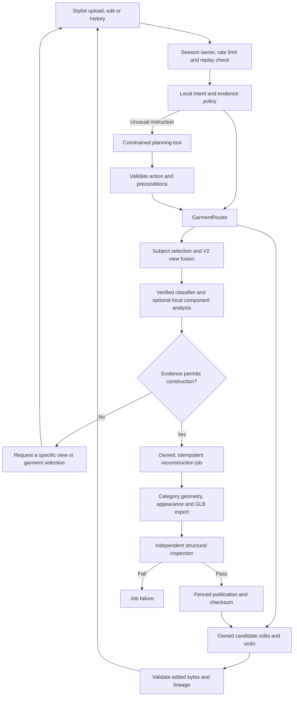

# Phase 16.0 garment intelligence architecture

Stylist still submits an authenticated garment turn. The server interprets the instruction, chooses capabilities, executes against owned assets and stores the decision and receipts with the assistant message. Delayed worker receipts live in the existing durable job result. No migration or new user interface is required.

## Repository inventory

Paths below are repository-relative. An implementation entry is evidence of code. The acceptance report identifies exercise of that code on the current host.

| Area | Evidence and reuse decision | Verification boundary |
| --- | --- | --- |
| Phase 13/14 releases | `services/ml/model_registry.py` under `backend/app`, the Phase 13 deployment manifest and Phase 14.1 release provenance supply canonical IDs and digests. The active classifier checks bytes, tensor state and label order. | Two pinned server artifacts passed identity checks. The classifier also ran on a photographed garment. |
| Phase 14 provider orchestration | `services/ai/orchestration/orchestrator.py` translates perception and normalization into a canonical specification. The older fallback manager tries cloud vision and cloud normalization first. Normal Stylist calls now use local perception and local normalization. | Explicit test/probe and legacy requested-provider paths are separate. Provider health or a configured key is insufficient execution evidence. |
| Model adapters and lifecycle | `local_multimodal_identification_engine.py` composes CLIP prompt scoring, color, silhouette and optional component/depth adapters. `sequential_model_manager.py` owns resident adapter instances. Concurrent calls to the shared local identification engine are serialized. | A source file named after an advanced model may execute a heuristic. Per-view adapter receipts and checkpoint evidence govern attribution. |
| Recognition and segmentation | `garment_instance_detector.py` isolates a requested subject. `ai/multiview/view_classifier.py` and `fusion_engine.py` handle image hashes, duplicate views, orientation, quality, conflicts and readiness. | A single front photo supports a partial reconstruction. Orientation and inferred rear properties are uncertain. |
| Overlapping recognition APIs | Single-image identification, generic hybrid identification and V2 multi-view identification expose different contracts in `api/garment_identification_routes.py`. Stylist keeps the V2 path as its canonical input to reconstruction. | Legacy APIs remain available. The new execution interface does not promote their historical scores. |
| Geometry | `garment_mesh_builder.py` delegates to `reconstruction/engine_registry.py`. Category builders cover jackets, hoodies, tops, bottoms, dresses, traditional garments and footwear. The local hybrid path uses the front image. | The worker records the selected strategy, actual engine and structural result. Remote neural reconstruction has no certification here. |
| Appearance, UV and physics | `reference_texture_reconstructor.py`, `uv_reconstruction_engine.py`, material profiles and the fitting/cloth services already implement texture, PBR, rigging, collision and relaxation stages. | Software behavior is covered by regression suites. Material identity, physical drape and body fit lack reference measurements in this conversation. |
| Job execution and assets | `garments/job_manager.py`, the Redis broker, PostgreSQL state machine and fenced publisher run bounded jobs, support cancellation/retry and recover metadata. Each worker gets its own analyzer diagnostics while sharing weights. | Canonical V2 jobs require structural inspection before publication. A missing publication record or failed commit rejects the job. |
| Candidate history and security | `api/conversational_garments.py`, `chat_candidate.py` and the session repository preserve ownership, parent turn, source checksum and edited checksum. | Browser recovery checks the asset and conversation after restarting the backend. Old messages can omit the new metadata. |
| Independent evaluation | `geometric_evaluator.py` supports reference-surface sampling, mask and landmark comparisons. `dataset_manifest.py` controls real-world reference eligibility. | No real-world metric is produced from a chat confidence value. Camera-conditioned multi-view scoring remains open. |
| Frontend | `frontend/src/pages/StylistChat.tsx`, `components/ai/GarmentJobMessage.tsx` and the garment/avatar engines already implement progress, previews, export, history and avatar attachment. | A browser attachment demonstrates handoff and rendering. It gives no independent fit measurement. |

## Execution boundary

`garment_execution.py` defines the versioned operation, validated parameters, per-turn context and bounded dispatcher. `garment_adapters.py` binds trusted application functions and result validators at startup. The caller passes data to a named capability. Uploaded text and provider output cannot register handlers, choose a filesystem path, invoke SQL or add a geometry opcode. `garment_policy.py` resolves intent, evidence gates and geometry strategy. `local_perception.py` invokes the already resident release. `provider_meter.py` observes transport attempts. The capability catalog also describes worker, browser and future operations outside the directly bound server interface.

Each executed operation records its task, operation ID, input references, algorithm, parameters, timeout, retry policy, validation, result reference, duration and outcome. Recognition and worker IDs link to durable evidence. Photo bytes and GLB buffers remain in their existing asset lifecycle. The durable record stores hashes and references. No new cross-user asset cache was introduced.

The dispatcher limits concurrent operations to two per application event loop. Local synchronous handlers run off-loop. Queue wait consumes the operation deadline. On timeout or disconnect a running native call can finish and retains its slot until completion. A turn does not dispatch subsequent operations after cancellation. Submitted jobs have their own cancellation and deadlines. This design does not forcibly interrupt a GPU kernel. Idempotency protects retried submissions. The shared sequential perception engine serializes its mutable adapter state.

## Roadmap interfaces

| Phase | Extension point | Independent evidence needed |
| --- | --- | --- |
| 16.1 semantic understanding | **Implemented**: `components.identify` bound in `GarmentRouter`, `component_taxonomy.py` (v16.1.0), `component_evidence.py`, `garment_structure_graph.py`, fused into `CanonicalGarmentSpecificationV2` | Full multi-view/visibility/seam annotations in `garment_evaluation_pilot_v1.json` (currently incomplete; 50 single-view Fashionpedia validation boxes evaluated separately) |
| 16.2 construction | **Implemented**: `structure.construct` & `pattern.interpret` bound in `GarmentRouter`, `pattern_geometry.py` (`16.2.0`), `pattern_construction_engine.py`, `pattern_exporter.py` (JSON/SVG/DXF), `pattern_evaluator.py`, connected via `ConstructionToGeometryHandoff` to `ReconstructionEngineRegistry` | Licensed 2D sewing-pattern & seam-graph reference dataset (currently empty `garment_evaluation_pilot_v1.json`) |
| 16.3 reconstruction | **Implemented**: Real-Time Graphics & Interactive Design Studio (`GarmentDesignWorkspace`, `InteractiveGarment3DEditor`, `Pattern2DEditor`, `DesignStateEngine`, `RealtimeMeshEditor`, `GraphicsCapabilityService`, `garment_design_routes.py`, rig-preserving `candidate-edit-gl`, synced 2D/3D revisions) | Matched camera-calibrated 3D reference geometry & physical textile measurements |
| 16.4 appearance | Appearance, UV and projection stages | Aligned textures and material references |
| 16.5 physics | Fitting, collision and simulation services | Body, material and deformation references |
| 16.6 critic | Independent evaluation operations | Calibrated defect and reference evidence |
| 16.7 optimization | Candidate lineage and bounded retry policy | Held-out improvement against independent metrics |
| 16.8 production | Existing Stylist, session and worker boundaries | Hosted recovery, credentialed supplemental inference and load tests |
| 16.3.1 correspondence & transactions | `semantic_correspondence.py`, `SemanticCorrespondenceEngine.ts`, `transactional_design_engine.py`, `/transactions/execute`, `/correspondence` | Versioned 2D-to-3D mapping (`16.3.1`), `MeasurementScope` contracts, 7-state `SyncStatus`, topology invalidation, extended construction checks & atomic rollback |
| 16.9 MotionCore engine | `motion_core.py`, `motion_routes.py`, `MotionCoreOrchestrator.ts`, `CharacterMotionEngine.ts`, `GarmentDynamicsEngine.ts`, `ComputeOrchestrator.ts` | Single-mixer skeletal FSM, retargeting, bounded IK/Pose, XPBD garment-avatar sync, secondary motion, compute tiering & animated GLB validation |
