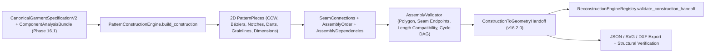

# Phase 16.2: Garment Pattern Intelligence & Construction Graph Engine

## 1. Mission & Architectural Boundary

Phase 16.2 transforms Phase 16.1 component understanding (`ComponentAnalysisBundle`) and multi-view evidence (`CanonicalGarmentSpecificationV2`) into an explicit, machine-readable **2D sewing pattern and structural construction model** (`UnifiedConstructionGraphContract` v`16.2.0`) packaged inside a validated `ConstructionToGeometryHandoff` for downstream 3D engines in Phase 16.3.

Phase 16.2 preserves all existing Phase 14.20–14.27 and Phase 16.0–16.1 systems:
- Existing 3D geometry builders (`hoodie_engine.py`, `jacket_engine.py`, `traditional_engine.py`, `dress_engine.py`, `shirt_engine.py`, `tops_engine.py`, `bottoms_engine.py`, `skirt_engine.py`) remain intact.
- `ReconstructionEngineRegistry.validate_construction_handoff()` connects Phase 16.2 `ConstructionToGeometryHandoff` contracts to the registered target engines without breaking existing job dispatch.
- `UniversalConstructionGraph.from_unified_contract()` bridges Phase 16.2 pattern graphs into the legacy 3D graph abstraction where needed.
- Capabilities `structure.construct` and `pattern.interpret` are bound in `GarmentRouter` (`garment_adapters.py`) and registered as `State.VERIFIED` in `capability_registry.py`.

## 2. Core Modules Implemented

| Module | Purpose |
| --- | --- |
| `backend/app/services/garments/reconstruction/pattern_geometry.py` | Versioned (`16.2.0`) 2D geometry primitives (`Point2DPattern`, `CubicBezierSegment`, `PatternEdge`, `PatternNotch`, `PatternDart`, `Grainline2D`, `InternalConstructionLine`, `MeasuredDimension`, `PatternPiece2D`, `SeamConnection`, `ConstructionInferenceRecord`, `AssemblyValidationReport`, `UnifiedConstructionGraphContract`, `ConstructionToGeometryHandoff`) and deterministic 2D computational geometry validators (`signed_polygon_area`, `polygon_perimeter`, `segments_intersect`, `validate_polygon_2d`, `compute_seam_allowance_polygon`). |
| `backend/app/services/intelligence/pattern_construction_engine.py` | `PatternConstructionEngine` generating category-authentic patterns across jackets, hoodies (pullover vs zip split), formal/casual shirts, knit tops/sweaters, bottoms (trousers/jeans/shorts with 4 legs + contoured waistband + fly shield), dresses (waist-darted bodice + A-line skirt), skirts, and traditional garments (kurta with chak side slits, flared gored lehenga, sherwani); plus `AssemblyValidator` verifying CCW polygons, seam endpoints, seam-length compatibility, and Kahn's DAG cycle detection. |
| `backend/app/services/garments/reconstruction/pattern_exporter.py` | Deterministic `export_pattern_json`, `export_pattern_svg`, and millimeter-scaled ASCII R12 `export_pattern_dxf` emitters with honest structural verification helpers (`verify_svg_xml` via `xml.etree.ElementTree` and `verify_dxf_entities`). |
| `backend/app/services/garments/evaluation/pattern_evaluator.py` | `PatternEvaluator` computing software topology consistency and reference-pattern accuracy (`pattern_boundary_error_m`, `panel_area_error_pct`, `panel_dimension_error_m`, `seam_precision`, `seam_recall`, `seam_f1`, `panel_connectivity_accuracy`, `construction_graph_accuracy`) with fail-closed `NOT_EVALUATED_EMPTY_DATASET` gating. |
| `backend/app/api/garment_identification_routes.py` | `POST /api/garments/{garment_id}/construction-plan` returning `handoff`, `registry_compatibility`, optional SVG cutting sheet, and optional DXF ASCII R12 entities. |

## 3. Pipeline Execution Flow

