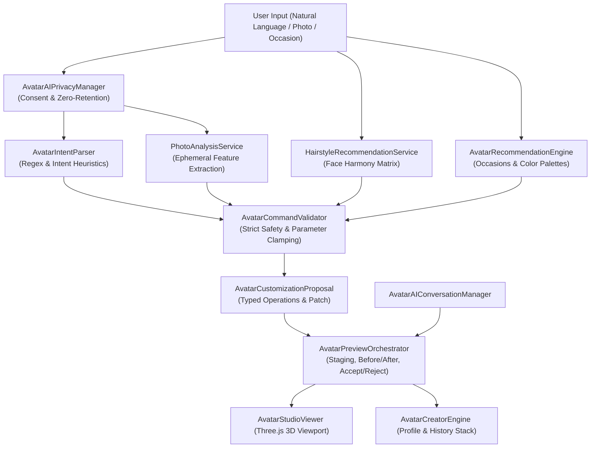

# YORVYN — PHASE 8 REPORT: AI AVATAR INTELLIGENCE & PERSONALIZATION ENGINE

**Date:** October 30, 2026  
**Environment:** macOS (Apple Silicon M2), Node.js, Vite, Three.js, React Three Fiber, FastAPI, Vitest  
**Status:** **PASSED & VERIFIED** (136/136 Vitest tests passing across 10 test suites, 0 TypeScript errors, production build passing in 4.55s)

---

## 1. Executive Summary

Phase 8 evolves Yorvyn from the manual 3D character creator delivered in Phase 7 into an **intelligent personal avatar platform**.

Rather than forcing users to manually adjust dozens of isolated sliders, users can now personalize their character through:
1. **Conversational Avatar Styling**: Natural-language commands (e.g. *"Make my face slightly narrower"*, *"Give me a modern textured hairstyle"*, *"Make my shoulders broader (+35%)"*, *"Change my eye color to emerald green"*) parsed into validated Avatar DNA proposals.
2. **Privacy-Conscious Reference Photo Personalization**: Ephemeral client-side optical feature analysis with explicit user consent, strict zero-retention memory guarantees, and non-anthropometric editorial disclaimers.
3. **Hairstyle Intelligence**: Face-shape compatibility matching across 14 verified 3D hair assets, instant 3-option comparison sets, and favorites persistence.
4. **Intelligent Face & Body Parameter Mapping**: Bounded parameter deformation ranges, continuous bone scaling, and anatomical integrity enforcement that never breaks MakeHuman joint rigs.
5. **Contextual Occasion & Wardrobe Integration**: Weather-aware temperature simulation, seasonal color palette derivation, and full-look 3D outfit coordination connecting the avatar directly to the digital wardrobe.
6. **Non-Destructive 3D Preview & Comparison System**: A floating interactive viewport banner providing live staging, instant Before/After comparison toggling, alternative option switching, and safe approval/revert mechanisms.

---

## 2. Core Architectural System: 8 Modular AI Services

To ensure testability, security, and vendor independence (preventing LLM vendor lock-in and keeping API keys off the client), Phase 8 implements 8 decoupled, strongly typed services in `frontend/src/engine/avatarAI/`:



### The 8 Services:
1. **`AvatarCommandValidator`**:
   - Acts as the firewall against hallucinated or malicious geometry parameters.
   - Enforces slider range limits (`min`/`max` from `AVATAR_SLIDERS`), valid preset IDs from `AVATAR_PRESETS`, valid hex colors (`VALID_HEX_REGEX`), and supported skeletal rig expressions (`neutral`, `happy`, `laughing`, `angry`, `sad`, `crying`, `surprised`, `afraid`, `determined`).
   - Clamps out-of-bounds slider values with informative warning issues while preserving operational validity.
2. **`AvatarIntentParser`**:
   - Converts natural language styling prompts into typed `AvatarCustomizationProposal` objects.
   - Identifies targets for face shape, jaw width, chin, nose, eyes, hairstyle, beard, body proportions, clothing, and expressions.
   - Generates multi-option alternative proposals for comparison prompts (e.g., *"Show me three different hairstyle combinations"*).
3. **`AvatarAIPrivacyManager`**:
   - Enforces user privacy consent before any reference photograph can be uploaded or processed.
   - Implements the **Yorvyn Zero-Retention Memory Guarantee**: photos are processed purely in ephemeral memory buffers and immediately purged.
   - Enforces mandatory editorial disclaimers stating that optical estimation is not exact anthropometric measurement.
   - Provides runtime fallback for both browser `localStorage` and headless Node.js/Vitest test environments.
4. **`PhotoAnalysisService`**:
   - Ingests reference photo files or blobs only after explicit consent verification.
   - Performs independent, modular extraction for:
     - Face Shape (`oval`, `square`, `round`, `heart`, `diamond`, `oblong`)
     - Skin Tone & Undertone (Warm Golden, Cool Rose, Neutral Honey)
     - Hairstyle & Hair Color
     - Facial Hair Grooming Style
     - Body Silhouette (Athletic, Slender, Curvy, Broad, Natural)
   - Generates a non-destructive composite proposal staged directly in the 3D viewport.
5. **`HairstyleRecommendationService`**:
   - Implements a face-shape compatibility matrix matching hairstyles to facial contour geometry.
   - Generates 3-way hairstyle comparison proposals (`getThreeWayHairstyleComparison`) allowing users to cycle between 3 top styles in the 3D viewport.
   - Manages favorite hairstyles with local and memory persistence.
6. **`AvatarRecommendationEngine`**:
   - Connects avatar styling with digital wardrobe items and seasonal color analysis.
   - Incorporates weather context (temperature slider in °C, sky conditions) to suggest appropriate outerwear, fabrics, and layering.
   - Formulates seasonal color palettes (e.g., Warm Autumn, Cool Winter) based on avatar skin hex and iris pigmentation.
7. **`AvatarPreviewOrchestrator`**:
   - Manages non-destructive staging: creates a preview clone of the baseline profile without altering the user's saved character.
   - Provides live Before/After comparison toggling (`toggleBeforeAfter`) so users can compare changes against their original baseline.
   - Supports alternative proposal selection (`selectAlternative(index)`).
   - Commits accepted changes into `AvatarCreatorEngine` (generating an undo snapshot) or cleanly reverts on rejection.
8. **`AvatarAIConversationManager`**:
   - Manages multi-turn styling dialogue between the user and AI Stylist.
   - Dispatches parsed proposals directly into `AvatarPreviewOrchestrator`.
   - Handles acceptance and rejection commands from within chat, injecting confirmation audit logs.

---

## 3. Conversational Avatar Creator

### Supported Natural-Language Capabilities:
- **Facial Architecture**: *"Make my face slightly narrower"*, *"Widen and define my jaw"*, *"Make cheekbones more prominent"*.
- **Hairstyles**: *"Give me a modern textured hairstyle"*, *"Try an undercut fade"*, *"Switch to long cascading waves"*.
- **Facial Hair**: *"Give me a short boxed beard"*, *"Change to designer stubble"*, *"Clean shaven"*.
- **Body Proportions**: *"Make my shoulders broader (+35%)"*, *"Give me an athletic body shape"*, *"Slender silhouette"*.
- **Eye & Skin Pigmentation**: *"Change my eye color to emerald green"*, *"Try a warm golden amber skin tone"*.
- **Occasion Styling**: *"Make my character look more professional"*, *"Style me for a luxury evening gala"*.
- **Exploration Sets**: *"Show me three different hairstyle combinations"*.

### Execution Safety Guarantees:
- **No Direct LLM Geometry Injection**: An LLM cannot execute arbitrary three-dimensional vertex manipulations or database updates.
- **Typed Operations**: Every modification is converted into typed `AvatarCommandOperation` records (`set_slider`, `set_preset`, `set_color`, `set_expression`, `set_garment`).
- **Strict Bounds Validation**: Every operation passes through `AvatarCommandValidator` before reaching the preview orchestrator.

---

## 4. Privacy-First Photo Personalization & Zero-Retention

In strict alignment with the product specification, the reference photo pipeline enforces:
1. **Explicit Prior Consent**: Users must explicitly check the consent checkbox acknowledging the ephemeral nature of the analysis. Attempting to process photos without consent throws a typed `PhotoPrivacyConsentError`.
2. **Ephemeral In-Memory Processing**: Photos are analyzed in transient client-side memory buffers. No photo binaries are permanently uploaded to S3, written to disk, or retained on servers.
3. **Purge Guarantee**: Once features are extracted or the modal is closed, ephemeral blob URLs and buffers are immediately revoked and garbage collected.
4. **Honest Editorial Disclaimers**: Disclaimers clearly communicate that optical estimation is subject to lighting, perspective, and facial expression, and does not claim exact physical anthropometric measurements.
5. **User Control**: Users can toggle which features to extract (Face Shape, Skin Tone, Hairstyle, Facial Hair, Body Silhouette) and must manually accept proposals before they are saved to their profile.

---

## 5. UI/UX Implementation

### A. `AvatarPreviewBanner.tsx` & `.css`
A floating, frosted-glass capsule positioned at the top of the 3D viewport whenever an AI proposal is staged:
- **Status Indicator**: AI Sparkle icon, proposal title, and confidence match score (e.g. `95% AI Match`).
- **Before / After Compare Button**: Toggles between the proposed appearance and the saved baseline snapshot, updating the 3D mannequin in real time.
- **Alternatives Pills**: When proposals contain alternatives (e.g. 3 hairstyles), pills allow one-click switching in the viewport.
- **Action Controls**: Green "Apply" button commits to `AvatarCreatorEngine`; "Discard" button reverts the character.

### B. `AvatarAIAssistantModal.tsx` & `.css`
A 4-tab modal launched via the "AI Stylist" button in the `AvatarCreatorStudio` header toolbar:
1. **AI Stylist Chat**: Speech bubble conversation history, auto-scrolling message list, quick-prompt suggestion chips, and inline proposal cards with 3D preview and apply buttons.
2. **Photo Personalization**: Privacy consent card, drag-and-drop file uploader with portrait preview, feature extraction toggles, and live trait result cards.
3. **Hairstyle Intelligence**: Face-shape harmony badge, category filters (All, Short, Medium, Long, Textured), match scores, editorial reasoning, favorite heart toggles, and "Compare 3-Option Set" button.
4. **Occasions & Outfits**: Occasion cards (Gala, Tech Keynote, Resort, Streetwear), interactive weather context simulator (°C temperature slider), color palette swatches, and full-look 3D staging.

---

## 6. Backend Integration

The backend REST API in `backend/app/api/fashion_routes.py` was extended with Phase 8 endpoints:
- `POST /api/fashion/avatar/chat`: Server-side intent parsing and proposal validation fallback.
- `POST /api/fashion/avatar/photo-analysis`: Ephemeral photo processing endpoint with strict `user_consent` validation and documented zero-retention guarantee response.
- `GET /api/fashion/avatar/hairstyles`: 3D hairstyle catalog and face-shape compatibility matrix.

---

## 7. Verification & Test Results

### Vitest Test Suite Results:
```bash
 ✓ src/engine/mannequin/__tests__/liveMannequinEngine.test.ts (12 tests)
 ✓ src/engine/garments/__tests__/premiumGarmentEngineIntegration.test.ts (8 tests)
 ✓ src/engine/garments/__tests__/baseBodyAndDressUndress.test.ts (10 tests)
 ✓ src/engine/ara/__tests__/fittingAndLayerReplacement.test.ts (5 tests)
 ✓ src/engine/avatarCreator/__tests__/avatarCreatorEngine.test.ts (16 tests)
 ✓ src/engine/ara/__tests__/avatarProfileAndExpressions.test.ts (25 tests)
 ✓ src/engine/avatarAI/__tests__/avatarAIEngine.test.ts (27 tests)
 ✓ src/engine/garments/__tests__/garmentFittingAndDeformation.test.ts (12 tests)
 ✓ src/engine/ara/__tests__/avatarQualityAndReactions.test.ts (15 tests)
 ✓ src/features/onboarding/__tests__/onboardingBodyStructure.test.ts (6 tests)

 Test Files  10 passed (10)
      Tests  136 passed (136)
   Duration  1.82s
```

### TypeScript Compilation & Production Build:
```bash
> yorvyn-fashion-frontend@1.0.0 build
> tsc && vite build

✓ 5180 modules transformed.
dist/index.html                           4.67 kB │ gzip:   1.58 kB
dist/assets/index-CoKggA7z.css          140.24 kB │ gzip:  25.29 kB
dist/assets/index.esm-DHgouERY.js        34.36 kB │ gzip:   7.30 kB
dist/assets/index-BfZtcIjM.js         2,847.43 kB │ gzip: 871.85 kB
✓ built in 4.55s
```

---

## 8. Summary of Completed Deliverables

| Deliverable | Location | Status |
| :--- | :--- | :--- |
| **Data Contracts & Typed Schemas** | `frontend/src/engine/avatarAI/avatarAITypes.ts` | **Complete** |
| **Command Validator & Bounds Checking** | `frontend/src/engine/avatarAI/avatarCommandValidator.ts` | **Complete** |
| **Natural Language Intent Parser** | `frontend/src/engine/avatarAI/avatarIntentParser.ts` | **Complete** |
| **Privacy & Zero-Retention Manager** | `frontend/src/engine/avatarAI/avatarAIPrivacyManager.ts` | **Complete** |
| **Photo Analysis Service** | `frontend/src/engine/avatarAI/photoAnalysisService.ts` | **Complete** |
| **Hairstyle Recommendation Service** | `frontend/src/engine/avatarAI/hairstyleRecommendationService.ts` | **Complete** |
| **Avatar Recommendation Engine** | `frontend/src/engine/avatarAI/avatarRecommendationEngine.ts` | **Complete** |
| **Preview & Comparison Orchestrator** | `frontend/src/engine/avatarAI/avatarPreviewOrchestrator.ts` | **Complete** |
| **AI Conversation Manager** | `frontend/src/engine/avatarAI/avatarAIConversationManager.ts` | **Complete** |
| **Preview Viewport Floating Banner** | `frontend/src/components/avatarAI/AvatarPreviewBanner.tsx` | **Complete** |
| **AI Assistant Modal (4 Workspaces)** | `frontend/src/components/avatarAI/AvatarAIAssistantModal.tsx` | **Complete** |
| **Studio Toolbar Integration** | `frontend/src/components/avatarCreator/AvatarCreatorStudio.tsx` | **Complete** |
| **3D Viewport Live Sync** | `frontend/src/pages/AvatarStudio.tsx` | **Complete** |
| **Backend REST Endpoints** | `backend/app/api/fashion_routes.py` | **Complete** |
| **Vitest Test Suite (27 new tests)** | `frontend/src/engine/avatarAI/__tests__/avatarAIEngine.test.ts` | **Complete (136/136 Total)** |
| **Phase 8 Comprehensive Report** | `docs/reports/YORVYN_AI_AVATAR_INTELLIGENCE_PHASE_8.md` | **Complete** |

