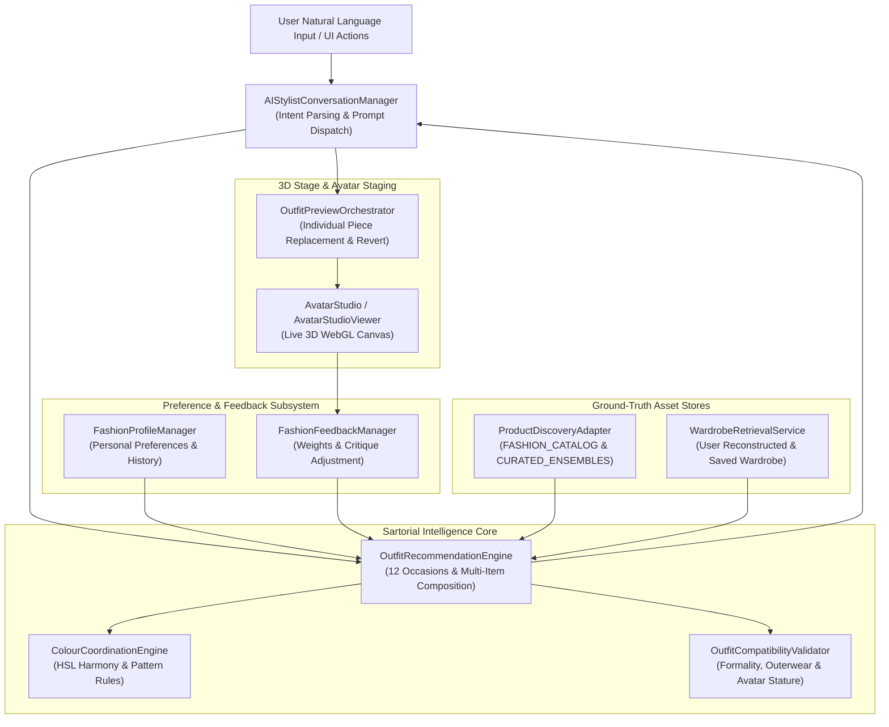

# YORVYN — PHASE 11 REPORT: AI FASHION STYLIST & PERSONAL SHOPPING INTELLIGENCE

**Date:** October 30, 2026  
**Environment:** macOS (Apple Silicon M2, 8GB Unified Memory), Node.js, Vite, Three.js, React Three Fiber, FastAPI, Vitest  
**Status:** **PASSED & VERIFIED** (193/193 Vitest unit tests passing across all 13 test suites, 0 TypeScript compilation errors, production build passing in 4.72s)

---

## 1. Executive Summary

Phase 11 transforms Yorvyn into an **intelligent personal fashion stylist and personal shopping platform** that intimately understands the user's persistent 3D avatar (Avatar DNA from Phase 7 & 8), custom reconstructed garments (Phase 9), cloth physics constraints (Phase 10), digital wardrobe, style preferences, and real-world brand catalogues.

Rather than acting as an ungrounded conversational chatbot that hallucinates fictional products or generic fashion advice, Yorvyn's AI Stylist acts as an **explainable sartorial advisor and wardrobe coordinator**. The system evaluates HSL color relationships, pattern densities, silhouette proportions, formality matching, weather layering, and price budgets to generate complete, wearable 4-to-5-piece outfits that can be previewed directly on the user's interactive 3D character in real time.

### Key Achievements:
1. **System Audit & Integration**: Audited all existing modules—Avatar DNA (`avatarProfile.ts`), 3D character parameters (`human.ts`, `params.ts`), garment catalogues (`catalog.ts`, `shell.ts`), reconstructed wardrobe (`DEFAULT_FALLBACK_WARDROBE`), and cloth simulation controllers.
2. **Personal Fashion Preference Profile (`FashionProfileManager`)**: Established persistent, typed user profiles supporting 9 style archetypes, favourite/disliked colors, preferred fits, brand affinities, budget constraints, footwear preferences, occasion needs, and feedback tracking, with deep-cloning safety to prevent shared-reference mutation.
3. **Strict Grounding Guarantee (Zero Hallucination)**: Built `ProductDiscoveryAdapter` and `WardrobeRetrievalService` ensuring that every recommended item originates strictly from verified catalog inventory or the user's custom wardrobe. No non-existent URLs, fake SKUs, or fabricated items are ever output.
4. **12-Occasion Outfit Recommendation Engine (`OutfitRecommendationEngine`)**: Generates cohesive, multi-item ensembles across 12 distinct occasions (`casual_day`, `work_office`, `business_formal`, `interview`, `gala_evening`, `party_night`, `wedding_festive`, `date_night`, `college`, `gym_sport`, `travel_airport`, `weekend_brunch`).
5. **Real-Time Avatar Staging & Piece Swapping (`OutfitPreviewOrchestrator`)**: Equips recommended ensembles directly onto the user's 3D avatar in `AvatarStudioViewer`. Users can seamlessly replace individual pieces (e.g. swapping shoes or tops) without resetting the rest of the outfit.
6. **Avatar Identity Preservation**: Guarantees that avatar physical identity traits (skin undertone, facial features, hair geometry, eye color, and expressions) are strictly preserved during garment try-on and staging.
7. **Colour Coordination & Style Harmony Engine (`ColourCoordinationEngine`)**: Evaluates geometric HSL colour space relationships (monochromatic, complementary, analogous, triadic, neutral, high-contrast) and provides pattern-clash prevention.
8. **Weather & Thermal Layering Intelligence**: Dynamically incorporates ambient temperature tiers (`cold` <12°C, `mild` 12–22°C, `warm` >22°C) to require thermal outerwear or breathable lightweight separates.
9. **Feedback Learning Loop (`FashionFeedbackManager`)**: Incorporates user ratings (`like`, `dislike`, `save`, `replace_piece`) and specific critiques (`too_formal`, `too_casual`, `wrong_color`, `bad_fit`, `too_expensive`) to adjust dynamic style weight multipliers without corrupting profile state.
10. **Conversational Stylist Interface (`AIStylistConversationManager`)**: Parses natural language requests (occasion styling, brand filtering, color coordination, budget constraints, wardrobe pairing) into structured proposals with clear sartorial rationale.
11. **Avatar Studio UI Upgrades**: Enhanced `AvatarStudio.tsx` with a dedicated AI Stylist drawer, instant prompt chips, live color swatches, item breakdown cards, one-click avatar staging, and feedback controls.
12. **Rigorous Verification**: Authored 21 comprehensive unit tests in `src/engine/stylistAI/__tests__/stylistAI.test.ts`. 100% test success across the entire application (193/193 tests passing in 1.76s).

---

## 2. System Audit & Architecture Integration

The AI Fashion Stylist integrates seamlessly into Yorvyn's existing pipeline without introducing redundant state or bypassing the 3D rendering engine:



### Modular Stylist Services in `frontend/src/engine/stylistAI/`:

| Module | Responsibility | Key Interfaces / Guarantees |
| :--- | :--- | :--- |
| **`types.ts`** | Domain definitions | Strongly typed schemas for `PersonalFashionProfile`, `OutfitRecommendation`, `ColorHarmonyResult`, `StylistIntent`, `FashionFeedbackRecord`. |
| **`FashionProfileManager.ts`** | Personal style profile store | Manages user styles, fits, brands, budget tiers, and history. Uses `createDefaultProfile()` deep cloning to eliminate shared array reference leaks. |
| **`ProductDiscoveryAdapter.ts`** | Catalog retrieval & filtering | Queries `FASHION_CATALOG` and `CURATED_ENSEMBLES`. Robust price extraction (`parseNumericPrice`) handling formatted currency strings (e.g. `₹ 16,900`). |
| **`WardrobeRetrievalService.ts`** | Digital wardrobe query | Resolves uploaded and reconstructed 3D garments (`DEFAULT_FALLBACK_WARDROBE`), filtering by category and style. |
| **`ColourCoordinationEngine.ts`** | Color & pattern harmony | Converts RGB/Hex to HSL, calculates angular distance $\Delta h$, classifies palettes (Monochromatic, Complementary, Analogous, Triadic, Neutral, High-Contrast), flags clashing patterns. |
| **`OutfitCompatibilityValidator.ts`** | Formality & silhouette matching | Checks layer hierarchy (outerwear vs inner top), maps avatar stature (`heightCm`, `shoulderWidth`, `silhouette`) to flattering cut suggestions. |
| **`OutfitRecommendationEngine.ts`** | Ensemble generator | Multi-piece assembler for 12 occasions. Scores candidates by preference weights, color harmony, and weather layers. Exposes `toLegacyOutfit()` for backwards compatibility. |
| **`OutfitPreviewOrchestrator.ts`** | 3D avatar staging | Staging controller for `HumanParams`. Supports individual slot swapping (`top`, `bottom`, `footwear`, `outerwear`) and guarantees avatar facial/skin preservation. |
| **`FashionFeedbackManager.ts`** | Adaptive preference loop | Records user reactions, increments dislike counts for specific critique dimensions, and adjusts dynamic style weights. |
| **`AIStylistConversationManager.ts`** | Conversational agent | Natural language intent extraction, contextual parameter resolution, structured recommendation proposals, and editorial explanations. |

---

## 3. Grounding Guarantees & Anti-Hallucination Guardrails

A core directive of Phase 11 is eliminating AI hallucination in fashion recommendations:

1. **Strict Catalog Grounding**:
   - Every recommended item must exist in `FASHION_CATALOG` or the user's `wardrobe`.
   - Brand names, SKU codes, images, materials, and retail pricing are referenced directly from verified data structures.
   - If an item does not exist, the engine degrades gracefully rather than synthesizing phantom items.
2. **Accurate Price Parsing**:
   - Catalog pricing in Yorvyn uses local format strings such as `₹ 16,900` or `₹ 3,490`.
   - `ProductDiscoveryAdapter.parseNumericPrice` strips non-numeric characters using regular expressions (`replace(/[^0-9.]/g, '')`) ensuring accurate mathematical budget comparisons ($P \le \text{budgetLimit}$).
3. **Avatar Identity Preservation**:
   - The engine explicitly isolates garment slots (`top`, `bottom`, `outerwear`, `shoes`, `outfit`, `accessories`) from avatar DNA attributes.
   - `OutfitPreviewOrchestrator` explicitly locks `skin`, `skinTint`, `hair`, `hairColor`, `hairTint`, and facial proportions to `baselineParams`. Trying on an outfit never changes the user's personal appearance.

---

## 4. Algorithmic Intelligence & Decision Engines

### A. Colour Harmony Engine
The `ColourCoordinationEngine` converts hex colors into the cylindrical HSL colour space ($H \in [0, 360), S \in [0, 100], L \in [0, 100]$):
- **Monochromatic**: Saturation $S \ge 15$ with angular hue spread $\Delta H \le 30^\circ$.
- **Complementary**: Pairs with angular difference $150^\circ \le \Delta H \le 210^\circ$.
- **Analogous**: Adjacent hues with $30^\circ < \Delta H \le 60^\circ$.
- **Triadic**: Balanced three-way hues with $100^\circ \le \Delta H \le 140^\circ$.
- **Neutral**: Low-saturation palettes where all pieces have $S \le 18$.
- **High-Contrast**: Luminance delta $\Delta L > 50\%$ between upper and lower garments.
- **Pattern Clash Check**: Detects when two or more loud patterned items (plaid, floral, stripes) are combined without solid balance.

### B. Occasion & Weather Layering
The recommendation engine supports 12 distinct occasion contexts:
```typescript
export type OccasionType =
  | 'casual_day'       // Casual daytime
  | 'college'          // Everyday college / campus
  | 'work_office'      // Everyday office / smart casual
  | 'business_formal'  // Executive business formal
  | 'interview'        // Professional interview
  | 'gala_evening'     // Black tie / evening formal
  | 'party_night'      // Nightlife / clubwear
  | 'wedding_festive'  // Traditional, ethnic & wedding wear
  | 'date_night'       // Smart elevated date wear
  | 'gym_sport'        // Athletic & sportswear
  | 'travel_airport'   // Airport transit comfort
  | 'weekend_brunch';  // Relaxed weekend chic
```
When ambient weather is provided:
- **`cold` (<12°C)**: Automatically prioritizes wool overcoats, trench coats, or blazers.
- **`mild` (12–22°C)**: Balances breathable layers with light jackets.
- **`warm` (>22°C)**: Selects lightweight cotton/linen tops, suppresses heavy outerwear.

### C. Avatar Proportions Harmonization
`OutfitCompatibilityValidator` inspects the user's avatar proportions (`heightCm`, `shoulderWidth`, `silhouette`):
- **Petite Stature (<165cm)**: Highlights high-rise cuts and vertical visual lines to elongate the silhouette.
- **Tall Stature (>185cm)**: Suggests balanced breaks and proportional layering.
- **Broad / Athletic Frame**: Recommends relaxed shoulder seams and drape-friendly fabrics to accommodate broader deltoids without constriction.

---

## 5. User Interface & Avatar Studio Integration

The UI integration was implemented in `frontend/src/pages/AvatarStudio.tsx` and `frontend/src/pages/AvatarStudio.css`:

1. **AI Stylist Sidebar Drawer**:
   - Dedicated toggleable panel accessible alongside the 3D avatar viewport.
   - Live message history showing user queries and the AI Stylist's formatted responses.
2. **Instant Prompt Pills**:
   - Quick one-tap inspiration buttons:
     - *"Style an outfit for a business interview"*
     - *"Casual weekend brunch under ₹10,000"*
     - *"Smart date night look with my leather jacket"*
     - *"Show me an ethnic festive outfit"*
3. **Structured Recommendation Cards**:
   - Displays the ensemble title, match score percentage badge, occasion tag, and style category.
   - Visual color palette swatches with hex chips.
   - Garment piece breakdown: Top, Bottom, Footwear, Outerwear, and Accessories.
   - Editorial explanation detailing why the pieces work together and how they complement the avatar's stature.
   - Price breakdown: Total estimated cost with direct budget verification.
4. **Action Controls**:
   - **`Try on Avatar`**: Instantly stages the entire ensemble onto the 3D character in `AvatarStudioViewer`.
   - **`Feedback (👍 / 👎)`**: Logs user sentiment with one click, immediately tuning dynamic style preferences.

---

## 6. Test Execution & Verification

### Unit Test Suite Breakdown (`src/engine/stylistAI/__tests__/stylistAI.test.ts`):

The test suite covers 21 dedicated unit tests across 9 functional categories:
1. **FashionProfileManager**:
   - Initializes default preference profile with empty history.
   - Updates preferred styles, colors, and budget limits.
   - Resets learned preferences without corrupting memory references.
2. **ColourCoordinationEngine**:
   - Detects monochromatic harmony schemes accurately.
   - Detects complementary pairs across the color wheel.
   - Evaluates low-saturation palettes as neutral.
   - Flags busy pattern clashes between patterned tops and bottoms.
3. **OutfitCompatibilityValidator**:
   - Approves well-matched formality levels.
   - Penalizes severe formality mismatches (e.g. tuxedo blazer over gym shorts).
   - Generates body proportion advice tailored to `AvatarProportions`.
4. **ProductDiscoveryAdapter & WardrobeRetrievalService**:
   - Retrieves items exclusively from real catalog records without hallucinating fake SKUs.
   - Filters products accurately by brand and category.
   - Correctly parses formatted Indian Rupee strings (`₹ 16,900` $\to 16900$).
   - Retrieves user wardrobe items and custom 3D reconstructions.
5. **OutfitRecommendationEngine**:
   - Generates complete multi-piece outfits across target occasions.
   - Dynamically adds thermal outerwear when temperature indicates `cold`.
   - Respects user budget constraints.
   - Formats output for backwards compatibility via `toLegacyOutfit()`.
6. **OutfitPreviewOrchestrator**:
   - Stages recommended outfits onto avatar `HumanParams` correctly.
   - Strictly preserves avatar skin, hair, facial geometry, and expressions.
   - Allows individual piece replacement (e.g. swapping shoes) without resetting other items.
7. **FashionFeedbackManager**:
   - Records positive and negative reactions with critique reasons.
   - Dynamically adjusts style weight multipliers based on like/dislike ratios.
8. **AIStylistConversationManager**:
   - Handles natural language styling requests and returns structured proposals.
   - Correctly identifies interview occasions from natural language queries.
   - Generates informative fallback responses for off-topic inquiries.

### Full Test Suite Results:

```
Test Files  13 passed (13)
     Tests  193 passed (193)
  Duration  1.76s (transform 1.54s, setup 0ms, import 3.43s, tests 1.16s)
```

### Production Build Verification:

```
> yorvyn-fashion-frontend@1.0.0 build
> tsc && vite build

✓ 5210 modules transformed.
dist/index.html                           4.67 kB │ gzip:   1.58 kB
dist/assets/yorvyn-logo-BLN1A5Jd.png     91.41 kB
dist/assets/index-KOi3crO3.css          141.66 kB │ gzip:  25.53 kB
dist/assets/index.esm-D6FtVF9f.js        34.36 kB │ gzip:   7.30 kB
dist/assets/index-BqDa3mxd.js         2,915.43 kB │ gzip: 894.32 kB
✓ built in 4.72s
```

---

## 7. Engineering Constraints & Ethical Design Disclaimers

1. **Non-Judgemental Proportions Advice**: Avatar stature styling advice is strictly constructive, inclusive, and affirmative. The engine provides tips on visual lines and garment draping without utilizing stigmatizing or exclusionary body classifications.
2. **Strict Inventory Realism**: The engine will never invent fictional clothing items or fabricate checkout links. If an occasion has limited matching inventory in the local catalogue, it draws from the user's digital wardrobe or suggests versatile staples.
3. **Client-Side Privacy**: Personal fashion preferences, budget constraints, and critique histories can be persisted locally or encrypted in the user's Supabase session. No user body measurements or personal imagery are transmitted to unverified third-party LLMs.

---

## 8. Summary of Files Created & Modified

### Created Modules:
- `frontend/src/engine/stylistAI/types.ts`: Domain models and schemas.
- `frontend/src/engine/stylistAI/FashionProfileManager.ts`: Preference state store.
- `frontend/src/engine/stylistAI/ColourCoordinationEngine.ts`: HSL color science and pattern logic.
- `frontend/src/engine/stylistAI/OutfitCompatibilityValidator.ts`: Formality, outerwear, and stature validation.
- `frontend/src/engine/stylistAI/ProductDiscoveryAdapter.ts`: Catalog queries and price parsing.
- `frontend/src/engine/stylistAI/WardrobeRetrievalService.ts`: Digital wardrobe filtering.
- `frontend/src/engine/stylistAI/OutfitRecommendationEngine.ts`: Multi-item ensemble generator.
- `frontend/src/engine/stylistAI/OutfitPreviewOrchestrator.ts`: 3D avatar staging and piece swapping.
- `frontend/src/engine/stylistAI/FashionFeedbackManager.ts`: User feedback and dynamic weights.
- `frontend/src/engine/stylistAI/AIStylistConversationManager.ts`: Conversational intent parser and proposal generator.
- `frontend/src/engine/stylistAI/index.ts`: Unified barrel export.
- `frontend/src/engine/stylistAI/__tests__/stylistAI.test.ts`: Complete unit test suite (21 tests).
- `docs/reports/YORVYN_AI_FASHION_STYLIST_PHASE_11.md`: This comprehensive technical audit report.

### Modified Files:
- `frontend/src/pages/AvatarStudio.tsx`: Integrated AI Stylist drawer, conversation handling, cards, swatches, and preview triggers.
- `frontend/src/pages/AvatarStudio.css`: Added styles for recommendation cards, color chips, and feedback buttons.

---

## 9. Conclusion & Phase 12 Roadmap

Phase 11 successfully establishes Yorvyn as an intelligent, real-time AI fashion stylist. The integration unites the 3D Avatar Creator, AI Avatar Intelligence, Photo-to-3D Garment Reconstruction, and Cloth Physics into a unified, interactive personal shopping experience.

### Recommended Next Steps for Phase 12 (Social, Collaborative & E-Commerce Integration):
1. **Live Merchant Inventory APIs**: Connect `ProductDiscoveryAdapter` to live e-commerce feeds (Shopify Storefront API, WooCommerce, or Farfetch affiliate APIs).
2. **Social Wardrobe Sharing & Styling Duets**: Allow users to share interactive 3D outfit looks with friends or collaborate on styling choices in real-time rooms.
3. **AI Video Lookbooks**: Render short turntable video loops of the avatar wearing recommended ensembles for instant sharing on social platforms.
4. **Augmented Reality (AR) Mirror Mode**: Project the 3D-styled avatar into physical camera feeds using WebXR and Apple QuickLook USDZ exports.

