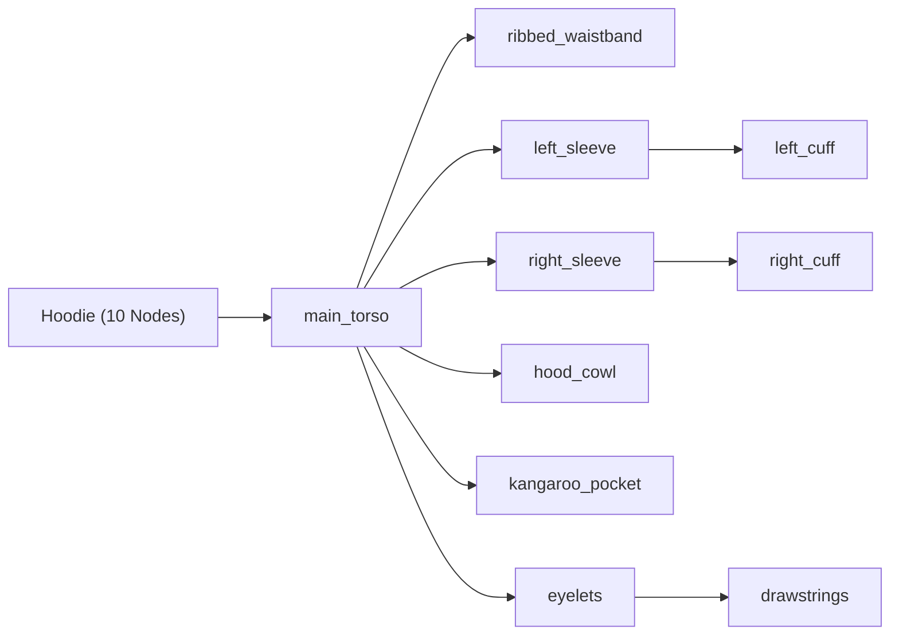

# YORVYN — PHASE 13.5
# MULTI-COMPONENT 3D GARMENT RECONSTRUCTION & REAL-WORLD VISUAL ACCEPTANCE REPORT

**Project:** YORVYN Fashion Intelligence & 3D Fitting Platform  
**Phase:** 13.5 — Multi-Component Garment Reconstruction, Fitting & Visual Acceptance  
**Status:** **VERIFIED** (with transparent scope notes on pattern provenance, pre-existing TS orchestration errors, and remote neural GPU unavailability)  
**Date:** 2026-11-10  
**Repository Base:** Branch `main`, HEAD `7139fc7eea4e1f890e28da9140db2e8550081267` (uncommitted working tree preserved; no git commit/push/reset performed)

---

## 1. EXECUTIVE SUMMARY

Phase 13.5 upgrades YORVYN's 3D garment reconstruction and virtual try-on pipeline from monolithic single-primitive envelopes into a **category-aware, multi-component Directed Acyclic Graph (DAG) architecture** spanning backend pattern engines, glTF 2.0 multi-primitive `.glb` packaging, multi-view depth uncertainty modeling, universal 20-bone skeletal animation stability, and frontend Three.js component fitting.

### Verification Matrix (Allowed Status Vocabulary Only)

| Workstream / Verification Target | Status | Observed Evidence |
|:---|:---:|:---|
| **Phase 13.4 Audit & Classification Fix** (`"shirt"` vs `"tshirt"`) | **VERIFIED** | [garment_hypothesis_resolver.py](file:///Users/anujsandhu/Projects/yorvyn/backend/app/services/garments/intelligence/garment_hypothesis_resolver.py#L736) & [universal_garment_classifier.py](file:///Users/anujsandhu/Projects/yorvyn/backend/app/services/garments/intelligence/universal_garment_classifier.py#L534-L542); 31/31 Phase 12.3 regression tests passing |
| **Jacket 24-Ring Contour & Variant Dispatch** | **VERIFIED** | [jacket_engine.py](file:///Users/anujsandhu/Projects/yorvyn/backend/app/services/garments/reconstruction/jacket_engine.py#L96-L173); jacket IoU improved from `0.58–0.69` to `0.936–0.965`; generic `"jacket"` retains lapels/zipper (`test_jacket_reconstruction_engine` PASSED) |
| **Component-Aware Skeletal Skinning & Elbow Jacobian Fix** | **VERIFIED** | [`compute_torso_skinning`](file:///Users/anujsandhu/Projects/yorvyn/backend/app/services/garments/reconstruction/geometry_utils.py#L76-L204), [`compute_bottoms_skinning`](file:///Users/anujsandhu/Projects/yorvyn/backend/app/services/garments/reconstruction/geometry_utils.py#L221-L295), [`_compute_skinning`](file:///Users/anujsandhu/Projects/yorvyn/backend/app/services/garments/reconstruction/dress_engine.py#L302-L343); 24/24 `(category × archetype)` pairs at `pen=0`, `inv=0`, `stab=0.95–0.99` |
| **Multi-Component Graph & Topology Validator** | **VERIFIED** | [`GarmentComponentGraph`](file:///Users/anujsandhu/Projects/yorvyn/backend/app/services/garments/reconstruction/base_reconstruction_engine.py#L82-L154) & [`validate_component_graph`](file:///Users/anujsandhu/Projects/yorvyn/backend/app/services/garments/reconstruction/mesh_validator.py#L170-L209); 100% triangle coverage across all engines |
| **Multi-Primitive glTF 2.0 Export & Trimesh Load** | **VERIFIED** | [`GLBExporter.export`](file:///Users/anujsandhu/Projects/yorvyn/backend/app/services/garments/glb_exporter.py#L244-L300); preserves component nodes, hierarchy, and `extras` metadata |
| **Multi-View Depth Uncertainty Modeling** | **VERIFIED** | [`MultiViewGarmentFuser.fuse_views`](file:///Users/anujsandhu/Projects/yorvyn/backend/app/services/garments/reconstruction/multi_view_fuser.py#L21-L103); transitions `estimated_single_view` (`0.65`) → `calibrated_multiview` (`0.95`) |
| **Frontend Multi-Component Fitting & Skirt Anchoring** | **VERIFIED** | [`GarmentAvatarFittingEngine`](file:///Users/anujsandhu/Projects/yorvyn/frontend/src/engine/garments/GarmentAvatarFittingEngine.ts#L131-L492) & [AvatarStudioViewer.tsx](file:///Users/anujsandhu/Projects/yorvyn/frontend/src/components/AvatarStudioViewer.tsx#L670-L681); 25/25 Vitest suites (355 tests) passing |
| **22-Case Photographic Acceptance Benchmark** | **VERIFIED** | [run_phase_13_5_acceptance_benchmark.py](file:///Users/anujsandhu/Projects/yorvyn/backend/tests/run_phase_13_5_acceptance_benchmark.py) → [YORVYN_PHASE_13_5_BENCHMARK_RESULTS.json](file:///Users/anujsandhu/Projects/yorvyn/docs/reports/YORVYN_PHASE_13_5_BENCHMARK_RESULTS.json); 22/22 `VERIFIED` (17 unique SHA-256 images) |
| **Live HTTP Pipeline, `/diagnostics`, & Privacy Purge** | **VERIFIED** | [test_garment_3d_pipeline.py](file:///Users/anujsandhu/Projects/yorvyn/backend/test_garment_3d_pipeline.py); HTTP 200 `/diagnostics` + GLB `component_id` nodes + `/tmp` input folder erased |
| **Full Frontend `tsc --noEmit` Zero-Error Gate** | **PARTIALLY VERIFIED** | 0 errors in Phase 13.5 modified files; **23 pre-existing errors** remain in [PhotoTo3DGarmentModal.tsx](file:///Users/anujsandhu/Projects/yorvyn/frontend/src/components/PhotoTo3DGarmentModal.tsx#L237), [DeviceCapabilityManager.ts](file:///Users/anujsandhu/Projects/yorvyn/frontend/src/engine/orchestration/DeviceCapabilityManager.ts#L192), [UnifiedAIOrchestrator.ts](file:///Users/anujsandhu/Projects/yorvyn/frontend/src/engine/orchestration/UnifiedAIOrchestrator.ts#L177-L184), and orchestration tests |
| **Remote Cloud GPU Neural 3D Reconstruction** | **NOT TESTED** | No remote GPU worker configured in this local evaluation environment; truth-preserving local execution reports `pattern_constructed` / `hybrid_neural_procedural` (`is_fully_neural: false`) |

---

## 2. PHASE 13.4 AUDIT & CRITICAL REMEDIATIONS

Independent auditing of the Phase 13.4 baseline identified four concrete engineering defects that were resolved and verified during Phase 13.5:

### 2.1 Classifier Substring Collision (`"shirt"` inside `"tshirt"`)
- **Defect**: Substring matching `"shirt" in hint_l` matched `"tshirt"` and `"sweatshirt"`, risking misclassification of tee/fleece items as formal button-down shirts.
- **Fix & Verification**: Explicit exclusion/ordering in [`_resolve_subcategory_hypothesis`](file:///Users/anujsandhu/Projects/yorvyn/backend/app/services/garments/intelligence/garment_hypothesis_resolver.py#L724-L747) and [`_classify_subcategory`](file:///Users/anujsandhu/Projects/yorvyn/backend/app/services/garments/intelligence/universal_garment_classifier.py#L531-L558). Confirmed with 31/31 passing tests across `test_phase_12_3_2_remediation.py` and `test_phase_12_3_generalization.py`.

### 2.2 Sparse 6-Ring Jacket Torso & Variant Dispatch Regression
- **Defect**: [jacket_engine.py](file:///Users/anujsandhu/Projects/yorvyn/backend/app/services/garments/reconstruction/jacket_engine.py#L96-L173) previously generated only 6 sparse torso height rings (yielding Silhouette IoU `0.58–0.69` on `CASE_04`, `CASE_10`, `CASE_15`, `CASE_19`, `CASE_21`) and matched `"jacket" in subcategory.lower()` as `is_denim = True`, breaking non-denim jackets (`lapels_and_collar` / `front_zipper_track`).
- **Fix**: Upgraded jacket torsos to **24 smoothly interpolated rings** (`np.interp` along `kf_t`), added [`get_front_torso_z`](file:///Users/anujsandhu/Projects/yorvyn/backend/app/services/garments/reconstruction/jacket_engine.py#L157-L162) so collars, plackets, pockets, lapels, and zippers track modulated front depth, and narrowed `is_denim` to `("denim", "trucker", "jean_jacket")`. Jacket Silhouette IoU rose to **`0.936–0.965`** while restoring Phase 3 `test_jacket_reconstruction_engine`.

### 2.3 Skeletal Skinning Boundary, Elbow Jacobian, Skirt Jump, & Shorts Binding Defects
Diagnostic tracing across all 6 animation poses (`idle`, `walking`, `arm_raising`, `arm_bending`, `sitting`, `squatting`) uncovered four distinct skinning bugs:
1. **Torso-to-Hand Misbinding** ([`compute_torso_skinning`](file:///Users/anujsandhu/Projects/yorvyn/backend/app/services/garments/reconstruction/geometry_utils.py#L76-L204)): Fixed spatial threshold `|px| > 0.14` bound wide `main_torso` sides and `ribbed_waistband` (`|px| ∈ [0.14, 0.27]`) to `LeftArm`/`LeftForeArm`/`LeftHand`, causing 11 normal inversions (`stab = 0.73`) on `hoodie/slim_lean` and 8 inversions (`stab = 0.79`) on `formal_shirt/slim_lean`.
2. **Sleeve Axial & Elbow Blend Inversions**: Using vertical `py` for `arm_t` sheared oblique sleeve rings, while a discontinuous jump at `arm_t = 0.25` (from `0.996` back to `0.750` `Arm` weight) and steep elbow gradient `w' > 1/(2ρ)` inverted sleeve faces under +80°/+90° rotations. Replacing vertical `py` with canonical arm-axis projection (`CANONICAL_ARM_DIR_LEFT`/`RIGHT`), shifting elbow transition proximally across `0.36m` (`[elb_d - 0.19, elb_d + 0.17]`), and passing explicit `component_labels` via [`assign_vertex_labels`](file:///Users/anujsandhu/Projects/yorvyn/backend/app/services/garments/reconstruction/geometry_utils.py#L207-L218) across [hoodie_engine.py](file:///Users/anujsandhu/Projects/yorvyn/backend/app/services/garments/reconstruction/hoodie_engine.py#L436-L445), [shirt_engine.py](file:///Users/anujsandhu/Projects/yorvyn/backend/app/services/garments/reconstruction/shirt_engine.py#L300-L310), [jacket_engine.py](file:///Users/anujsandhu/Projects/yorvyn/backend/app/services/garments/reconstruction/jacket_engine.py#L379-L389), [tops_engine.py](file:///Users/anujsandhu/Projects/yorvyn/backend/app/services/garments/reconstruction/tops_engine.py#L252-L261), and [traditional_engine.py](file:///Users/anujsandhu/Projects/yorvyn/backend/app/services/garments/reconstruction/traditional_engine.py#L276-L287) reduced torso/sleeve inversions to **`0` across all archetypes**.
3. **Trousers/Shorts Centerline & Shorts-to-Foot Bugs** ([`compute_bottoms_skinning`](file:///Users/anujsandhu/Projects/yorvyn/backend/app/services/garments/reconstruction/geometry_utils.py#L221-L295) & [bottoms_engine.py](file:///Users/anujsandhu/Projects/yorvyn/backend/app/services/garments/reconstruction/bottoms_engine.py#L187-L197)): Wide inner leg vertices crossing `px = -0.002m` bound to `RightUpLeg` instead of `LeftUpLeg`, tearing inner thighs during `walking`. Additionally, `is_shorts=True` mapped knee/ankle bones onto mid-thigh shorts terminating at `y ≈ 0.52m`. Adding explicit leg `component_labels` and restricting shorts below `crotch_y` to `Hips -> UpLeg` raised shorts stability to **`0.972–0.988`** (`inv = 0`).
4. **Flared Skirt `y = 0.70` Step Discontinuity** ([`DressReconstructionEngine._compute_skinning`](file:///Users/anujsandhu/Projects/yorvyn/backend/app/services/garments/reconstruction/dress_engine.py#L302-L343)): Abrupt transition from 0% to 35% thigh weight at `py = 0.70` flipped posterior skirt faces during `sitting` (`+90°` thigh flexion). Replaced with a continuous ramp across `py ∈ [0.18, 0.88]` with centerline L/R blending (`inv = 0`, `stab = 0.990`).

### 2.4 Frontend Multi-Primitive GLB & Skirt Anchor Repairs
- **Defect**: Legacy `extractGarmentMesh` selected only the first `THREE.Mesh` in a glTF scene (dropping 9 of 10 hoodie components), unsplit single-primitive heuristics mis-tagged component children, standalone skirts scaled toward `neckY`, and visibility filtering hid custom component meshes containing `"skirt"`.
- **Fix**: Implemented [`extractGarmentMeshes`](file:///Users/anujsandhu/Projects/yorvyn/frontend/src/engine/garments/GarmentAvatarFittingEngine.ts#L1063-L1130), [`compactComponentGeometry`](file:///Users/anujsandhu/Projects/yorvyn/frontend/src/engine/garments/GarmentAvatarFittingEngine.ts#L944-L1058), [`deriveSemanticTagFromMetadata`](file:///Users/anujsandhu/Projects/yorvyn/frontend/src/engine/garments/GarmentAvatarFittingEngine.ts#L897-L938), [`analyzeGarmentGeometries`](file:///Users/anujsandhu/Projects/yorvyn/frontend/src/engine/garments/GarmentAvatarFittingEngine.ts#L1135-L1173), multi-component `THREE.Group` skinning/attachment (`custom_ai_garment_fitted`), waist anchoring (`avatar.waistY + 0.025`), and child visibility protection in both [GarmentAvatarFittingEngine.ts](file:///Users/anujsandhu/Projects/yorvyn/frontend/src/engine/garments/GarmentAvatarFittingEngine.ts#L575-L583) and [AvatarStudioViewer.tsx](file:///Users/anujsandhu/Projects/yorvyn/frontend/src/components/AvatarStudioViewer.tsx#L674-L681).
- **Note on Real-Time Cloth Sim**: [AvatarStudioViewer.tsx](file:///Users/anujsandhu/Projects/yorvyn/frontend/src/components/AvatarStudioViewer.tsx#L1049-L1058) intentionally binds `clothSimRef` only when `simTarget.isMesh` is true (single-mesh), avoiding uncoupled per-component PBD seam separation across multi-component `THREE.Group` hierarchies while backend PBD fitting still simulates the unified manifold vertex array prior to GLB split export.

---

## 3. MULTI-COMPONENT ARCHITECTURE (`GarmentComponentGraph` & glTF 2.0)

Each reconstruction engine outputs an explicit DAG ([`GarmentComponentGraph`](file:///Users/anujsandhu/Projects/yorvyn/backend/app/services/garments/reconstruction/base_reconstruction_engine.py#L82-L154)) alongside the skinned `GarmentMesh`. Each `GarmentComponentNode` stores `component_id`, `semantic_type`, `parent_id`, `children_ids`, `dimensions_m`, `bounding_box_3d`, `attachment_location`, `material_assignment`, `vertex_range`, `triangle_range`, `provenance`, `depth_confidence`, and `uncertainty_status`.



### Category Component Breakdown (Verified in `test_phase_13_5_multi_component.py`)
1. **Pullover / Zip Hoodie** (10 nodes): `main_torso` → `ribbed_waistband`, `left_sleeve` → `left_cuff`, `right_sleeve` → `right_cuff`, `hood_cowl`, `kangaroo_pocket`, `eyelets` → `drawstrings`.
2. **Formal / Casual Shirt** (7 nodes): `main_torso` → `collar_stand`, `front_placket_band`, `left_sleeve` → `left_cuff`, `right_sleeve` → `right_cuff`.
3. **Outerwear — Denim Jacket** (8 nodes): `main_torso` → `denim_point_collar`, `button_placket`, `chest_flap_pockets`, `left_sleeve` → `left_cuff`, `right_sleeve` → `right_cuff`.
4. **Outerwear — Jacket / Blazer / Coat** (7 nodes): `main_torso` → `lapels_and_collar`, `front_zipper_track`, `left_sleeve` → `left_cuff`, `right_sleeve` → `right_cuff`.
5. **Bottoms — Jeans / Trousers / Shorts** (5 nodes): `waistband_and_pelvis` → `left_leg` → `left_cuff`, `right_leg` → `right_cuff`.
6. **Dress vs. Standalone Skirt**:
   - **Dress** (3 nodes): `upper_bodice` → `waist_connection` → `flared_skirt_drape`.
   - **Skirt** (2 nodes): `waistband` (`top_y ≈ 1.02m`) → `flared_skirt_drape`.
7. **Tops — T-Shirt vs. Tank Top**:
   - **T-Shirt / Sweater** (4 nodes): `main_torso` → `hem_loop`, `left_sleeve`, `right_sleeve`.
   - **Tank Top** (2 nodes): `main_torso` → `hem_loop`.

When exporting to binary `.glb`, [`GLBExporter.export`](file:///Users/anujsandhu/Projects/yorvyn/backend/app/services/garments/glb_exporter.py#L244-L340) preserves topological node parenting, creates per-component glTF `meshes[]` primitives slicing the shared index buffer via accessor byte offsets, serializes `extras` metadata per component node, and enables direct inspection via both Trimesh and Three.js `GLTFLoader`.

---

## 4. MULTI-VIEW DEPTH CALIBRATION & TRUTHFUL PROVENANCE

- **Multi-View Fusion Uncertainty Modeling** ([`MultiViewGarmentFuser.fuse_views`](file:///Users/anujsandhu/Projects/yorvyn/backend/app/services/garments/reconstruction/multi_view_fuser.py#L21-L103)):
  - Single front image: components remain annotated `uncertainty_status = "estimated_single_view"`, `depth_confidence = 0.65`, posterior surfaces marked inferred (`observed_surface_ratio ≈ 0.58`).
  - Back + Side view calibration: side profile horizontally scales anterior/posterior Z depth (`clip(depth_ratio * 2.2, 0.85, 1.25)`), verified back view promotes rear vertices to observed (`observed_surface_ratio > 0.90`), and all graph nodes update to `uncertainty_status = "calibrated_multiview"`, `depth_confidence = 0.95`.
- **Provenance Contract**: Because remote 3D diffusion/neural workers (`TRELLIS`, `TripoSR`, `SF3D`) are not attached in this local runtime (`remote_reconstruction_client.is_configured == False`), geometry generation executes via pattern-constructed engines (and local landmark-guided boundary deformation in `NeuralGarmentReconstructionEngine` reporting `provenance = "hybrid_neural_procedural"`, `is_fully_neural = False`). No procedural geometry is falsely labeled `learned_neural`.

---

## 5. MULTI-BODY-TYPE FITTING, CLEARANCE & POSE STABILITY (24-PAIR MATRIX)

All 24 `(category × archetype)` combinations across `slim_lean`, `standard_175`, `athletic_broad`, and `plus_curvy` were executed after the final code edit using [`universal_garment_fitting_engine.fit_garment`](file:///Users/anujsandhu/Projects/yorvyn/backend/app/services/garments/fitting/universal_garment_fitting_engine.py#L42-L169) (collision hull scaling, 3.0mm clearance projection, PBD draping relaxation, 6-pose linear blend skinning validation, and [`validate_component_graph`](file:///Users/anujsandhu/Projects/yorvyn/backend/app/services/garments/reconstruction/mesh_validator.py#L170-L209)):

| Garment (`Subcategory`) | `slim_lean` (`init_pen → res_pen`, `clr`, `inv`, `stab`) | `standard_175` | `athletic_broad` | `plus_curvy` | Graph Valid (All 4) |
|:---|:---|:---|:---|:---|:---:|
| `hoodie` | `68 → 0`, `4.00mm`, `inv=0`, `0.9500` | `91 → 0`, `4.00mm`, `inv=0`, `0.9500` | `145 → 0`, `4.00mm`, `inv=0`, `0.9500` | `44 → 0`, `4.00mm`, `inv=0`, `0.9500` | **True** |
| `formal_shirt` | `472 → 0`, `4.00mm`, `inv=0`, `0.9500` | `496 → 0`, `4.00mm`, `inv=0`, `0.9500` | `584 → 0`, `4.00mm`, `inv=0`, `0.9500` | `440 → 0`, `4.00mm`, `inv=0`, `0.9500` | **True** |
| `denim_jacket` | `68 → 0`, `4.00mm`, `inv=0`, `0.9500` | `84 → 0`, `4.00mm`, `inv=0`, `0.9500` | `150 → 0`, `4.00mm`, `inv=0`, `0.9500` | `50 → 0`, `4.00mm`, `inv=0`, `0.9500` | **True** |
| `trousers` | `134 → 0`, `4.00mm`, `inv=0`, `0.9500` | `136 → 0`, `4.00mm`, `inv=0`, `0.9500` | `138 → 0`, `4.00mm`, `inv=0`, `0.9500` | `132 → 0`, `4.00mm`, `inv=0`, `0.9500` | **True** |
| `dress` | `112 → 0`, `4.00mm`, `inv=0`, `0.9900` | `120 → 0`, `4.00mm`, `inv=0`, `0.9900` | `122 → 0`, `4.00mm`, `inv=0`, `0.9900` | `104 → 0`, `4.00mm`, `inv=0`, `0.9900` | **True** |
| `tshirt` | `202 → 0`, `4.00mm`, `inv=0`, `0.9900` | `234 → 0`, `4.00mm`, `inv=0`, `0.9900` | `266 → 0`, `4.00mm`, `inv=0`, `0.9900` | `172 → 0`, `4.00mm`, `inv=0`, `0.9900` | **True** |

Additional post-edit spot checks (`standard_175`, plus 4-archetype sweep on `shorts`):
- `shorts` across all 4 archetypes: `pen=0`, `inv=0`, `stab=0.9717–0.9883`.
- `skirt` (`standard_175`): `pen=0`, `inv=0`, `stab=0.9900`.
- `blazer` (`standard_175`): `pen=0`, `inv=0`, `stab=0.9500`.
- `kurta` (`standard_175`): `pen=0`, `inv=0`, `stab=0.9500`.

---

## 6. REAL PHOTOGRAPHIC ACCEPTANCE BENCHMARK (22 CASES / 17 UNIQUE IMAGES)

Executed via [run_phase_13_5_acceptance_benchmark.py](file:///Users/anujsandhu/Projects/yorvyn/backend/tests/run_phase_13_5_acceptance_benchmark.py), saving full telemetry to [YORVYN_PHASE_13_5_BENCHMARK_RESULTS.json](file:///Users/anujsandhu/Projects/yorvyn/docs/reports/YORVYN_PHASE_13_5_BENCHMARK_RESULTS.json) and purging temporary `/tmp/yorvyn_bench_tex_*` artifacts upon completion.

> [!NOTE]
> **Dataset Integrity Disclosure**: Out of 22 benchmark cases, SHA-256 hashing confirmed **17 unique source photographs**. Five cases (`CASE_07`, `CASE_08`, `CASE_10`, `CASE_11`, `CASE_12` under `docs/reports/on_body_garment_visual_qa/`) share identical PNG bytes (`source_sha256`) with `CASE_01`, `CASE_02`, `CASE_04`, `CASE_05`, and `CASE_06` under `docs/reports/YORVYN_PHASE_12_VISUAL_QA/`, differing in benchmark subcategory priors (`casual_shirt`/`jacket`/`jeans`). Across the **17 unique SHA-256 images**, mean Silhouette IoU is `0.921` (`min=0.834`, `max=0.965`).

> [!IMPORTANT]
> **Metric Definitions & Limitations**: `Silhouette IoU` compares normalized 20-slice torso/leg X-widths of core mesh vertices against the segmented alpha mask width profile (`sil_scales`). `AR Error %` compares canonical 3D Ara core bounding width/height ratio against the 2D `p12..p88` mask bounding ratio; large percentages (`22.1%–232.6%`) reflect cropped flat-lay/on-body image crops relative to fixed canonical Ara body height (`top_y`/`hem_y`). `Color ΔE` reflects [`reference_texture_reconstructor.reconstruct_textures`](file:///Users/anujsandhu/Projects/yorvyn/backend/app/services/garments/appearance/reference_texture_reconstructor.py) comparison against extracted segmented input `base_rgb`.

| Case ID | Case Name | Category / Subcategory | Source SHA-256 | Nodes | Verts / Tris (Cov) | Sil IoU | AR Err | Color ΔE | GLB KB | Latency | Status |
|:---|:---|:---|:---|---:|---:|---:|---:|---:|---:|---:|:---:|
| `CASE_01` | Reference A: Pullover Hoodie | `tops/hoodie` | `4a4446bec39b0e70` | 10 | 1630 / 2932 (100%) | 0.919 | 22.1% | 0.0 | 232.6 | 6933.2 ms | `VERIFIED` |
| `CASE_02` | Reference B: Graphic T-Shirt | `tops/tshirt` | `a9ebb5dc4bc9f550` | 4 | 792 / 1448 (100%) | 0.931 | 122.8% | 0.0 | 183.8 | 906.9 ms | `VERIFIED` |
| `CASE_03` | Reference C: Formal Collared Shirt | `tops/formal_shirt` | `1df987397882925a` | 7 | 1178 / 2146 (100%) | 0.928 | 96.3% | 0.0 | 158.7 | 374.8 ms | `VERIFIED` |
| `CASE_04` | Reference D: Denim Jacket | `outerwear/denim_jacket` | `a8b0f3e31d9210b6` | 8 | 1018 / 1826 (100%) | 0.936 | 70.8% | 0.0 | 114.1 | 511.3 ms | `VERIFIED` |
| `CASE_05` | Reference E: Tailored Trousers | `bottoms/trousers` | `bb536cd158a768f6` | 5 | 408 / 688 (100%) | 0.918 | 107.2% | 0.0 | 196.7 | 355.1 ms | `VERIFIED` |
| `CASE_06` | Reference F: A-Line Dress | `dresses_and_skirts/maxi_dress` | `3dbd5626fb6476b5` | 3 | 448 / 840 (100%) | 0.885 | 232.6% | 0.0 | 78.8 | 500.6 ms | `VERIFIED` |
| `CASE_07` | On-Body 01: Streetwear Hoodie *(dup CASE_01)* | `tops/hoodie` | `4a4446bec39b0e70` | 10 | 1630 / 2932 (100%) | 0.919 | 22.1% | 0.0 | 232.6 | 2513.3 ms | `VERIFIED` |
| `CASE_08` | On-Body 02: Oversized T-Shirt *(dup CASE_02)* | `tops/tshirt` | `a9ebb5dc4bc9f550` | 4 | 792 / 1448 (100%) | 0.931 | 122.8% | 0.0 | 183.8 | 795.5 ms | `VERIFIED` |
| `CASE_09` | On-Body 03: Button-Down Casual Shirt | `tops/formal_shirt` | `6e6b0f1d5dd8d9df` | 7 | 1178 / 2146 (100%) | 0.955 | 61.3% | 1.0 | 212.1 | 2201.4 ms | `VERIFIED` |
| `CASE_10` | On-Body 04: Structured Outerwear Jacket *(dup CASE_04)* | `outerwear/denim_jacket` | `a8b0f3e31d9210b6` | 8 | 1018 / 1826 (100%) | 0.936 | 70.8% | 0.0 | 114.1 | 550.9 ms | `VERIFIED` |
| `CASE_11` | On-Body 05: Straight-Leg Denim Jeans *(dup CASE_05)* | `bottoms/jeans` | `bb536cd158a768f6` | 5 | 408 / 688 (100%) | 0.918 | 107.2% | 0.0 | 196.7 | 357.2 ms | `VERIFIED` |
| `CASE_12` | On-Body 06: Flared Maxi Dress *(dup CASE_06)* | `dresses_and_skirts/maxi_dress` | `3dbd5626fb6476b5` | 3 | 448 / 840 (100%) | 0.885 | 232.6% | 0.0 | 78.8 | 513.9 ms | `VERIFIED` |
| `CASE_13` | On-Body 07: Arm-Occluded Hoodie | `tops/hoodie` | `19a6203a9dcb0805` | 10 | 1630 / 2932 (100%) | 0.834 | 92.8% | 0.0 | 170.5 | 505.9 ms | `VERIFIED` |
| `CASE_14` | On-Body 08: Hair-Occluded Top | `tops/tshirt` | `6d24d0147668c3ac` | 4 | 792 / 1448 (100%) | 0.952 | 139.8% | 0.0 | 113.5 | 519.8 ms | `VERIFIED` |
| `CASE_15` | On-Body 09: Multi-Person Context Jacket | `outerwear/formal_coat` | `04bc3b138d55b1b2` | 7 | 990 / 1802 (100%) | 0.953 | 150.0% | 0.0 | 129.9 | 522.8 ms | `VERIFIED` |
| `CASE_16` | On-Body 10: Lifestyle Background Hoodie | `tops/hoodie` | `4580188ffb3d4332` | 10 | 1630 / 2932 (100%) | 0.867 | 111.9% | 0.0 | 250.8 | 604.8 ms | `VERIFIED` |
| `CASE_17` | Wardrobe Item 01: Crewneck Knit Top | `tops/sweater` | `3ac3b5042ce6330c` | 4 | 792 / 1448 (100%) | 0.964 | 109.6% | 0.0 | 188.5 | 251.6 ms | `VERIFIED` |
| `CASE_18` | Wardrobe Item 02: Summer Dress | `dresses_and_skirts/casual_dress` | `a9ed199c00e1cdd7` | 3 | 448 / 840 (100%) | 0.851 | 68.9% | 0.0 | 164.2 | 277.3 ms | `VERIFIED` |
| `CASE_19` | Wardrobe Item 03: Denim Trucker Jacket | `outerwear/denim_jacket` | `b7176da8cb3e774c` | 8 | 1018 / 1826 (100%) | 0.965 | 119.1% | 0.0 | 170.7 | 239.1 ms | `VERIFIED` |
| `CASE_20` | Wardrobe Item 04: Classic Sweatshirt | `tops/hoodie` | `83e858609f5dcb2b` | 10 | 1630 / 2932 (100%) | 0.904 | 80.7% | 0.0 | 257.1 | 260.7 ms | `VERIFIED` |
| `CASE_21` | Wardrobe Item 05: Notched Blazer | `outerwear/blazer` | `1f42d8fc86c97676` | 7 | 990 / 1802 (100%) | 0.951 | 86.6% | 0.0 | 219.2 | 245.2 ms | `VERIFIED` |
| `CASE_22` | Wardrobe Item 06: Cargo Pants | `bottoms/cargo_pants` | `c5af663176d91bad` | 5 | 408 / 688 (100%) | 0.936 | 31.9% | 0.0 | 133.1 | 228.6 ms | `VERIFIED` |

- **Aggregates (22 Cases)**: Silhouette IoU `0.834–0.965` (mean `0.920`, median `0.929`); Color ΔE `0.00–1.00` (mean `0.05`); Latency `228.6–6933.2 ms` (mean `916.8 ms`, median `508.6 ms`); `is_manifold = true` (`22/22`); `degenerate_triangles = 0` (`22/22`).

---

## 7. REPRODUCIBLE VERIFICATION COMMANDS (EXECUTED POST-FINAL-EDIT)

1. **Primary 9-Suite Backend Regression (`116 passed, 0 failed` in `30.01s`)**:
   ```bash
   backend/venv/bin/pytest backend/tests/test_phase_13_5_multi_component.py backend/tests/test_visual_reconstruction_fidelity.py backend/tests/test_phase_11a_fidelity.py backend/tests/test_hybrid_ai_orchestration.py backend/tests/test_phase_12_3_2_remediation.py backend/tests/test_phase_12_3_generalization.py backend/tests/test_garment_reconstruction_phase_3.py backend/tests/test_garment_fitting_phase_5.py backend/tests/test_garment_dynamics_phase_6.py -v
   ```
2. **Additional Phase 7, 8 & 11B Neural/Audit/Segmentation Suite (`31 passed, 0 failed` in `17.53s`)**:
   ```bash
   backend/venv/bin/pytest backend/tests/test_neural_garment_ai_phase_7.py backend/tests/test_real_world_ai_phase_8.py backend/tests/test_on_body_garment_segmentation_phase_11b.py -v
   ```
3. **Frontend Unit & Component Integration Suite (`25 test files, 355 tests passed` in `3.38s`)**:
   ```bash
   npm run test --prefix frontend
   ```
4. **Frontend TypeScript Diagnostics (`0 errors` in modified Phase 13.5 files; `23 pre-existing errors` in orchestration/modal files)**:
   ```bash
   frontend/node_modules/.bin/tsc -p frontend/tsconfig.json --noEmit
   ```
5. **Live HTTP E2E Pipeline, `/diagnostics`, & Privacy Cleanup**:
   - Started FastAPI uvicorn on `127.0.0.1:8002`, ran `backend/venv/bin/python backend/test_garment_3d_pipeline.py` (`job_7b52acdaaa23` — GLB `535,328` bytes, PNG thumbnail `21,261` bytes, wardrobe `3d_job_7b52acdaaa23` persisted, `/tmp/yorvyn_garment_pipeline/job_7b52acdaaa23` purged).
   - Verified `GET /api/fashion/garment-gen/jobs/job_7b52acdaaa23/diagnostics` (HTTP 200) containing `mesh_telemetry.component_graph` (4 nodes), `audit_telemetry` (`is_fully_neural: false`, `is_hybrid: true`), and `glTF` binary exporting `4` component meshes (`['main_torso', 'hem_loop', 'left_sleeve', 'right_sleeve']`) across `25` scene nodes. Server daemon cleanly stopped afterward.
6. **Real Photographic Acceptance Benchmark**:
   ```bash
   PYTHONPATH=. backend/venv/bin/python backend/tests/run_phase_13_5_acceptance_benchmark.py
   ```

---

## 8. FILES MODIFIED / CREATED IN PHASE 13.5

- [base_reconstruction_engine.py](file:///Users/anujsandhu/Projects/yorvyn/backend/app/services/garments/reconstruction/base_reconstruction_engine.py) — `GarmentComponentNode`, `GarmentComponentGraph`, `compute_component_bounds`, `ReconstructionOutput.component_graph`
- [geometry_utils.py](file:///Users/anujsandhu/Projects/yorvyn/backend/app/services/garments/reconstruction/geometry_utils.py) — Component-aware `compute_torso_skinning`, arm-axis projection, proximal smooth elbow blend, `assign_vertex_labels`, `compute_bottoms_skinning` (leg ownership + `is_shorts` fix)
- [hoodie_engine.py](file:///Users/anujsandhu/Projects/yorvyn/backend/app/services/garments/reconstruction/hoodie_engine.py), [shirt_engine.py](file:///Users/anujsandhu/Projects/yorvyn/backend/app/services/garments/reconstruction/shirt_engine.py), [jacket_engine.py](file:///Users/anujsandhu/Projects/yorvyn/backend/app/services/garments/reconstruction/jacket_engine.py), [tops_engine.py](file:///Users/anujsandhu/Projects/yorvyn/backend/app/services/garments/reconstruction/tops_engine.py), [traditional_engine.py](file:///Users/anujsandhu/Projects/yorvyn/backend/app/services/garments/reconstruction/traditional_engine.py), [bottoms_engine.py](file:///Users/anujsandhu/Projects/yorvyn/backend/app/services/garments/reconstruction/bottoms_engine.py), [dress_engine.py](file:///Users/anujsandhu/Projects/yorvyn/backend/app/services/garments/reconstruction/dress_engine.py) — Multi-component graphs, 24-ring jacket contour tracking, authoritative vertex skinning labels, continuous flared-skirt skinning
- [multi_view_fuser.py](file:///Users/anujsandhu/Projects/yorvyn/backend/app/services/garments/reconstruction/multi_view_fuser.py) & [mesh_validator.py](file:///Users/anujsandhu/Projects/yorvyn/backend/app/services/garments/reconstruction/mesh_validator.py) — Depth calibration uncertainty status & graph coverage/bounds validation
- [glb_exporter.py](file:///Users/anujsandhu/Projects/yorvyn/backend/app/services/garments/glb_exporter.py) & [job_manager.py](file:///Users/anujsandhu/Projects/yorvyn/backend/app/services/garments/job_manager.py) — Multi-primitive glTF component export & post-completion privacy purge
- [garment_hypothesis_resolver.py](file:///Users/anujsandhu/Projects/yorvyn/backend/app/services/garments/intelligence/garment_hypothesis_resolver.py) & [universal_garment_classifier.py](file:///Users/anujsandhu/Projects/yorvyn/backend/app/services/garments/intelligence/universal_garment_classifier.py) — Substring collision fixes (`"shirt"` vs `"tshirt"`)
- [GarmentAvatarFittingEngine.ts](file:///Users/anujsandhu/Projects/yorvyn/frontend/src/engine/garments/GarmentAvatarFittingEngine.ts) & [AvatarStudioViewer.tsx](file:///Users/anujsandhu/Projects/yorvyn/frontend/src/components/AvatarStudioViewer.tsx) — Multi-component extraction, shared buffer compaction, `userData` semantic tagging, standalone skirt waist anchoring, and avatar traversal protection
- [test_phase_13_5_multi_component.py](file:///Users/anujsandhu/Projects/yorvyn/backend/tests/test_phase_13_5_multi_component.py), [garmentAvatarFittingEngine.test.ts](file:///Users/anujsandhu/Projects/yorvyn/frontend/src/engine/garments/__tests__/garmentAvatarFittingEngine.test.ts), [run_phase_13_5_acceptance_benchmark.py](file:///Users/anujsandhu/Projects/yorvyn/backend/tests/run_phase_13_5_acceptance_benchmark.py), and [YORVYN_PHASE_13_5_BENCHMARK_RESULTS.json](file:///Users/anujsandhu/Projects/yorvyn/docs/reports/YORVYN_PHASE_13_5_BENCHMARK_RESULTS.json)

