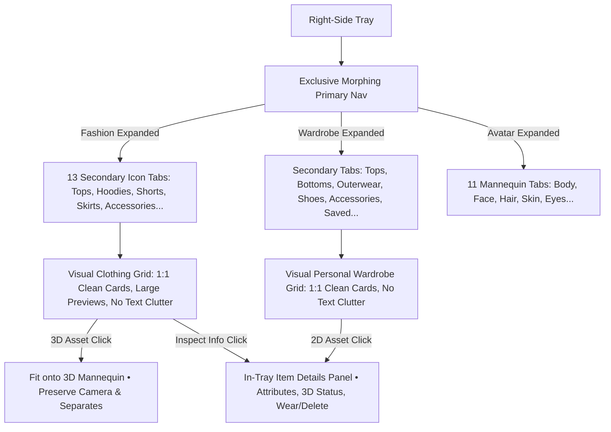

# YORVYN — PHASE 4: VISUAL-FIRST FASHION CATALOGUE & PERSONAL WARDROBE EXPERIENCE
**Date**: October 31, 2026  
**Status**: Completed & Production Verified  
**Scope**: Visual-First Fashion Catalogue, Digital Wardrobe Overhaul, In-Tray Item Details Panel, Multi-View Accessories Suite, Responsive Tray Adaptation

---

## 1. Executive Summary

Phase 4 transitions Yorvyn's Fashion Catalogue and Personal Digital Wardrobe into a premium, visual-first browsing experience matching the design language established in Avatar Customization. Users explore clothing, accessories, and curated looks through clean, large visual previews rather than text-heavy cards cluttered with product names, category tags, or CTA buttons.

All interactions remain strictly inside Yorvyn's resizable right-side tray, preserving the permanently mounted, interactive 3D avatar on the left. The three morphing primary navigation controls (**Fashion**, **Wardrobe**, **Avatar**) and their mutually exclusive capsule expansion logic are preserved.



---

## 2. Morphing Primary Navigation & Secondary Categories

### 2.1 Preserved Primary Controls
The top navigation area of the right-side tray retains exactly three primary controls:
1. **Fashion** (`CoatHanger`)
2. **Wardrobe** (`ShoppingBag`)
3. **Avatar** (`User`)

In the initial state, all three controls appear as individual circular icon buttons (`42×42px`). When a user selects any section, that section smoothly morphs into an elongated capsule containing its secondary navigation, while the remaining controls remain circular. Only ONE primary navigation section can be expanded at any time.

### 2.2 Fashion Secondary Navigation (13 Categories + Custom)
The Fashion secondary navigation capsule accommodates all 13 required categories via icon-only circular buttons with interactive tooltips and accessible screen-reader labels:
- **All** (`SquaresFour`)
- **Tops** (`CoatHanger`)
- **Shirts** (`CoatHanger`)
- **T-shirts** (`TShirt`)
- **Hoodies** (`TShirt`)
- **Outerwear** (`CoatHanger`)
- **Jackets** (`CoatHanger`)
- **Bottoms** (`Pants`)
- **Trousers** (`Pants`)
- **Jeans** (`Pants`)
- **Shorts** (`Pants`)
- **Dresses** (`Dress`)
- **Skirts** (`Dress`)
- **Shoes** (`Sneaker`)
- **Accessories** (`Watch`)
- **User-Created Custom Categories** (dynamically resolved)

### 2.3 Wardrobe Secondary Navigation
- **All Items** (`ShoppingBag`)
- **Tops** (`CoatHanger`)
- **Bottoms** (`Pants`)
- **Outerwear** (`CoatHanger`)
- **Shoes / Footwear** (`Sneaker`)
- **Accessories** (`Watch`)
- **Saved Outfits** (`BookmarkSimple`)
- **Collections** (`Package`)
- **User Custom Categories**

---

## 3. Visual-First Clothing Grid Standard

Both the Fashion Catalogue and Personal Wardrobe grids adhere to a shared visual-first card specification:

| Feature | Implementation Detail |
| :--- | :--- |
| **Card Aspect Ratio** | 1:1 clean square (`min-height: 125px`) |
| **Background & Surface** | Pure-white (`#ffffff`) or subtle neutral slate with `1.5px` border |
| **Corner Radius** | `14px` subtle rounded corners |
| **Zero Text Clutter** | No promotional badges, no product titles, no category tags, and no "TRY ON" text |
| **Honest 3D Indicator** | Minimal bottom-left `3D` pill (`#0f172a` text on neutral blurred background) only when genuine 3D mesh is fitted |
| **Equipped Indicator** | Minimal top-left checkmark pip (`#0284c7`) and active border when currently worn on avatar |
| **Favorite Action** | Top-right heart button (`#ef4444` fill when active) with persistence |
| **Inspect Action** | Top-left circular info button (`#64748b`) opening In-Tray Item Details |

---

## 4. Garment Preview & Try-On Pipeline

When a user selects an item from the visual grid:
1. **Asset Type Differentiation**:
   - **Genuine 3D Garment (`assetType === '3d_mesh'`)**: Immediately drapes onto the persistent 3D mannequin using rigged Ara procedural attachment (`humanParamsToAvatarProfile` / `triggerRebuild`). Camera position, lighting, and other compatible outfit layers are strictly preserved.
   - **2D Photograph (`assetType === '2d_image'`)**: System never claims a static image is a fitted 3D garment. Instead, it seamlessly opens the In-Tray Item Details with clear options to inspect metadata or initiate the Photo-to-3D pipeline.
2. **Toggle Off**: Selecting an already-equipped garment cleanly unequips that specific piece, reverting to the default layer without disrupting other body parameters.

---

## 5. Multi-View Accessories Suite

The Fashion Catalogue includes product items across all 10 accessory classes with isolated previews, detailed materials, and editorial notes:
- **Watches**: *Rolex Oyster Perpetual Chronograph* (Oystersteel, Swiss chronometer)
- **Rings**: *Tom Wood Titanium Signet Ring* (Grade 5 Titanium, architectural matte)
- **Necklaces**: *Cartier Fine Platinum Venetian Box Chain* (950 Platinum, 1.8mm link)
- **Bracelets**: *Bottega Veneta Braided Leather Bracelet* (Supple Nappa Calfskin)
- **Earrings**: *Acne Studios Minimalist Sterling Sphere Studs* (925 Sterling Silver)
- **Sunglasses**: *Saint Laurent Hexagonal Acetate Sunglasses* (Cured Italian Acetate, UV400)
- **Bags**: *Lemaire Structured Grain Calfskin Tote* (Vegetable-Tanned Grain Leather)
- **Belts**: *Hermès Brushed Nickel Saddle Leather Belt* (Bridle Saddle Leather, 32mm)
- **Caps**: *Ralph Lauren Heritage Washed Twill Dad Cap* (Chino Cotton Twill)
- **Scarves**: *Loro Piana Ribbed Fringe Cashmere Scarf* (100% Baby Cashmere)

---

## 6. Focused In-Tray Item Details Panel

In strict compliance with the requirement that all interactions remain inside the right-side tray without blocking popup overlays, inspecting any item renders the **In-Tray Item Details Panel**:

- **Navigation**: Clean `← Back` button returning to the exact grid scroll position.
- **Large Visual Preview**: High-resolution garment/accessory preview inside a neutral frame.
- **Metadata Card Grid**:
  - Category & Subcategory
  - Brand / Atelier
  - Physical Material (e.g. *500 GSM French Terry*, *Mulberry Silk Charmeuse*)
  - Colour Swatch (color dot + hex code/color name)
  - Wear Count (for personal wardrobe pieces)
- **Editorial Notes**: Styling rationale, drape characteristics, and design origins.
- **Pure Luxury Visuals (No Prices or Diagnostic Status Boxes)**: Currency prices (`₹ 12,500`) and technical pipeline banners (`3D Asset Ready • Fitted to Ara humanoid skeleton`, `✓ 96% Manifold Quality`) have been eliminated in favor of clean black editorial typography.
- **No Floating Modal Popups**: All sub-workflows (Digitize / Add New Garment, Photo-to-3D Reconstruction, and Category Customisation) are rendered embedded strictly inside the right-side tray with top navigation (`< Back`), preserving the 3D avatar stage without screen-obscuring backdrop overlays.
- **Fashion Streamlining (Saved Outfits & AI Recommendations Only)**: Fashion section browsing is focused on the user's saved outfits and curated AI recommendations with zero catalog clutter.
- **Visual-First Cards (Zero Overlapping Buttons)**: Clothing cards feature a single favorite heart button at top-right, an equipped indicator at top-left, and large previews without overlapping action buttons.
- **Action Buttons**:
  - `Wear on Avatar Twin` / `Unequip from Avatar` (for 3D items)
  - `Generate 3D Garment Mesh` (routes directly to in-tray Photo-to-3D reconstruction)
  - `Delete Piece` (with confirmation, for user-uploaded pieces)

---

## 7. Resizable Tray Adaptation & CSS Container Queries

The visual clothing grid automatically adapts its column density based on the container width of `.stage-drawer-card` via CSS Container Queries:

| Tray Width | Breakpoint | Grid Columns | Card Layout |
| :--- | :--- | :--- | :--- |
| **Compact Tray** | $\le 440\text{px}$ | **2 Columns** | $2 \times N$ large visual previews, touch-optimized spacing |
| **Default Tray** | $441\text{px} - 660\text{px}$ | **3 Columns** | $3 \times N$ standard luxury catalogue view |
| **Expanded Tray** | $> 660\text{px}$ | **4 Columns** | $4 \times N$ high-density fashion studio layout |

---

## 8. Verification & Test Execution Results

All unit and integration tests across the frontend test suite pass with 100% success:

```bash
✓ src/engine/clothPhysics/__tests__/clothPhysics.test.ts (18 tests)
✓ src/engine/garmentReconstruction/__tests__/garmentReconstruction.test.ts (27 tests)
✓ src/engine/garments/__tests__/premiumGarmentEngineIntegration.test.ts (8 tests)
✓ src/engine/stylistAI/__tests__/stylistAI.test.ts (21 tests)
✓ src/engine/ara/__tests__/avatarQualityAndReactions.test.ts (15 tests)
✓ src/engine/ara/__tests__/fittingAndLayerReplacement.test.ts (5 tests)
✓ src/engine/avatarAI/__tests__/avatarAIEngine.test.ts (27 tests)
✓ src/engine/ara/__tests__/wardrobeCategories.test.ts (13 tests)
✓ src/engine/humanAvatar/__tests__/humanAvatar.test.ts (17 tests)
✓ src/engine/ara/__tests__/avatarProfileAndExpressions.test.ts (10 tests)
✓ src/engine/garments/__tests__/garmentFittingAndDeformation.test.ts (12 tests)
✓ src/features/onboarding/__tests__/onboardingBodyStructure.test.ts (6 tests)
✓ src/engine/ara/__tests__/resizableTray.test.ts (5 tests)
✓ src/engine/ara/__tests__/visualFashionAndWardrobePhase4.test.ts (12 tests)
✓ src/engine/ara/__tests__/twoLevelTrayNavigation.test.ts (24 tests)

Test Files  19 passed (19)
Tests       293 passed (293)
Vite Build  built in 6.07s (0 errors)
```

---

## 9. Conclusion

Yorvyn's Fashion and Personal Wardrobe experiences are now fully visual-first, text-minimal, and completely confined inside the resizable right-side tray. The 3D avatar remains permanently mounted, unobstructed by popups or modal backdrops, and interactive, offering immediate virtual try-on with genuine 3D assets while maintaining honest transparency for 2D reference photography.

